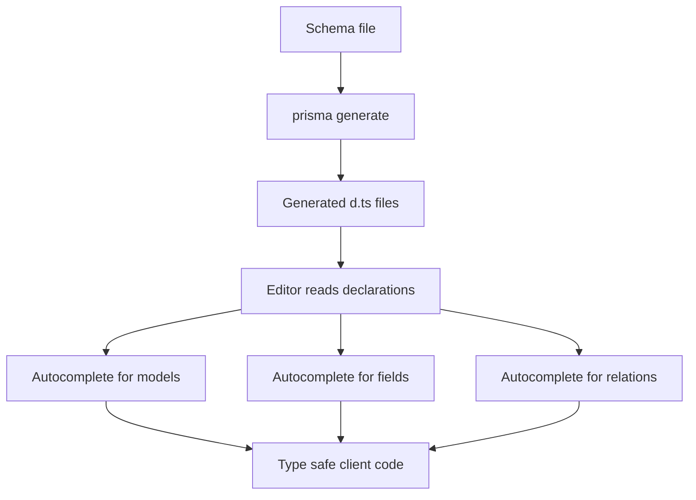

# Ambient Types and Editor IntelliSense: The Developer Experience Payoff

## English

One of Prisma's most tangible benefits is invisible until you open your editor: autocomplete that knows your exact schema. After running `prisma generate`, Prisma writes TypeScript declaration files into a generated output directory that you choose. Since Prisma 7 the `output` field is required in the generator block, and the client is no longer written into `node_modules` by default — a path like `generated/prisma` in your source tree is the new normal, and you import the client from the generated path rather than from `@prisma/client`. Your editor reads those declarations and offers suggestions for every model, every field, and every relation — including fields you have not yet queried. This is a different kind of type safety from runtime validation: it is ambient, meaning the types exist in your project's type environment without you importing anything beyond the client itself.

The mechanism is worth understanding. The generated client is not one giant file; it is a set of `.d.ts` files describing generic types parameterised by your schema. When you write `prisma.user.findMany({`, the editor consults those declarations and knows that `where`, `select`, `include`, `orderBy`, and `cursor` are valid keys, and that `where.email` accepts a string filter object like `{ contains: '@example.com' }`. Because the types are generated from the schema, they stay in sync automatically — change the schema, regenerate, and the editor immediately flags code that references a removed field.

This is why the generation step is not optional busywork. If you clone a repository and forget to run `prisma generate`, you will see red squiggles everywhere and errors like "Property 'user' does not exist on type 'PrismaClient'" — even though the code is correct. The fix is simply to regenerate. Many teams wire generation into a `postinstall` script in `package.json` so that `npm install` or `pnpm install` automatically produces the client, avoiding the classic "works on my machine" confusion.

There are subtleties. The generated types are large, and on very big schemas editors can become sluggish; splitting schemas across multiple files (via `prismaSchemaFolder`) helps, as does keeping `select` narrow in hot paths. Also, the types describe the shape of results, not the guarantees of the database — a field marked optional in the schema does not mean the database enforces it, only that Prisma will type it as `string | null`. And if you use `$queryRaw`, the result is typed as `unknown` unless you supply a generic parameter, because Prisma cannot infer the shape of arbitrary SQL.

In practice, ambient types change how you write code. You explore the API by typing a dot and reading the suggestions; you refactor with confidence because renaming a field in the schema produces compile errors at every usage site; and you onboard new teammates faster because the editor teaches them the data model as they type. The payoff is not just fewer runtime bugs — it is a shorter feedback loop between "I wonder what fields exist" and "I know, because the editor told me."

## 中文

Prisma 最實在的好處之一，要到你打開編輯器才看得見：自動完成功能知道你的確切 schema。執行 `prisma generate` 之後，Prisma 會把 TypeScript 宣告檔寫入你自己指定的生成輸出目錄（在 Prisma 7，generator 區塊的 `output` 欄位是必填的，client 預設不再寫進 `node_modules`——像 `generated/prisma` 這種放在原始碼樹裡的路徑已成為新常態）。你的編輯器讀取那些宣告，然後為每個 model、每個欄位、每條關聯提供建議——包括你還沒查詢過的欄位。這是與執行期驗證不同的一種型別安全：它是 ambient（環境型別），意思是這些型別存在於你專案的型別環境中，你除了 `PrismaClient` 之外不需要 import 任何東西。

這個機制值得理解。生成的客戶端不是一個巨型檔案，而是一組 `.d.ts` 檔案，描述以你的 schema 為參數的泛型型別。當你寫 `prisma.user.findMany({`，編輯器會查閱那些宣告，知道 `where`、`select`、`include`、`orderBy`、`cursor` 都是合法的鍵，也知道 `where.email` 接受像 `{ contains: '@example.com' }` 這樣的字串篩選物件。因為型別是從 schema 生成的，它們會自動保持同步——改了 schema、重新生成，編輯器馬上就會標出引用了已移除欄位的程式碼。

這就是為何生成步驟不是可有可無的雜務。如果你 clone 了一個 repo 而忘了執行 `prisma generate`，你會見到滿屏紅色波浪線，以及像「Property 'user' does not exist on type 'PrismaClient'」的錯誤——即使程式碼本身是正確的。解決方法就是重新生成。很多團隊會把生成掛到 `package.json` 的 `postinstall` 腳本，令 `npm install` 或 `pnpm install` 自動產生客戶端，避免經典的「在我機器上沒問題」混亂。

當中有細節。生成的型別很大，在非常大的 schema 上編輯器會變慢；把 schema 拆成多個檔案（透過 `prismaSchemaFolder`）有幫助，在熱路徑保持 `select` 精簡也有幫助。另外，型別描述的是結果的形狀，不是資料庫的保證——schema 中標為 optional 的欄位不代表資料庫會強制執行，只代表 Prisma 會把它型別成 `string | null`。而如果你用 `$queryRaw`，除非你提供泛型參數，否則結果會被型別成 `unknown`，因為 Prisma 無法推斷任意 SQL 的形狀。

在實務上，環境型別改變了你寫程式的方式。你透過打一個點、讀取建議來探索 API；你重構時有信心，因為在 schema 中重新命名欄位會在每個使用處產生編譯錯誤；新同事上手更快，因為編輯器在他們打字時就教他們資料模型。回報不只是更少的執行期 bug——而是「我想知道有哪些欄位」與「我知道，因為編輯器告訴我」之間更短的回饋循環。

## Key Takeaway

Generated ambient types turn your editor into a live map of the schema, shortening the feedback loop from question to answer.

## Related Concepts
- TypeScript declaration files
- Code generation

## Diagram

