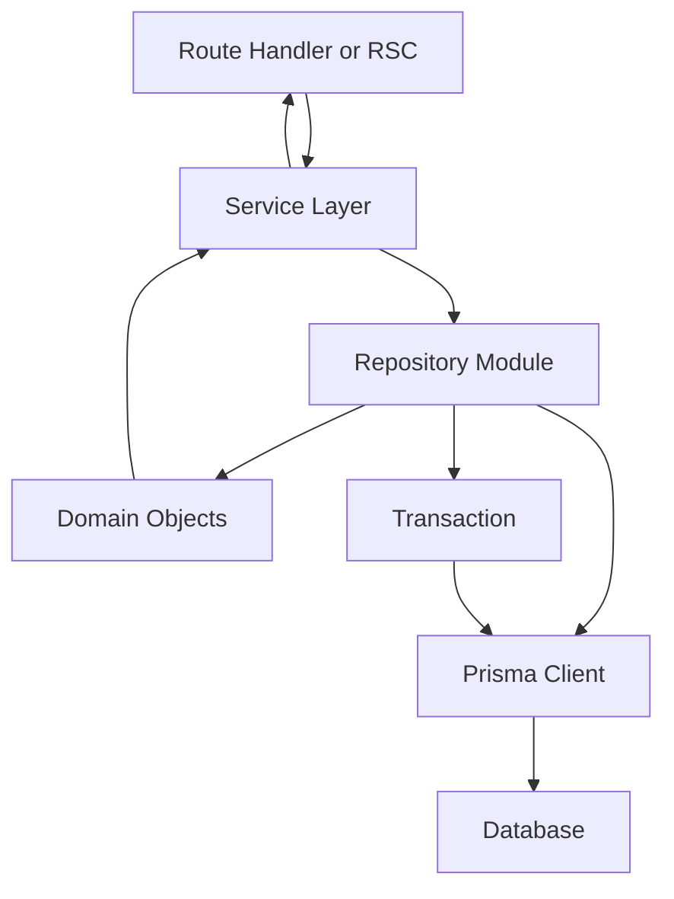

# Where Prisma Fits in a Layered Architecture

## English

A common early mistake is to call Prisma directly from every route handler or React Server Component, scattering `prisma.user.findMany(...)` across the codebase. It works, but it couples your transport layer to your persistence layer, making testing harder and refactoring painful. A more durable pattern is to treat Prisma as the bottom of a small stack: a repository or service layer wraps the client, exposes intention-revealing functions like `getActiveUsers()` or `createOrderWithItems()`, and returns plain domain objects. Route handlers then call the service, not the ORM.

Why bother with the extra layer? Three reasons. First, testability: you can swap the repository for an in-memory fake in unit tests without needing a database, and reserve real Prisma calls for integration tests. Second, consistency: cross-cutting concerns like soft-delete filtering, audit logging, or tenant scoping can be applied once in the repository rather than remembered at every call site. Third, evolution: if you later move a hot path to raw SQL or TypedSQL for performance, or shard a table, callers do not change because the interface stayed the same.

The layer does not need to be heavy. A single module per aggregate — say `src/repositories/user.ts` — exporting a handful of async functions is often enough. Inside, you inject or import the `PrismaClient` instance and use `select` to shape exactly the fields the caller needs, avoiding over-fetching. You can also use Prisma's `$transaction` inside the repository to group multi-step writes atomically, so the service layer sees a single all-or-nothing operation rather than a sequence of calls it must coordinate.

There is a counter-argument worth hearing: for small projects, a repository layer can be ceremony. If your app has three endpoints and one developer, calling Prisma directly is fine and arguably clearer. The rule of thumb is to introduce the layer when you notice duplication (the same `where` clause copy-pasted), when testing friction appears, or when more than one developer touches the same models. Start direct, extract when the pain is real, not preemptively.

Finally, be mindful of where transactions and connection lifecycle live. The `PrismaClient` should be a singleton per process (otherwise you exhaust the connection pool), typically created in a dedicated module and imported where needed. In serverless environments, that module may need to cache the instance across invocations. Keeping instantiation in one place, and business logic in the layer above, gives you a clean separation: the ORM handles persistence mechanics, the service layer handles intent, and the transport layer handles HTTP or RPC.

## 中文

一個常見的早期錯誤，是在每個 route handler 或 React Server Component 裡直接呼叫 Prisma，把 `prisma.user.findMany(...)` 散落到整個程式庫。這樣可行，但會把你的傳輸層與持久層耦合，令測試更難、重構更痛苦。較耐久的模式，是把 Prisma 當作一個小堆疊的底部：用 repository 或 service 層包住客戶端，對外暴露能表達意圖的函式，例如 `getActiveUsers()` 或 `createOrderWithItems()`，並回傳純淨的領域物件。Route handler 於是呼叫 service，而不是 ORM。

為何要多這一層？三個原因。第一，可測試性：在單元測試中，你可以把 repository 換成記憶體內的假物件，不需要資料庫，而把真正的 Prisma 呼叫留給整合測試。第二，一致性：像軟刪除過濾、稽核日誌、租戶範圍（tenant scoping）這類橫切關注點，可以在 repository 中一次過套用，而不必在每個呼叫點記住。第三，演進：如果你日後為了效能把某條熱路徑改用原生 SQL 或 TypedSQL，或者把某張表分片，呼叫方不用改，因為介面維持不變。

這一層不需要很重。每個聚合（aggregate）一個模組——例如 `src/repositories/user.ts`——匯出幾個 async 函式通常就夠。裡面你注入或 import `PrismaClient` 實例，並用 `select` 精確塑造呼叫方所需的欄位，避免過度抓取。你也可以在 repository 內用 Prisma 的 `$transaction` 把多步寫入原子地組合起來，令 service 層看到的是一個全有或全無的操作，而不是一連串它必須自行協調的呼叫。

有一個值得聽的反方論點：對小專案而言，repository 層可能是繁文縟節。如果你的應用只有三個 endpoint、一個開發者，直接呼叫 Prisma 沒問題，甚至更清晰。經驗法則是：當你發現重複（同一個 `where` 子句被複製貼上）、當測試摩擦出現、或者當多過一個開發者碰同一批 model 時，才引入這一層。先直接寫，痛楚真實時才抽出來，不要預防性地做。

最後，要注意交易與連線生命週期放在哪裡。`PrismaClient` 應該每個 process 一個單例（否則會耗盡連線池），通常在專用模組中建立，然後在需要的地方 import。在 serverless 環境中，該模組可能需要在多次 invocation 之間快取實例。把實例化集中在一個地方，業務邏輯放在上一層，就能有清晰的分離：ORM 處理持久化機制，service 層處理意圖，傳輸層處理 HTTP 或 RPC。

## Key Takeaway

Wrap Prisma in a thin repository layer so transport code stays decoupled from persistence and cross-cutting concerns live in one place.

## Related Concepts
- Repository pattern
- Separation of concerns

## Diagram

