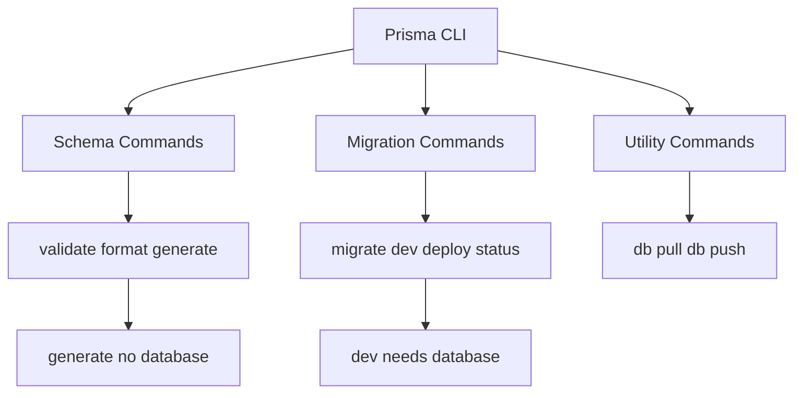

# What the Prisma CLI Actually Does: A Tour of Its Commands

## English

The Prisma CLI is the command-line tool you install as a development dependency, and it is the entry point for almost everything you do with Prisma. Its subcommands fall into a few families. Schema-related commands work on your schema file: `prisma validate` checks that the schema is syntactically and semantically correct, `prisma format` rewrites it into canonical layout (aligning fields and sorting blocks), and `prisma generate` reads the schema and produces the generated client code. Migration-related commands talk to your database: `prisma migrate dev` creates and applies migrations during development, `prisma migrate deploy` applies already-committed migrations in production without generating new ones, and `prisma migrate status` reports whether your database matches the migration history. There are also utility commands like `prisma db pull` (introspect an existing database into a schema) and `prisma db push` (push the schema straight to the database without creating migration files).

The important mental model is that the CLI is mostly a coordinator, not the runtime. `prisma generate` does not touch your database at all — it only reads the schema and writes files into the generated client output directory (which, since Prisma 7, you must specify explicitly — the client is no longer generated into node_modules by default). That is why you can run it in CI without any database credentials. Conversely, `prisma migrate dev` does touch the database: it compares your schema against the migration history, creates a new migration file containing SQL, applies pending migrations, and then triggers a client regeneration. Knowing which commands need a live database connection and which do not saves a lot of confusion when a build fails on a machine that has no database.

A subtle but frequently misunderstood detail is the difference between `migrate dev` and `db push`. `migrate dev` is the development workflow: it produces SQL migration files that are committed to version control, so the change is reproducible and reviewable. `db push` skips migration files entirely and simply makes the database schema match the Prisma schema — useful for prototyping or for throwaway databases, but dangerous as a production strategy because you lose the audit trail. Likewise, `migrate deploy` never generates new migrations; it only applies what already exists in the migrations folder, which is exactly what you want in a deployment pipeline where the schema change was reviewed beforehand.

Another practical point: the CLI reads configuration from your schema file and, in newer versions, from a Prisma config file. That configuration determines where the schema lives, where generated output goes, and which datasource URL to use. Environment variables referenced in the schema (for example a `DATABASE_URL` in the datasource block) are resolved at command time, so the same schema can point at different databases depending on the environment. This is why a common failure mode is running a command in the wrong shell where the environment variable is not set.

Finally, the CLI is designed to be scriptable. Commands exit with non-zero status on failure, print machine-readable output where relevant, and can be wired into npm scripts or CI steps. A typical pipeline runs `prisma generate` after installing dependencies, then `prisma migrate deploy` against the target database before starting the app. Understanding the CLI as a set of small, composable steps — rather than a magic black box — makes debugging far easier when something goes wrong.

## 中文

Prisma CLI 是你以開發依賴形式安裝的命令列工具，亦是你使用 Prisma 時幾乎所有操作的入口。它的子命令大致可分為幾類。與 schema 有關的命令作用於你的 schema 檔案：`prisma validate` 檢查 schema 在語法與語意上是否正確，`prisma format` 把它重寫成標準排版（對齊欄位、排序區塊），而 `prisma generate` 則讀取 schema 並產生客戶端程式碼。與遷移有關的命令則會與你的資料庫溝通：`prisma migrate dev` 在開發期間建立並套用遷移，`prisma migrate deploy` 在正式環境套用已提交的遷移而不產生新的遷移，而 `prisma migrate status` 會報告你的資料庫是否與遷移歷史一致。此外還有工具型命令，例如 `prisma db pull`（把既有資料庫反向內省成 schema）與 `prisma db push`（不建立遷移檔案，直接把 schema 推到資料庫）。

重要的心智模型是：CLI 主要是協調者，而非執行期本身。`prisma generate` 完全不會接觸你的資料庫——它只讀取 schema，並把檔案寫入產生的客戶端輸出目錄（自 Prisma 7 起你必須明確指定這個路徑——客戶端預設不再產生到 node_modules 裡）。這就是為何你可以在沒有任何資料庫憑證的 CI 中執行它。相反，`prisma migrate dev` 確實會接觸資料庫：它會把你的 schema 與遷移歷史比對、建立含 SQL 的新遷移檔案、套用待處理的遷移，然後觸發客戶端重新產生。清楚哪些命令需要活的資料庫連線、哪些不需要，可以在沒有資料庫的機器上建置失敗時省下大量困惑。

一個細微但經常被誤解的細節，是 `migrate dev` 與 `db push` 的差別。`migrate dev` 是開發工作流程：它產出可提交到版本控制的 SQL 遷移檔案，因此變更是可重現、可審閱的。`db push` 則完全跳過遷移檔案，直接讓資料庫 schema 與 Prisma schema 一致——適合原型開發或即棄式資料庫，但作為正式環境策略則很危險，因為你會失去稽核軌跡。同樣地，`migrate deploy` 從不產生新遷移；它只套用 migrations 資料夾中已存在的內容，這正是你在部署流程中想要的——因為 schema 變更早已被審閱過。

另一個實務重點：CLI 會從你的 schema 檔案讀取設定，在較新版本中亦會從 Prisma 設定檔讀取。該設定決定 schema 的位置、產生輸出的去處，以及使用哪個 datasource URL。schema 中引用的環境變數（例如 datasource 區塊中的 `DATABASE_URL`）會在命令執行時解析，因此同一個 schema 可以視環境指向不同的資料庫。這就是為何常見的失敗模式，是在沒有設定該環境變數的錯誤 shell 中執行命令。

最後，CLI 的設計是可腳本化的。命令失敗時會以非零狀態結束，在相關情況下會輸出機器可讀的結果，並可接入 npm scripts 或 CI 步驟。典型的流程會在安裝依賴後執行 `prisma generate`，然後在啟動應用程式前對目標資料庫執行 `prisma migrate deploy`。把 CLI 理解為一組小而可組合的步驟——而非神奇黑盒——會令出錯時的除錯容易得多。

## Key Takeaway

The Prisma CLI is a set of small composable commands where only some (migrate, db pull, db push) touch the database, and knowing which is which prevents most build and deploy confusion.

## Related Concepts
- Prisma Migrate workflow
- Client generation

## Diagram

