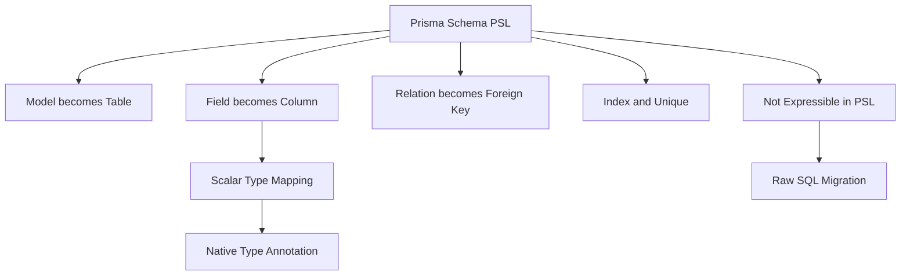

# The Prisma Schema Language vs SQL DDL: What Maps and What Does Not

## English

Prisma's schema language (often called PSL) looks a little like SQL's data definition language, but it is not a one-to-one translation. A model in PSL becomes a table, a field becomes a column, and a `@relation` between two models becomes a foreign key. Scalar types map to database types — `String` to text or varchar, `Int` to integer, `DateTime` to a timestamp type — but the exact mapping is database-specific and sometimes lossy. Prisma picks a sensible default per database, and when you need something precise you attach a native type annotation such as `@db.VarChar(255)` or `@db.Decimal(10, 2)` to pin down the exact column type. Without native types, you get Prisma's default, which may be wider or narrower than you expect.

Many database concepts have no direct PSL equivalent. Views, stored procedures, triggers, partial indexes, and check constraints are not expressible in the Prisma schema. Prisma does not try to own every feature of every database; it models the common relational core. When you need those features you express them in raw SQL migrations and then, if you want them visible to the client, use tools like `prisma db pull` to introspect them or define them manually in the schema where supported. This is the boundary of the abstraction: Prisma is a good citizen of the database, not a replacement for it.

Indexes are a good example of where the mapping is explicit but partial. You can declare `@@index` and `@@unique` in the schema, and Prisma will generate the corresponding index in migrations. But advanced index features — expression indexes, index include columns, or per-index collations — are not all expressible, and you may need to hand-edit the generated SQL migration. Prisma does let you edit migration files after generation, which is the intended escape hatch: the migration is just SQL, and you can add anything the schema language cannot say.

Enums are another interesting case. PSL has an `enum` construct that maps to a native database enum on databases that support it (like PostgreSQL), and to a string column with application-level validation on databases that do not. That means the same schema can behave differently at the database level depending on the provider. If you rely on the database enforcing the enum, you should check what your provider actually does rather than assuming.

The practical lesson is to treat the Prisma schema as a high-level model of your data, and to treat generated SQL migrations as the source of truth for what actually reaches the database. Read the generated SQL at least once when you add a non-trivial field or index. If the SQL is not what you intended, you can edit it before applying. This habit keeps you honest about the abstraction: the schema language is convenient, but the database is the thing that runs.

## 中文

Prisma 的 schema 語言（常稱為 PSL）看起來有點像 SQL 的資料定義語言，但它並非一對一的翻譯。PSL 中的一個 model 會變成一個資料表，一個欄位會變成一個資料行，而兩個 model 之間的 `@relation` 會變成一個外鍵。純量型別會對應到資料庫型別——`String` 對應 text 或 varchar、`Int` 對應 integer、`DateTime` 對應時間戳型別——但確切對應視資料庫而定，有時會有損失。Prisma 會為每個資料庫挑選合理的預設值，而當你需要精確控制時，可加上原生型別標註，例如 `@db.VarChar(255)` 或 `@db.Decimal(10, 2)`，以鎖定確切的資料行型別。若不加原生型別，你會得到 Prisma 的預設值，而它可能比你預期的更寬或更窄。

許多資料庫概念在 PSL 中沒有直接對應。檢視表、預存程序、觸發器、部分索引與檢查約束都無法在 Prisma schema 中表達。Prisma 並不試圖擁有每個資料庫的每一項功能；它建模的是共通關聯式核心。當你需要那些功能時，你會在手寫的 SQL 遷移中表達它們，然後若想讓客戶端看得見，可使用 `prisma db pull` 之類的工具進行內省，或在支援的情況下於 schema 中手動定義。這就是抽象化的邊界：Prisma 是資料庫的好公民，而非其替代品。

索引是對應明確但僅屬部分的好例子。你可以在 schema 中宣告 `@@index` 與 `@@unique`，Prisma 會在遷移中產生對應的索引。但進階索引功能——運算式索引、索引 include 欄位，或逐索引的 collation——並非全部可表達，你可能需要手動編輯產生的 SQL 遷移。Prisma 確實允許你在產生後編輯遷移檔案，這正是預留的逃生口：遷移就只是 SQL，你可以加入 schema 語言無法表達的任何東西。

列舉（enum）是另一個有趣的案例。PSL 有 `enum` 建構，在支援原生資料庫列舉的資料庫（例如 PostgreSQL）上會對應到原生列舉，而在不支援的資料庫上則對應到字串資料行加上應用層驗證。這意味著同一個 schema 在資料庫層面的行為，可能因 provider 而異。若你依賴資料庫強制執行列舉，你應該查核你的 provider 實際做了什麼，而非假設。

實務上的教訓是：把 Prisma schema 視為資料的高階模型，並把產生的 SQL 遷移視為實際送達資料庫內容的真實來源。當你新增非平凡欄位或索引時，至少讀一次產生的 SQL。若 SQL 不是你想要的，你可以在套用前編輯它。這個習慣讓你對抽象化保持誠實：schema 語言很方便，但真正執行的是資料庫。

## Key Takeaway

The Prisma schema is a high-level model, not a full SQL replacement — always read the generated migration SQL when adding non-trivial fields or indexes, and hand-edit it when the schema language cannot express what you need.

## Related Concepts
- Native database types
- Raw SQL escape hatches

## Diagram

