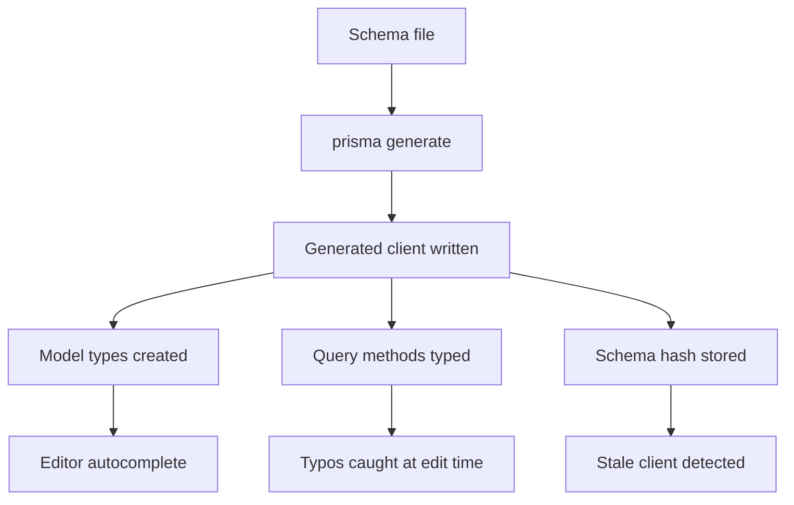

# Prisma's Type Generation: Why Your Editor Knows Your Columns

## English

When you run `prisma generate`, Prisma reads your schema and writes a TypeScript (or JavaScript) client into the generated output directory. The key insight is that the client is generated code, not a hand-written library. Every model in your schema produces a corresponding TypeScript type, and every query method is typed against those models. That is why your editor autocompletes field names, flags typos as type errors before you run anything, and narrows the return type of a `select` to exactly the fields you asked for. This is type safety derived from the schema, not from separate hand-maintained interface files that can drift out of sync.

A concrete example makes it clearer. Suppose your schema has a `User` model with `id`, `email`, and `name`. After generation, `prisma.user.findMany({ select: { email: true } })` returns a type whose elements have only an `email` property. If you wrote `select: { emial: true }`, TypeScript reports an error immediately because the generated types describe the exact shape of valid arguments. This is different from a generic database driver where a typo in a column name only fails at runtime when the query hits the database. The feedback loop moves from runtime to edit time.

The generated client is also versioned by content. Prisma stores a hash or fingerprint of the schema in the generated output so it can detect when the client is stale relative to the schema. If you edit the schema and forget to regenerate, some workflows will warn you, and in any case the types will no longer match what the database expects. This is why `prisma generate` is typically wired into `postinstall` scripts or the first step of your build — it makes stale-client problems rare, but it also means that a fresh clone without running install will not type-check correctly.

There is a subtlety about where the client lives. Since Prisma 7 the generator's `output` field is required and the client is no longer generated into node_modules by default — you point it at a path in your own source tree, which means you decide whether those generated files are committed to version control or regenerated on every install. A custom output path is also what makes monorepos and bundlers that struggle with node_modules resolution work smoothly. Either way, the generated files are build artifacts: you should not edit them by hand, and you should treat them as disposable. If something looks wrong in the generated types, the fix is in the schema or the generator configuration, never in the generated file itself.

Finally, it is worth understanding that the generated client is not just types — it also contains the runtime code that translates your method calls into queries. So `prisma generate` produces both the type declarations your editor uses and the JavaScript that actually runs. That dual nature is why regeneration is needed after any schema change: the types and the runtime must agree with the schema, and only regeneration makes them agree.

## 中文

當你執行 `prisma generate` 時，Prisma 會讀取你的 schema，並把 TypeScript（或 JavaScript）客戶端寫入產生的輸出目錄。關鍵洞見是：客戶端是產生的程式碼，而非手寫的函式庫。你 schema 中的每個 model 都會產生對應的 TypeScript 型別，而每個查詢方法都會依據那些 model 加上型別。這就是為何你的編輯器會自動完成欄位名稱、在你執行任何東西之前就把錯字標示為型別錯誤，並把 `select` 的回傳型別縮窄到正好是你要求的欄位。這種型別安全源自 schema，而非源自另外手動維護、可能與 schema 脫節的介面檔案。

一個具體例子會更清楚。假設你的 schema 有一個 `User` model，含有 `id`、`email` 與 `name`。產生之後，`prisma.user.findMany({ select: { email: true } })` 會回傳一個型別，其元素只有 `email` 屬性。若你寫成 `select: { emial: true }`，TypeScript 會立即回報錯誤，因為產生的型別描述了有效引數的確切形狀。這與泛用資料庫驅動不同：在後者中，欄位名稱的錯字只會在查詢打到資料庫時於執行期失敗。回饋迴路從執行期移到了編輯期。

產生的客戶端亦以內容作為版本依據。Prisma 會在產生的輸出中儲存 schema 的雜湊或指紋，以便偵測客戶端相對於 schema 是否已過時。若你編輯了 schema 而忘記重新產生，某些工作流程會警告你，而無論如何型別將不再符合資料庫的預期。這就是為何 `prisma generate` 通常會接入 `postinstall` 腳本或建置的第一步——它讓客戶端過時的問題變得罕見，但也意味著全新複製而沒有執行安裝的專案將無法正確通過型別檢查。

關於客戶端所在位置有一個細微之處。自 Prisma 7 起，產生器的 `output` 欄位是必填的，客戶端預設不再產生到 node_modules 裡——你要把它指向自己原始碼樹裡的一個路徑，這代表由你決定那些產生的檔案要不要提交到版本控制，還是每次安裝時重新產生。自訂輸出路徑同時也是讓 monorepo、以及對 node_modules 解析有困難的打包工具運作順暢的關鍵。無論哪種方式，產生的檔案都是建置產物：你不應手動編輯它們，並應把它們視為可丟棄的。若產生的型別看起來有問題，修正之處在 schema 或產生器設定，絕不在產生的檔案本身。

最後，值得理解的是：產生的客戶端不只是型別——它亦包含把你的方法呼叫轉譯成查詢的執行期程式碼。因此 `prisma generate` 同時產生了你的編輯器所用的型別宣告，以及實際執行的 JavaScript。這種雙重性質正是為何任何 schema 變更後都需要重新產生：型別與執行期都必須與 schema 一致，而只有重新產生才能讓它們一致。

## Key Takeaway

Prisma Client is generated code containing both types and runtime, so schema changes require regeneration — and stale-client bugs are almost always a missing `prisma generate` step.

## Related Concepts
- Client generation step
- TypeScript type inference

## Diagram

