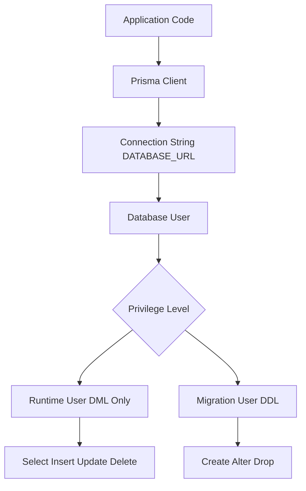

# Prisma and the Database User: Roles, Permissions and Least Privilege

## English

Prisma is not a database in itself; it is a client that opens a TCP connection to your database (or speaks to it through a driver adapter) and sends SQL. That means every query Prisma sends executes with the privileges of the database user named in your connection string (DATABASE_URL). If that user is a superuser or the schema owner, then a bug in your application, or a compromised dependency, can drop tables, read the entire schema, or grant itself new powers. The principle of least privilege says: give the runtime user only the permissions it genuinely needs — usually SELECT, INSERT, UPDATE, DELETE on the specific tables it touches, plus the ability to read sequences for auto-increment columns.

A common and healthy pattern is to use two different database users. One, the owner or migration user, has DDL privileges (CREATE, ALTER, DROP) and is used only by prisma migrate dev or prisma migrate deploy in your CI/CD pipeline. The other, the runtime user, has DML privileges only and is what your application's DATABASE_URL points at. Prisma Migrate's shadow database is a related concept: to detect drift and generate a diff, the migration engine needs to create and destroy a temporary database, so the migration user needs CREATE DATABASE privileges on the server — a privilege you definitely do not want the runtime user to have.

In PostgreSQL you would typically write something like CREATE ROLE app_runtime LOGIN PASSWORD '...'; then GRANT SELECT, INSERT, UPDATE, DELETE ON ALL TABLES IN SCHEMA public TO app_runtime; and ALTER DEFAULT PRIVILEGES so future tables created by migrations also grant the same permissions. In MySQL the equivalent is GRANT SELECT, INSERT, UPDATE, DELETE ON mydb.* TO 'app_runtime'@'%'. SQLite is different: there are no per-user grants, so file-system permissions on the .db file are the only guardrail.

How do you know what privileges your app actually needs? Run your test suite against a restricted user and watch for permission errors. A more systematic approach: enable query logging (log: ['query']) in a staging environment, collect the statements Prisma emits, and audit which tables and operations appear. You will often discover that a rarely used admin endpoint needs DELETE on a table you thought was append-only — a useful design signal, not just a security one.

Least privilege is not a silver bullet, but it is a cheap, high-value layer of defence. It limits blast radius when something goes wrong: a SQL injection, an unintended cascade delete, or a runaway migration. It also makes the boundary between 'schema changes' and 'data changes' explicit, which lines up nicely with Prisma's own separation between prisma migrate and Prisma Client.

## 中文

Prisma 本身唔係一個資料庫，而係一個客戶端：佢會開啟一條 TCP 連線去你嘅資料庫（或者透過 driver adapter 同資料庫溝通），然後送出 SQL。意思係，Prisma 送出嘅每一句查詢，都會以你連線字串（DATABASE_URL）所指定嘅資料庫使用者身份同權限執行。如果嗰個使用者係 superuser 或者 schema owner，咁你應用程式嘅一個 bug，或者一個被入侵嘅依賴套件，就可以刪表、讀取整個 schema，甚至自我授權。最小權限原則（principle of least privilege）就係話：執行時期嘅使用者只應該攞佢真正需要嘅權限——通常係對佢會用到嘅嗰幾張表有 SELECT、INSERT、UPDATE、DELETE，再加上讀取 sequence 嘅能力（用嚟攞自動遞增欄位嘅值）。

一個常見而健康嘅做法係用兩個唔同嘅資料庫使用者。一個係 owner 或者 migration 使用者，擁有 DDL 權限（CREATE、ALTER、DROP），只會俾 prisma migrate dev 或者 CI/CD pipeline 裡面嘅 prisma migrate deploy 使用。另一個係 runtime 使用者，只有 DML 權限，你應用程式嘅 DATABASE_URL 就係指向佢。Prisma Migrate 嘅 shadow database 係一個相關概念：為咗偵測 drift 同產生差異，migration engine 需要建立同銷毀一個臨時資料庫，所以 migration 使用者要喺伺服器層面有 CREATE DATABASE 權限——而呢個權限你絕對唔想俾 runtime 使用者擁有。

喺 PostgreSQL 裡面，你通常會寫類似 CREATE ROLE app_runtime LOGIN PASSWORD '...'; 然後 GRANT SELECT, INSERT, UPDATE, DELETE ON ALL TABLES IN SCHEMA public TO app_runtime; 再設定 ALTER DEFAULT PRIVILEGES，令將來由 migration 建立嘅表都自動授予同樣權限。喺 MySQL 裡面，對應嘅寫法係 GRANT SELECT, INSERT, UPDATE, DELETE ON mydb.* TO 'app_runtime'@'%'。SQLite 就唔同：佢冇逐個使用者嘅授權機制，所以 .db 檔案嘅檔案系統權限就係唯一嘅防線。

你點知應用程式實際需要咩權限？可以喺測試套件裡面用一個受限使用者去跑，然後留意有冇權限錯誤。更系統化嘅做法係：喺 staging 環境開啟查詢記錄（log: ['query']），收集 Prisma 送出嘅語句，再審核邊啲表同操作有出現。你經常會發現某個好少用嘅 admin endpoint 需要對一張你以為只會 append 嘅表做 DELETE——呢個唔單止係安全訊號，仲係一個有用嘅設計提示。

最小權限唔係萬靈丹，但係一個成本低、價值高嘅防禦層。佢可以限制出事時嘅影響範圍：SQL injection、唔小心嘅 cascade delete，或者失控嘅 migration。佢亦令「schema 變更」同「資料變更」之間嘅界線變得清晰，而呢個界線正好對應 Prisma 自己將 prisma migrate 同 Prisma Client 分開嘅設計。

## Key Takeaway

Give the runtime database user only the DML privileges your app truly needs, and reserve DDL privileges for the migration user, so a bug or breach cannot rewrite your schema.

## Related Concepts
- Principle of least privilege
- Shadow database

## Diagram

