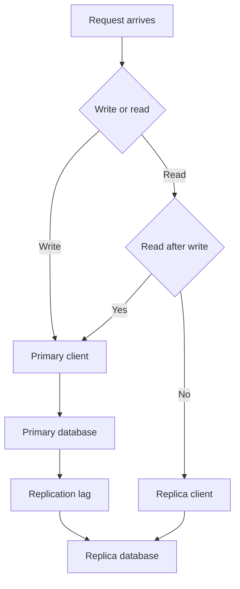

# Read Replicas and Routing Reads: Splitting Load with Prisma

## English

As an application grows, one database server often becomes the bottleneck for reads, not writes. A standard remedy is a read replica: a second database server that continuously receives the primary's changes (via streaming replication in PostgreSQL or binary log replication in MySQL) and serves read-only queries. Prisma supports this pattern through the official `@prisma/extension-read-replicas` client extension, which routes read operations to one or more replica clients while writes and `$transaction` queries stay on the primary. Modern Prisma versions expect each client to be configured with a driver adapter (or an `accelerateUrl`), and the extension takes whole `PrismaClient` instances rather than connection URLs. Note that `directUrl` in the datasource block is a different thing entirely — it is the separate connection Prisma uses for migrations and for tools like Prisma Studio — so it is not the mechanism that routes reads to a replica.

The core idea is straightforward: reads go to the replica, writes go to the primary. But the tricky part is replication lag. A replica is eventually consistent — it is usually milliseconds behind the primary, but under load it can be seconds. If you write a row and immediately read it back from the replica, you may see a stale result or nothing at all. This is called a read-your-writes anomaly, and it is the single most common bug when teams first adopt replicas. Prisma does not magically solve it; you must decide per query whether consistency or throughput matters more.

A pragmatic strategy is to route by intent. Anything that follows a write in the same request — for example, showing the user the record they just created — should go to the primary. Listing pages, search, dashboards, and analytics can go to the replica. Some teams implement a 'sticky primary' window: after a user performs a write, their subsequent reads for the next few seconds are pinned to the primary, then fall back to the replica. Others use a session-level flag on the request context.

In Prisma, the official extension routes every read operation to a replica and sends writes and transactions to the primary. If you want finer-grained control — reads for some models on the replica, others pinned to the primary — you can write your own client extension that intercepts query operations and chooses a client instance (one built with the primary's URL, one with the replica's) based on the model and operation. For example, you might route all findMany and count calls on read-heavy models like Product or Article to the replica, and send everything else to the primary. The extension API lets you wrap $allOperations or specific model operations, so the routing logic stays in one place rather than scattered across your service layer.

Operationally, remember that a replica is not a backup. It mirrors deletions and corruption just as faithfully as it mirrors inserts. Also watch out for transactions: a transaction must run entirely on one connection, so you cannot split a transaction across primary and replica. Finally, monitor replication lag as a first-class metric; if it spikes, your read routing can silently start serving stale data, and no amount of type safety in Prisma will catch that for you.

## 中文

隨住應用程式成長，好多時會變成單一資料庫伺服器喺讀取（而唔係寫入）方面成為瓶頸。一個標準嘅補救方法係用讀取副本（read replica）：一部第二部資料庫伺服器，佢會持續接收主庫嘅變更（PostgreSQL 用串流複製，MySQL 用 binary log 複製），並且提供唯讀查詢。Prisma 透過官方嘅 `@prisma/extension-read-replicas` client extension 支援呢個模式：讀取操作會路由去一個或多個副本 client，而寫入同 `$transaction` 查詢仍然留喺主庫。現代 Prisma 版本要求每個 client 都用 driver adapter（或者 `accelerateUrl`）設定，而 extension 收嘅係完整嘅 `PrismaClient` 實例而唔係連線 URL。另外要留意，datasource 區塊入面嘅 `directUrl` 係另一回事——嗰個係 Prisma 做 migration 同 Prisma Studio 之用嘅獨立連線，所以佢唔係將讀取路由去副本嘅機制。

核心概念好簡單：讀取去副本，寫入去主庫。但棘手嘅地方係複製延遲（replication lag）。副本係最終一致（eventually consistent）嘅——佢通常比主庫慢幾毫秒，但喺高負載之下可以慢幾秒。如果你寫入一列資料，然後即刻喺副本讀返，你可能會見到舊資料，甚至乜都見唔到。呢個叫做「讀取自己寫入」（read-your-writes）異常，亦係團隊第一次採用副本時最常見嘅 bug。Prisma 唔會神奇地幫你解決；你必須逐條查詢去決定一致性同吞吐量邊樣更重要。

一個務實嘅策略係按意圖路由。任何喺同一個請求裡面跟住寫入之後嘅操作——例如顯示使用者啱啱建立嘅記錄——都應該去主庫。列表頁、搜尋、儀表板同分析就可以去副本。有啲團隊會實作一個「黏住主庫」（sticky primary）嘅時間窗：使用者做過寫入之後，佢接下來幾秒嘅讀取都會釘死喺主庫，之後先回落去副本。亦有啲團隊喺請求 context 上面用一個 session 層級嘅旗標。

喺 Prisma 入面，官方 extension 會將所有讀取操作路由去副本，而寫入同交易仍然行喺主庫。如果你想要更細緻嘅控制——某啲 model 嘅讀取去副本、其他啲釘死喺主庫——你可以自己寫一個 client extension，攔截查詢操作並按 model 同 operation 揀返合適嘅 client 實例（一個用主庫 URL 建、一個用副本 URL 建）。例如，你可以將 Product 或者 Article 呢啲讀取密集 model 嘅所有 findMany 同 count 呼叫路由去副本，其餘送去主庫。Extension API 讓你可以包裝 $allOperations 或者指定嘅 model operation，令路由邏輯集中一處，而唔會散落喺 service layer 各處。

營運上要記住：副本唔係備份。佢會照樣鏡像刪除同資料損壞，同鏡像插入一樣忠實。另外要小心交易（transaction）：一個交易必須完全喺同一條連線上面執行，所以你唔可以將一個交易拆開喺主庫同副本兩邊。最後，要將複製延遲當作一等公民指標去監控；如果佢突然飆升，你嘅讀取路由就會靜靜雞開始提供舊資料，而 Prisma 嘅型別安全點都幫你捉唔到。

## Key Takeaway

Read replicas scale reads but introduce replication lag, so route by intent in a Prisma client extension and pin read-your-writes queries to the primary.

## Related Concepts
- Replication lag
- Client extensions

## Diagram

