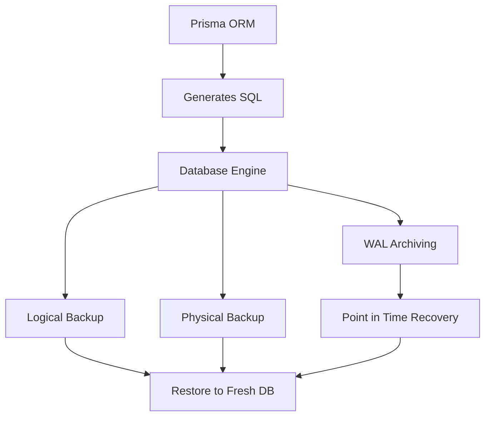

# Backups, Point-in-Time Recovery and What Prisma Does Not Do

## English

It is tempting to assume that because Prisma manages your schema and your data access, it also handles durability. It does not. Prisma is an ORM: it generates SQL and reads results. Durability, backups, and disaster recovery are the database's job, and every serious deployment needs a plan for them. Understanding this boundary is one of the most practically important things a backend developer can learn.

The two main backup strategies are logical and physical. A logical backup dumps the data as SQL statements or a portable format — pg_dump in PostgreSQL, mysqldump in MySQL, .dump in SQLite. These are human-readable, portable across major versions, and easy to restore into a fresh database, which makes them ideal for development snapshots or small databases. Their weakness is size and time: on a large database, a logical dump can take hours and restoring it can take longer than the original outage. Physical backups copy the actual data files or use the database's own continuous archiving, and they are much faster to restore at scale.

Point-in-time recovery (PITR) is the gold standard for production. The database continuously archives its write-ahead log (WAL in PostgreSQL) or binary log (MySQL), and you can restore a base backup and then replay the log up to a specific timestamp — say, 14:32:07, just before someone ran a destructive DELETE. In PostgreSQL this is configured with archive_mode and archive_command or, more commonly today, handled by a managed service or a tool like pgBackRest. Prisma has no role in this process; it never sees the WAL.

Where Prisma does help is in the discipline around migrations and seeding. Because your schema is versioned in prisma/migrations, restoring an old backup and pointing a fresh Prisma Client at it is predictable: you know exactly which schema version the backup corresponds to. Seed scripts (prisma db seed) let you rebuild reference data quickly after a restore. What Prisma cannot help with is the data itself — the rows your users created. If you have no backup, no ORM will save you.

A practical checklist: verify that backups exist and are automated; verify that restores actually work by rehearsing them on a schedule (an untested backup is a rumour); know your recovery point objective (how much data you can afford to lose) and recovery time objective (how long you can be down); and keep backups in a different region or account from the primary. Treat Prisma as the tool that shapes and queries your data, and treat your database platform as the tool that keeps it alive.

## 中文

好容易會假設：既然 Prisma 管理你嘅 schema 同資料存取，佢應該都會處理持久性（durability）。其實唔係。Prisma 係一個 ORM：佢產生 SQL 同讀取結果。持久性、備份同災難復原係資料庫嘅責任，而每一個認真嘅部署都需要為呢啲嘢制定計劃。理解呢條界線，係後端開發者可以學到嘅其中一件最實用嘅事。

備份主要有兩種策略：邏輯備份同實體備份。邏輯備份會將資料以 SQL 語句或者可攜格式匯出——PostgreSQL 用 pg_dump，MySQL 用 mysqldump，SQLite 用 .dump。呢啲備份人類可讀、可以跨主要版本攜帶、亦好容易還原到一個全新資料庫，所以非常適合開發快照或者細型資料庫。佢哋嘅弱點係大小同時間：喺一個大型資料庫上面，邏輯匯出可以花幾個鐘，而還原所需時間可能比原本嘅故障仲要長。實體備份就複製實際嘅資料檔案，或者用資料庫自己嘅持續歸檔（continuous archiving），喺大規模情況下還原快好多。

時間點復原（point-in-time recovery，PITR）係生產環境嘅黃金標準。資料庫會持續歸檔佢嘅預寫日誌（PostgreSQL 嘅 WAL）或者 binary log（MySQL），你可以還原一個基礎備份，然後重播日誌到某個特定時間戳——例如 14:32:07，即係有人執行破壞性 DELETE 之前嗰一刻。喺 PostgreSQL 裡面，呢個用 archive_mode 同 archive_command 設定，或者（今日更常見）交由託管服務或者 pgBackRest 之類嘅工具處理。Prisma 喺呢個過程完全冇角色；佢從來都見唔到 WAL。

Prisma 幫到手嘅地方，係 migration 同 seeding 周圍嘅紀律。因為你嘅 schema 喺 prisma/migrations 裡面有版本控制，還原一個舊備份再將一個全新 Prisma Client 指向佢，係可預測嘅：你清楚知道嗰個備份對應邊個 schema 版本。Seed 腳本（prisma db seed）令你可以喺還原之後快速重建參考資料。Prisma 幫唔到手嘅係資料本身——你使用者建立嘅嗰啲列。如果你冇備份，冇任何 ORM 救到你。

一個實用嘅檢查清單：確認備份存在而且自動化；定期演練還原，確認佢哋真係work（未測試過嘅備份只係傳聞）；清楚你嘅復原點目標（RPO，你可以承受失去幾多資料）同復原時間目標（RTO，你可以停機幾耐）；並且將備份放喺同主庫唔同嘅區域或者帳戶。將 Prisma 當作塑造同查詢你資料嘅工具，將你嘅資料庫平台當作令資料活下去嘅工具。

## Key Takeaway

Prisma shapes and queries your data but never backs it up; durability, PITR and restore drills are the database platform's job and must be planned separately.

## Related Concepts
- Point-in-time recovery
- Write-ahead log

## Diagram

