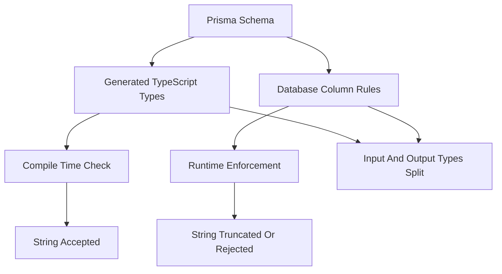

# Prisma's Type System vs TypeScript's: Where They Disagree

## English

Prisma generates TypeScript types from your schema, but those types are not a perfect mirror of what the database will actually accept at runtime. A classic example: a field declared `String` in the schema becomes `string` in TypeScript, but `String` in Prisma's DSL is unbounded by default — on PostgreSQL that maps to `TEXT`, on MySQL it maps to `VARCHAR(191)` unless you specify `@db.VarChar(n)`. So the TypeScript compiler will happily let you assign a ten-thousand-character string to a field that the underlying column will truncate or reject. The type is structurally correct but semantically looser than the storage layer.

Nullability is another place where the two systems drift. Prisma distinguishes optional (`String?`) from required (`String`), and the generated TypeScript respects that — a required field is `string`, not `string | undefined`. But at the database level, a required field with a `@default(now())` or `@default(uuid())` is effectively optional on insert. Prisma models this with a separate input type (often named something like `UserCreateInput`) where defaulted fields are optional, while the output type `User` keeps them required. This split between input and output types is one of the most underappreciated parts of Prisma's code generation: the same column can be optional in one direction and required in the other.

Enums are a third mismatch. TypeScript enums and Prisma enums look similar, but Prisma enums are enforced by the database, and how that enforcement is expressed depends on the connector: MySQL has a native `ENUM(...)` column type, SQLite stores the value as TEXT plus a `CHECK` constraint, and PostgreSQL has no native enum column type — Prisma instead creates a database-level enum type in the migration and the column references that type. If you add a value to the Prisma enum and forget to migrate, the TypeScript types will compile fine — they are generated from the schema file, not from the live database — but the insert will fail at runtime with a constraint violation. Keeping the schema and the database in sync is therefore the workflow's job: `prisma migrate dev` changes the database and then automatically runs `prisma generate` for you, so the types are regenerated as part of the same step. The two only become separate steps in the CI path, where `prisma migrate deploy` applies migrations without regenerating the client and you must run `prisma generate` explicitly.

Decimal and BigInt are the last big one. Prisma's `Decimal` maps to a `Decimal.js` instance at runtime, not a JavaScript `number`, precisely because floating point cannot represent money. If you write `price: 19.99` in a query, Prisma accepts it and coerces, but the value you read back is a `Decimal` object with methods like `.toNumber()` and `.toString()`. Similarly, `BigInt` fields return native `BigInt`, which does not serialise to JSON without a custom replacer. These are not bugs — they are the type system being honest about precision — but they surprise people who expect Prisma types to be plain JavaScript primitives.

The practical lesson is to treat Prisma's generated types as a contract about shape, not about constraints. Length limits, check constraints, collation, timezone behaviour, and numeric precision all live in the database and are invisible to TypeScript. If you need those guarantees at the type level, you have to duplicate them — usually with a validation layer like Zod — and keep the two in sync manually.

## 中文

Prisma 會由你嘅 schema 生成 TypeScript 型別，但呢啲型別唔係資料庫執行時真正接受嘅完美鏡像。最經典嘅例子：schema 入面宣告 `String` 嘅欄位，喺 TypeScript 就係 `string`，但 Prisma DSL 入面嘅 `String` 預設係無長度上限嘅 —— 喺 PostgreSQL 會映射成 `TEXT`，喺 MySQL 就會映射成 `VARCHAR(191)`，除非你寫明 `@db.VarChar(n)`。所以 TypeScript 編譯器會好開心咁俾你塞一萬個字入去一個底層欄位會截斷或者拒絕嘅位。個型別結構上啱，但語意上比儲存層寬鬆。

可空性係另一個兩套系統會走歪嘅地方。Prisma 分開 optional（`String?`）同 required（`String`），生成嘅 TypeScript 都尊重呢點 —— required 欄位係 `string`，唔係 `string | undefined`。但喺資料庫層面，一個有 `@default(now())` 或者 `@default(uuid())` 嘅 required 欄位，插入時其實係 optional。Prisma 用一個獨立嘅 input 型別（通常叫 `UserCreateInput` 之類）去表達呢件事：有 default 嘅欄位喺 input 型別入面係 optional，但 output 型別 `User` 就保持 required。呢個 input/output 型別嘅分裂，係 Prisma 代碼生成入面最被低估嘅部分之一：同一個欄位，一個方向可以係 optional，另一個方向就係 required。

Enum 係第三個唔匹配嘅位。TypeScript enum 同 Prisma enum 睇落好似，但 Prisma enum 係由資料庫強制執行嘅，而具體點樣執行就要睇 connector：MySQL 有原生 `ENUM(...)` 欄位型別，SQLite 就係 TEXT 加一個 `CHECK` 約束，而 PostgreSQL 冇原生 enum 欄位型別 —— Prisma 會喺 migration 裡面建立一個資料庫層級嘅 enum type，欄位再參照嗰個 type。如果你加咗個值落 Prisma enum 但唔記得 migrate，TypeScript 型別會照樣編譯通過 —— 因為佢哋係由 schema 檔案生成，唔係由實際資料庫生成 —— 但插入時就會因為約束違反而失敗。所以要靠你嘅工作流程保持 schema 同資料庫同步：`prisma migrate dev` 改完資料庫之後會自動幫你行 `prisma generate`，所以型別喺同一步入面重新生成。真正要分開做嘅只有 CI 路徑：嗰度 `prisma migrate deploy` 只套用 migration，唔會重新生成 client，你要自己明確行 `prisma generate`。

Decimal 同 BigInt 係最後一個大陷阱。Prisma 嘅 `Decimal` 執行時映射成 `Decimal.js` 實例，唔係 JavaScript `number`，正正因為浮點數表達唔到錢。你寫 `price: 19.99` 落 query，Prisma 會接受並強制轉換，但你讀返嚟嘅係一個有 `.toNumber()` 同 `.toString()` 方法嘅 `Decimal` 物件。同樣，`BigInt` 欄位會回傳原生 `BigInt`，冇自訂 replacer 就唔會 JSON 序列化。呢啲唔係 bug —— 係型別系統對精度嘅誠實 —— 但會殺好多人一個措手不及，因為佢哋以為 Prisma 型別就係純 JavaScript 原始型別。

實際嘅教訓係：將 Prisma 生成嘅型別當成關於「形狀」嘅合約，唔係關於「約束」嘅合約。長度上限、check 約束、collation、時區行為、數值精度，全部住喺資料庫入面，TypeScript 睇唔到。如果你想喺型別層面有呢啲保證，就要自己重複一次 —— 通常用 Zod 之類嘅驗證層 —— 然後人手保持兩邊同步。

## Key Takeaway

Prisma's generated types describe shape, not constraints — length limits, precision and database-enforced rules live outside TypeScript and must be enforced separately.

## Related Concepts
- Decimal and BigInt precision
- Input vs output types in Prisma Client

## Diagram

