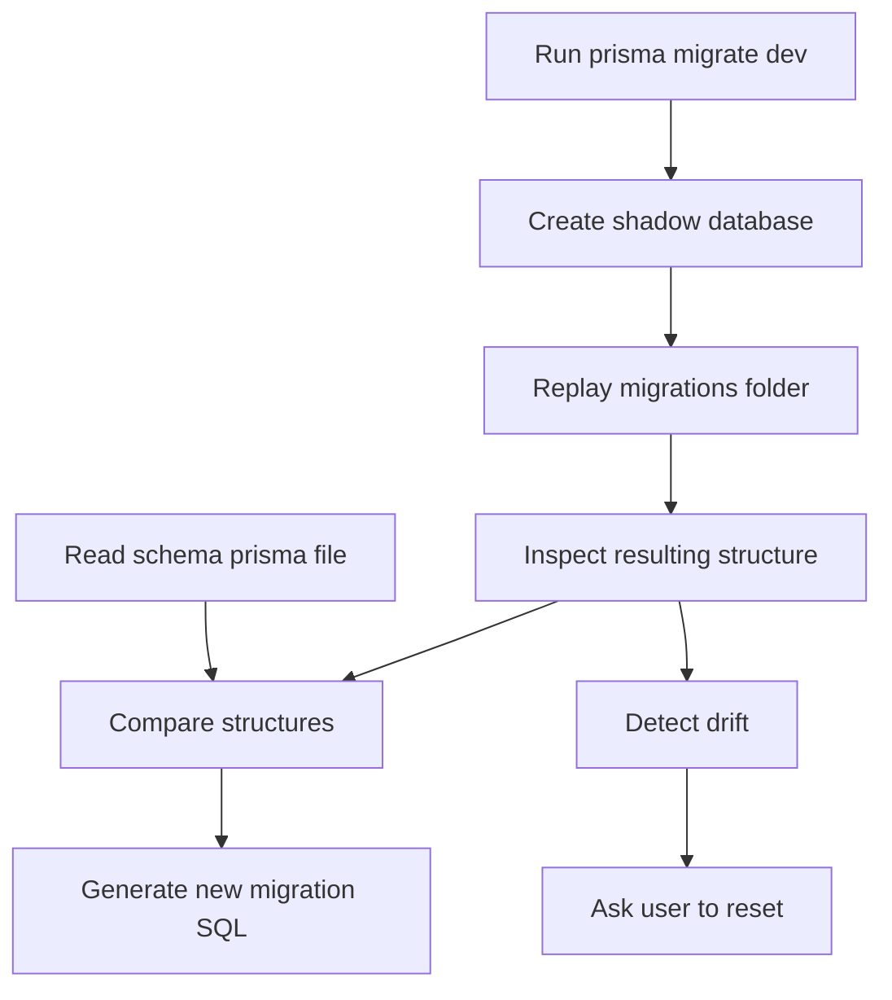

# The Shadow Database: Why Migrations Need a Scratch Space

## English

When you run `prisma migrate dev`, Prisma does something that surprises almost everyone the first time they see it in the logs: it creates a second, temporary database. This is the shadow database, and understanding why it exists explains a lot about how Prisma Migrate actually works. The shadow database is a throwaway schema that Prisma uses to replay your migration history from scratch, then compare the result against your current schema file to compute what SQL it needs to generate.

The reason this is necessary is that Prisma Migrate is diff-based, not state-based. It does not just look at your schema and emit a big `CREATE TABLE` script; it needs to know what the database looked like before, so it can produce an incremental migration. To know that, it replays every migration in `prisma/migrations/` against an empty database — the shadow — and inspects the resulting structure. Then it compares that structure to what your `schema.prisma` now describes, and the difference becomes the new migration file. Without the shadow database, Prisma would have to trust that your migration history and your live database are in sync, which they frequently are not.

The shadow database also powers drift detection. If someone manually altered a column in development, or a previous migration was edited after the fact, the shadow replay will produce a structure that no longer matches your live database. Prisma flags this as drift and asks you to reset. This is why editing an already-applied migration file is a bad idea: the shadow database will happily replay the edited version, but your real database still has the old version applied, and the two will diverge.

There are practical consequences. The database user Prisma connects as needs permission to create and drop databases, because the shadow database is created and destroyed on each `migrate dev` run. In many production setups, the application user does not have that permission — which is fine, because `migrate deploy` (the production command) does not use a shadow database at all. It only applies pending migrations in order and trusts that they were generated correctly in development. That asymmetry is deliberate: `migrate dev` is a design tool that needs a scratch space, while `migrate deploy` is a deployment tool that needs to be safe and permission-light.

If your environment genuinely cannot create databases — some managed Postgres providers restrict it, or you are on a shared instance — Prisma lets you point at a pre-created shadow database with the `shadowDatabaseUrl` setting. That database will be wiped on each run, so it must never be one you care about. The mental model to keep: the shadow database is Prisma's sketchpad, not your data. It exists so that Prisma can answer the question 'what changed?' without ever touching the database you actually care about.

## 中文

當你行 `prisma migrate dev`，Prisma 會做一件幾乎所有人第一次喺 log 見到都會嚇一跳嘅事：佢會開多一個臨時資料庫。呢個就係 shadow database（影子資料庫），明白佢為何存在，就明白 Prisma Migrate 實際上點運作。影子資料庫係一個用完即棄嘅 schema，Prisma 用佢由零開始重播你嘅遷移歷史，然後同你目前嘅 schema 檔案比較，計出需要生成咩 SQL。

為何要咁做？因為 Prisma Migrate 係基於 diff（差異），唔係基於狀態。佢唔係淨係望住你嘅 schema 就嘔一大段 `CREATE TABLE` 出嚟；佢要知道資料庫之前係咩樣，先可以產生一個增量遷移。要知道呢件事，佢就將 `prisma/migrations/` 入面每一個遷移重播落一個空資料庫 —— 即係影子 —— 然後檢查得出嘅結構。再將嗰個結構同你 `schema.prisma` 而家描述嘅嘢比較，差異就變成新嘅遷移檔案。冇影子資料庫嘅話，Prisma 就要信你嘅遷移歷史同你嘅實際資料庫係同步嘅，但實際上佢哋經常都唔同步。

影子資料庫亦都驅動 drift（漂移）偵測。如果有人喺開發環境手動改咗個欄位，或者之前某個遷移喺套用之後被改過，影子重播就會產生一個唔再符合你實際資料庫嘅結構。Prisma 會標記呢個為 drift，並要求你 reset。呢個就係為何改一個已經套用咗嘅遷移檔案係壞主意：影子資料庫會好開心咁重播改咗嘅版本，但你真正嘅資料庫仍然係舊版本，兩者就會分叉。

實際後果有幾個。Prisma 連線用嘅資料庫使用者需要有建立同刪除資料庫嘅權限，因為影子資料庫每次 `migrate dev` 都會建立同銷毀。好多生產環境入面，應用程式使用者冇呢個權限 —— 咁樣冇問題，因為生產用嘅 `migrate deploy` 指令完全唔用影子資料庫。佢只會按順序套用待處理嘅遷移，並信任佢哋喺開發時已經正確生成。呢個不對稱係刻意嘅：`migrate dev` 係設計工具，需要一個草稿空間；`migrate deploy` 係部署工具，需要安全同低權限。

如果你嘅環境真係唔可以建立資料庫 —— 有啲託管 Postgres 供應商限制咗，或者你喺共用實例上面 —— Prisma 俾你用 `shadowDatabaseUrl` 設定指向一個預先建立好嘅影子資料庫。嗰個資料庫每次行都會被清空，所以千萬唔可以係你在意嘅嗰個。要記住嘅心智模型：影子資料庫係 Prisma 嘅草稿紙，唔係你嘅資料。佢存在嘅目的，就係俾 Prisma 可以答「咩改咗？」呢條問題，而完全唔會掂到你真正在意嘅資料庫。

## Key Takeaway

The shadow database is a disposable scratch schema that Prisma replays your migration history into so it can compute diffs and detect drift — which is why `migrate dev` needs database-creation rights and `migrate deploy` does not.

## Related Concepts
- Migration drift detection
- prisma migrate dev vs migrate deploy

## Diagram

