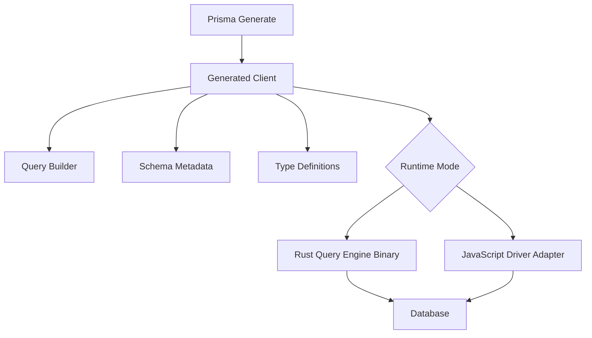

# Prisma Client's Runtime: What Actually Ships to Your Server

## English

It is easy to think of Prisma Client as a thin wrapper that turns method calls into SQL, but the package that ends up in your `node_modules` is larger and more layered than that. When you run `prisma generate`, you are not just producing `.d.ts` type files — you are producing a full client implementation tailored to your schema. The generated code includes the query builder, the schema metadata (model names, field names, relation graph), and the type definitions. Where it lands depends on the generator: the legacy `prisma-client-js` generator writes it to `node_modules/.prisma/client` by default, while the `prisma-client` generator (the default from Prisma 7) requires you to declare an explicit `output` path in the generator block. Either way, regenerating after a schema change is mandatory: the generated client and the schema must be built together.

Historically, the generated client talked to a separate binary called the query engine, written in Rust. Your Node process would serialise a query description, hand it to the engine over a local channel, and the engine would compile it to SQL, talk to the database, and return results. This design is why Prisma could support many databases with one API: the engine handled dialect differences. It is also why Prisma deployments used to require shipping a platform-specific binary, which caused friction on serverless platforms and unusual architectures.

Newer versions of Prisma have been moving toward a driver-adapter model, where the client talks to the database through a JavaScript driver (for example, the `pg` driver for PostgreSQL) instead of letting the engine manage the connection itself. It is worth being precise about what this changes and what it does not: driver adapters still use the Rust Query Engine binary, which continues to compile the query and drive the database interaction. The genuinely Rust-free mode is the WASM Query Compiler used by the `prisma-client` generator (the default from Prisma 7), where query compilation happens in Rust compiled to WASM (`@prisma/query-compiler-wasm`) and only the execution of the compiled plan is TypeScript. Either way, the connection is managed by the driver you chose. This changes the deployment story considerably: smaller bundles, no platform-specific binaries to ship in the WASM mode, and more control over the connection itself. It also means the behaviour of the connection pool is now the driver's behaviour, not the engine's, which is worth knowing when you are tuning pool sizes.

Either way, the key mental model is that Prisma Client is generated, not generic. Two projects with different schemas have different generated clients, even though they import from the same package name. That is why you cannot share a generated client between projects, why `prisma generate` must run in CI before type-checking, and why a stale generated client produces type errors that look like your schema is wrong when it is actually just out of date. The generated artefacts are build output, and they should be treated like any other build output: regenerated deterministically, never hand-edited, and never committed without a clear reason.

The practical upshot is that 'Prisma Client' is really two things at once: a stable, hand-written API surface you import in your code, and a generated implementation underneath that is specific to your schema and your chosen runtime mode. When something behaves oddly — a type that does not update, a binary that will not load on your deployment target, a pool that exhausts — the question to ask is usually 'which layer am I looking at?' The answer determines whether you fix it in the schema, in the generate step, or in the runtime configuration.

## 中文

好容易會以為 Prisma Client 只係一層薄薄嘅包裝，將方法呼叫變成 SQL，但實際上落入你 `node_modules` 嘅嗰個 package 比呢個大好多、層次多好多。當你行 `prisma generate`，你唔止係產生 `.d.ts` 型別檔案 —— 你係產生一個為你 schema 度身訂造嘅完整 client 實作。生成嘅代碼包括 query builder、schema metadata（model 名、欄位名、關聯圖）同型別定義。佢寫去邊度視乎用邊個 generator：舊嘅 `prisma-client-js` generator 預設寫入 `node_modules/.prisma/client`，而 `prisma-client` generator（由 Prisma 7 起係預設）就一定要喺 generator block 度明確指定 `output` 路徑。無論邊種，schema 一改就一定要重新 generate：生成嘅 client 同 schema 必須一齊 build。

歷史上，生成嘅 client 會同一個叫 query engine 嘅獨立 binary 溝通，嗰個 engine 係用 Rust 寫嘅。你嘅 Node 程序會將查詢描述序列化，經本地通道交俾 engine，engine 就編譯成 SQL、同資料庫溝通、回傳結果。呢個設計就係為何 Prisma 可以用一個 API 支援咁多資料庫：dialect 差異由 engine 處理。亦都係為何 Prisma 部署以前要運送一個平台專屬 binary，喺 serverless 平台同奇怪架構上面好麻煩。

較新版本嘅 Prisma 一直走向 driver-adapter 模式，client 透過 JavaScript driver（例如 PostgreSQL 用 `pg` driver）同資料庫溝通，而唔係由 engine 自己去管理連線。但要分清楚佢改咗啲乜、冇改啲乜：driver adapter 依然用緊 Rust Query Engine binary，由佢編譯查詢同埋做緊同資料庫嘅互動。真正冇 Rust 嘅模式係 `prisma-client` generator（由 Prisma 7 起係預設）採用嘅 WASM Query Compiler：查詢編譯係喺 Rust 編譯成 WASM（`@prisma/query-compiler-wasm`）之後做，而執行編譯好嘅 plan 嗰部分先至係 TypeScript。唔論邊種模式，連線都由你揀嘅 driver 管理。呢個大幅改變部署故事：bundle 更細、WASM 模式下冇平台專屬 binary 要運送、對連線本身有更多控制。亦都代表連線池嘅行為而家係 driver 嘅行為，唔係 engine 嘅，調校 pool size 時值得知道。

無論邊種模式，關鍵心智模型係：Prisma Client 係生成出嚟嘅，唔係通用嘅。兩個 schema 唔同嘅專案，生成嘅 client 都唔同，即使佢哋由同一個 package 名 import。呢個就係為何你唔可以喺專案之間共用生成嘅 client、為何 CI 入面 type-check 之前一定要行 `prisma generate`、以及為何一個過期嘅生成 client 會產生啲型別錯誤，睇落好似你 schema 錯咗，但其實只係過期。生成嘅 artefact 就係 build output，應該當任何其他 build output 咁對待：確定性地重新生成、永不手動編輯、冇清楚理由就永不 commit。

實際結論係：「Prisma Client」其實同時係兩樣嘢：一個穩定、手寫嘅 API 表面，你喺代碼 import 佢；同埋底下一個為你 schema 同你揀嘅執行模式度身訂造嘅生成實作。當有嘢行為古怪 —— 型別唔更新、binary 喺部署目標載入唔到、pool 耗盡 —— 要問嘅問題通常係「我而家望住邊一層？」答案決定你係喺 schema、喺 generate 步驟、定係喺執行時設定度修。

## Key Takeaway

Prisma Client is generated per-schema build output, not a generic library — knowing whether you are debugging the schema, the generate step, or the runtime driver layer is what makes weird behaviour tractable.

## Related Concepts
- Query engine vs driver adapters
- Build artefacts and CI generation

## Diagram

