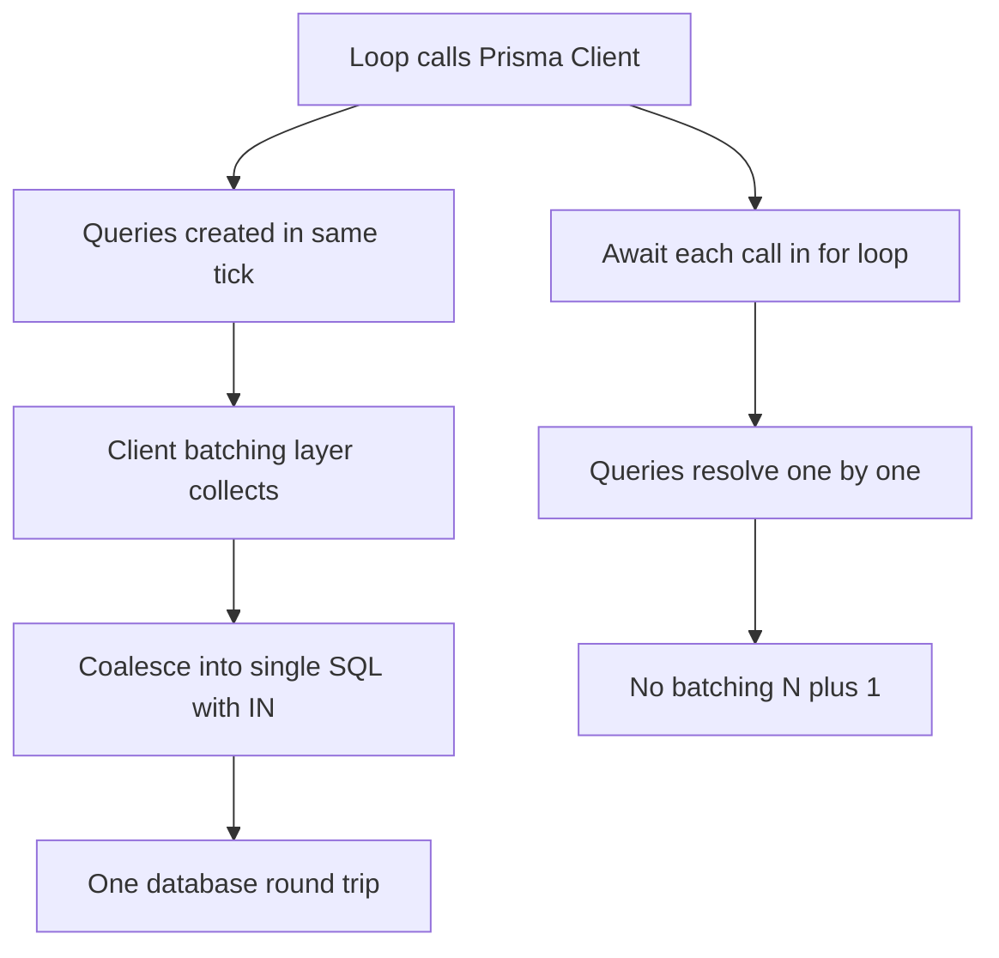

# Prisma's Query Batching and the DataLoader Pattern

## English

When you write a loop that calls Prisma Client inside it — for example, fetching the author of each post in a list — you might expect one database round trip per iteration. Prisma Client actually has a built-in batching layer: if several `findUnique()` queries of the same shape are issued in the same tick of the event loop, the client can coalesce them into a single SQL statement (typically using an IN clause) before sending anything to the database. The scope is worth stating precisely, because it is narrower than "any query that looks similar": the automatic batching layer applies to `findUnique()` (and `findUniqueOrThrow()`) queries issued in the same tick with the same `where` and `include` parameters. `findMany()` queries and bulk mutations such as `createMany`, `updateMany` or `deleteMany` are not batched this way. This is the same idea as Facebook's DataLoader, a utility that collects individual lookups during a single frame of execution and resolves them together. The practical effect is that naive-looking code often performs far better than a hand-rolled loop over a raw driver would.

The mechanism depends on how JavaScript's event loop works. Synchronous code runs to completion first; promise callbacks are queued as microtasks and drained before the next macrotask. If you build an array of promises with `posts.map(p => prisma.user.findUnique({ where: { id: p.authorId } }))` and then `await Promise.all(...)`, all those calls are created before any of them resolve, so they land in the same batch window. If instead you `await` each call inside a `for` loop, each one resolves before the next is created, and batching cannot help — you get the classic N+1 pattern.

Batching is not a free lunch. It only merges queries that are structurally identical apart from their arguments; queries with different `select`, `include`, `where` shapes, or different models, cannot be combined. It also does not help when the queries depend on each other (you need the result of query A to know what to ask in query B). And because batching happens per Prisma Client instance in a single process, it does nothing across separate serverless invocations or separate Node processes.

A useful mental model: batching is an optimisation for fan-out reads that are independent of one another. If you find yourself writing `for (const id of ids) { await prisma.thing.findUnique({ where: { id } }) }`, you have almost certainly created an N+1 problem. Rewriting it as a single `findMany({ where: { id: { in: ids } } })` is usually better still, because it makes the intent explicit and does not rely on the batching layer firing at the right moment.

Knowing this changes how you review code. When you see `await` inside a loop, ask whether the iterations are independent. If they are, hoist the awaits into a `Promise.all` or collapse them into one query. If they are not — each iteration needs the previous result — then sequential execution is correct and you should look for a different optimisation, such as a recursive CTE or a single query with a join.

## 中文

當你寫一個迴圈，在裡面呼叫 Prisma Client——例如為清單中每篇文章抓取其作者——你可能會以為每次迭代都會有一次資料庫往返。其實 Prisma Client 內建了一層批次處理：如果在事件迴圈的同一 tick 內發出多個形狀相同的 `findUnique()` 查詢，客戶端可以在送出任何東西到資料庫之前，把它們合併成一條 SQL 語句（通常用 IN 子句）。這個範圍值得說得精準一點，因為它比「任何看起來相似的查詢」都要窄：自動批次層只適用於在同一 tick 內發出、且 `where` 與 `include` 參數相同的 `findUnique()`（以及 `findUniqueOrThrow()`）查詢；`findMany()` 查詢，以及 `createMany`、`updateMany`、`deleteMany` 這類批次 mutation 並不會以這種方式被合併。這跟 Facebook 的 DataLoader 是同一個概念——那個工具會在單一執行幀內收集個別查詢，然後一起解決。實際效果是：看起來很天真的程式碼，往往比手寫原始驅動的迴圈效能好得多。

這個機制取決於 JavaScript 事件迴圈的運作方式。同步程式碼會先執行完；promise 回呼會排入 microtask 佇列，並在下一個 macrotask 之前被排空。如果你用 `posts.map(p => prisma.user.findUnique({ where: { id: p.authorId } }))` 建立一個 promise 陣列，然後 `await Promise.all(...)`，所有呼叫都會在任何一個解決之前被建立，因此它們會落在同一個批次視窗內。相反，如果你在 `for` 迴圈裡逐一 `await`，每一個都會在下一個被建立之前解決，批次處理就幫不上忙——你會得到經典的 N+1 模式。

批次處理不是免費午餐。它只會合併除了參數以外結構完全相同的查詢；`select`、`include`、`where` 形狀不同，或模型不同的查詢，都無法合併。當查詢彼此依賴時（你需要查詢 A 的結果才知道查詢 B 要問什麼），它也幫不上忙。而且因為批次處理是在單一程序內的每個 Prisma Client 實例上發生，它對不同的 serverless 呼叫或不同的 Node 程序完全無效。

一個有用的心智模型：批次處理是針對彼此獨立的扇出讀取所做的優化。如果你發現自己寫出 `for (const id of ids) { await prisma.thing.findUnique({ where: { id } }) }`，你幾乎肯定製造了 N+1 問題。改寫成單一 `findMany({ where: { id: { in: ids } } })` 通常更好，因為它把意圖寫得明確，也不依賴批次層在正確時刻觸發。

知道這一點會改變你審查程式碼的方式。當你看到迴圈裡的 `await`，先問各次迭代是否獨立。如果獨立，就把 await 提升到 `Promise.all`，或收斂成一條查詢。如果不獨立——每次迭代都需要前一次的結果——那麼循序執行才是正確的，你應該去找別的優化方式，例如遞迴 CTE 或帶 join 的單一查詢。

## Key Takeaway

Prisma Client batches independent same-shape queries issued in the same tick, so awaiting inside a loop is what creates N+1 problems, not the ORM itself.

## Related Concepts
- DataLoader pattern
- Event loop microtasks

## Diagram

