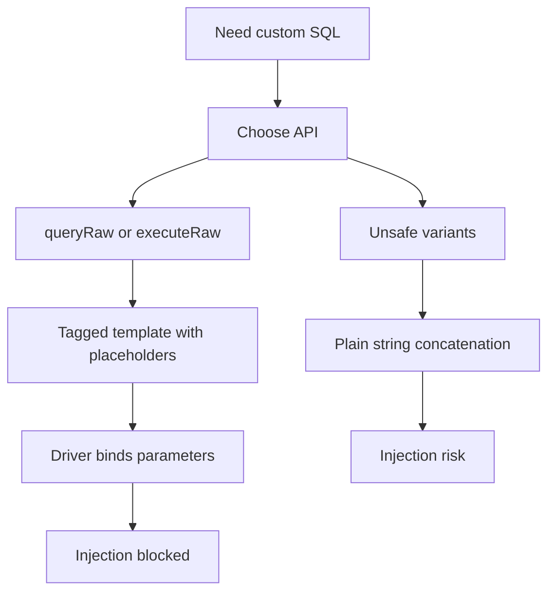

# Prisma's `$queryRaw` and the Injection Boundary

## English

Prisma Client's typed methods cover most queries, but sometimes you need something the query builder cannot express: a window function, a `LATERAL` join, a database-specific extension like PostGIS, or a query that is simply faster written by hand. Prisma exposes two escape hatches: `$queryRaw` for queries that return rows and `$executeRaw` for statements that return a count (INSERT, UPDATE, DELETE, DDL). Both are tagged-template functions, and that detail matters enormously.

When you write ``prisma.$queryRaw`SELECT * FROM User WHERE id = ${userId}` ``, Prisma does not splice the string together. It sends the SQL text with a placeholder (`$1`, `?`, or similar depending on the database) and passes `userId` as a bound parameter. The database driver handles the substitution, which means a malicious value cannot escape into the SQL grammar. This is the same protection you get from parameterised queries in any driver, and it is why the tagged-template form is the recommended one.

By contrast, `$queryRawUnsafe` and `$executeRawUnsafe` accept a plain string followed by variadic bound values, for example `$queryRawUnsafe(sql, value1, value2)` with `?` or `$1` placeholders. They exist for cases where the SQL is genuinely dynamic — table names from a whitelist, for instance — but they bypass the template mechanism. If you build that string with user input, you have reintroduced SQL injection. The naming is deliberately blunt: the word "Unsafe" is there to make you stop and think before typing it. A common safe pattern is to keep the SQL string static and only vary the bound parameters, which `$queryRaw` supports natively.

Raw queries return plain JavaScript objects, not typed Prisma models. You can recover type safety with a generic: ``prisma.$queryRaw<{ id: number; email: string }[]>`...` `` tells TypeScript what shape to expect, but nothing verifies it at runtime. If the SQL returns different columns than you declared, you will get a runtime surprise. Some teams use a schema validator on the result for this reason. Also note that raw queries do not participate in Prisma's relation loading — you cannot `.include()` on a raw result — and they do not automatically respect soft-delete extensions or other client extensions you may have installed.

Finally, raw queries interact with transactions in the usual way. Inside `prisma.$transaction(async (tx) => { ... })`, you should call `tx.$queryRaw` rather than `prisma.$queryRaw`; otherwise the raw query runs on a different connection and outside the transaction, which can lead to surprising isolation behaviour. The rule of thumb: use the typed API by default, reach for `$queryRaw` when you must, and treat `$queryRawUnsafe` as a code smell that needs a comment explaining why.

## 中文

Prisma Client 的型別化方法涵蓋大多數查詢，但有時你需要查詢建構器表達不了的東西：視窗函數、`LATERAL` join、像 PostGIS 這類資料庫專屬擴充，或單純手寫更快的查詢。Prisma 提供兩個逃生口：`$queryRaw` 用於會回傳資料列的查詢，`$executeRaw` 用於回傳筆數的語句（INSERT、UPDATE、DELETE、DDL）。兩者都是 tagged-template 函式，而這個細節極其重要。

當你寫 ``prisma.$queryRaw`SELECT * FROM User WHERE id = ${userId}` `` 時，Prisma 不會把字串拼接起來。它送出帶佔位符（`$1`、`?`，視資料庫而定）的 SQL 文字，並把 `userId` 當作綁定參數傳入。由資料庫驅動處理替換，這意味著惡意的值無法逃逸進 SQL 語法。這跟任何驅動的參數化查詢所提供的保護相同，也是為什麼 tagged-template 形式是建議用法。

相反，`$queryRawUnsafe` 和 `$executeRawUnsafe` 接受一個純字串，後面接住可變數量的綁定值，例如 `$queryRawUnsafe(sql, value1, value2)`，配合 `?` 或 `$1` 佔位符使用。它們存在於 SQL 真正動態的情況——例如來自白名單的資料表名稱——但它們繞過了模板機制。如果你用使用者輸入來建構那個字串，你就重新引入了 SQL 注入。命名刻意直白："Unsafe" 這個字就是要你在打下去之前停下來想一想。一個常見的安全模式是保持 SQL 字串靜態，只變化綁定參數，而 `$queryRaw` 原生支援這一點。

原始查詢回傳純 JavaScript 物件，不是型別化的 Prisma 模型。你可以用泛型恢復型別安全：``prisma.$queryRaw<{ id: number; email: string }[]>`...` `` 告訴 TypeScript 預期什麼形狀，但執行時沒有任何東西驗證它。如果 SQL 回傳的欄位跟你宣告的不同，你會得到執行時的驚喜。有些團隊因此對結果套用 schema 驗證器。另外注意，原始查詢不參與 Prisma 的關聯載入——你不能對原始結果 `.include()`——它們也不會自動遵循軟刪除擴充或你安裝的其他客戶端擴充。

最後，原始查詢以慣常方式與交易互動。在 `prisma.$transaction(async (tx) => { ... })` 內部，你應該呼叫 `tx.$queryRaw` 而不是 `prisma.$queryRaw`；否則原始查詢會在另一個連線上、在交易之外執行，可能導致令人意外的隔離行為。經驗法則：預設用型別化 API，必須時才用 `$queryRaw`，並把 `$queryRawUnsafe` 視為需要註解解釋原因的程式碼異味。

## Key Takeaway

Tagged-template `$queryRaw` binds parameters safely, while the Unsafe variants trade that protection for dynamic SQL — use them only when the SQL string itself is not user-controlled.

## Related Concepts
- SQL injection
- Parameterised queries

## Diagram

