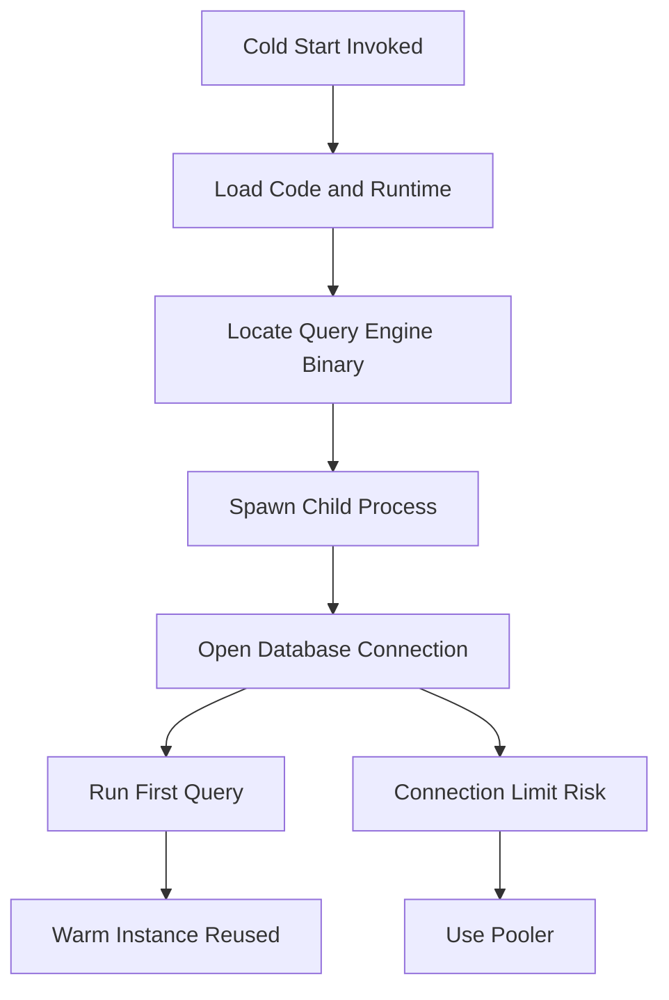

# Prisma and the Serverless Cold Start Trade-off

## English

Serverless functions (AWS Lambda, Vercel Functions, Cloudflare Workers) spin up a fresh execution environment when there is no warm instance to reuse. That startup work — loading code, initialising the runtime, opening connections — is the cold start, and it is where Prisma's architecture has historically been most visible. Understanding what happens during a Prisma cold start explains many of the deployment patterns you will see in real projects.

A legacy Prisma Client ships with a query engine written in Rust, and the way that engine is loaded matters. Up to Prisma 6 it is loaded as a Node-API library inside the client process by default, with a child-process binary mode available as an opt-in via `engineType = "binary"`; as of Prisma 7 the Rust engine is gone from the default path altogether, and queries are compiled to SQL by a TypeScript query compiler that talks to the database through a driver adapter. In the older binary mode, a cold start had to extract or locate the executable, start the process, and establish a connection to the database before the first query could run. On a long-lived server this cost is paid once and amortised over millions of requests; on a serverless platform it may be paid on every cold start, adding hundreds of milliseconds. This is one of the motivations behind Prisma's driver adapters and the newer Rust-free client, which talk to the database through the same JavaScript drivers other libraries use, eliminating the child process and often shrinking the deployment bundle.

Connection management is the second half of the story. A serverless platform may run hundreds of concurrent function instances, each of which wants its own database connection. Postgres and MySQL have finite connection limits, and a burst of cold starts can exhaust them. The common remedy is to put a connection pooler such as PgBouncer in front of the database, but poolers come in different modes (session, transaction, statement) and Prisma's compatibility depends on which one you use. Transaction-mode pooling, for instance, does not preserve session state across statements, which affects prepared statements and some Prisma features. This is why the "serverless + Prisma" advice is rarely a single flag but a combination of driver adapter choice, pooler mode, and connection limit tuning.

Practical mitigations fall into a few buckets. Keep the Prisma Client instance outside the handler so warm invocations reuse it — creating a client per request throws away the pool on every call. Set conservative connection limits so a burst of instances does not overwhelm the database; many teams set the pool size to one or two per instance and rely on the pooler for fan-in. Choose a driver adapter that matches your platform, especially on edge runtimes where a Rust binary cannot run at all. And measure: cold start latency is highly variable, so instrument the first query in a fresh instance rather than trusting benchmarks.

The broader lesson is that Prisma is a client library with a runtime, and serverless platforms punish runtime weight. Newer architectures (driver adapters, edge-compatible clients) exist precisely because the original design assumed a long-lived Node process. If you are deploying to serverless, treat the client lifecycle and connection topology as first-class design decisions, not afterthoughts.

## 中文

Serverless 函式（AWS Lambda、Vercel Functions、Cloudflare Workers）在沒有可重用的暖實例時，會啟動全新的執行環境。這些啟動工作——載入程式碼、初始化執行時、開啟連線——就是冷啟動，而這正是 Prisma 架構歷來最顯眼的地方。了解 Prisma 冷啟動期間發生什麼，能解釋你在真實專案中看到的許多部署模式。

舊版 Prisma Client 隨附一個以 Rust 寫成的查詢引擎，而這個引擎點樣載入好重要。到 Prisma 6 為止，預設係以 Node-API library 形式載入客戶端行程之內；`engineType = "binary"` 才可以改用子程序二進位檔模式。由 Prisma 7 起，預設路徑更加完全冇 Rust 引擎，查詢改由 TypeScript query compiler 編譯成 SQL，再透過 driver adapter 同資料庫溝通。在舊有的 binary 模式底下，冷啟動時執行時必須解壓或定位該執行檔、啟動程序，並在第一次查詢執行前建立資料庫連線。在長駐伺服器上，這個成本只付一次，並分攤到數百萬次請求；在 serverless 平台上，它可能在每次冷啟動時都要付，增加數百毫秒。這正是 Prisma 驅動適配器和較新的無 Rust 客戶端背後的動機之一——它們透過其他函式庫也在用的相同 JavaScript 驅動與資料庫對話，消除子程序，通常也縮小部署包。

連線管理是故事的後半段。Serverless 平台可能同時執行數百個函式實例，每個都想要自己的資料庫連線。Postgres 和 MySQL 的連線數有限，一波冷啟動就可能把它們耗盡。常見的補救措施是在資料庫前面放一個連線池器，例如 PgBouncer，但池器有不同模式（session、transaction、statement），而 Prisma 的相容性取決於你用哪一種。例如 transaction 模式池化不會在語句之間保留 session 狀態，這會影響預備語句和某些 Prisma 功能。這就是為什麼「serverless + Prisma」的建議很少是單一旗標，而是驅動適配器選擇、池器模式和連線上限調校的組合。

實務上的緩解措施分成幾類。把 Prisma Client 實例放在處理函式外面，讓暖呼叫重用它——每次請求建立一個客戶端等於每次呼叫都丟掉連線池。設定保守的連線上限，讓一波實例不會壓垮資料庫；許多團隊把每個實例的池大小設為一或二，並依賴池器做扇入。選擇符合你平台的驅動適配器，特別是在根本無法執行 Rust 二進位檔的邊緣執行時。而且要量測：冷啟動延遲變異很大，所以要對全新實例中的第一次查詢做監控，而不是相信基準測試。

更廣泛的教訓是：Prisma 是一個帶執行時的客戶端函式庫，而 serverless 平台會懲罰執行時重量。較新的架構（驅動適配器、邊緣相容客戶端）之所以存在，正是因為原始設計假設了長駐的 Node 程序。如果你要部署到 serverless，請把客戶端生命週期和連線拓撲當作一級設計決策，而不是事後補救。

## Key Takeaway

On serverless, Prisma's cold-start cost and connection fan-out are architectural concerns — driver adapters, a pooler, and a module-scoped client are the levers you tune.

## Related Concepts
- Cold start latency
- PgBouncer pooling modes

## Diagram

