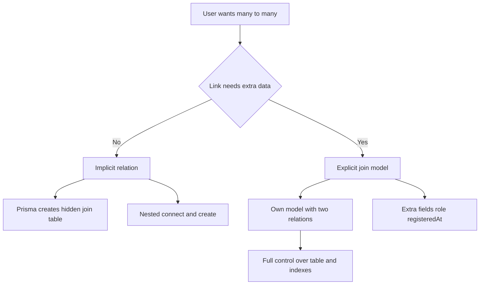

# Prisma's Many-to-Many Models: Implicit vs Explicit Join Tables

## English

In a relational database, a many-to-many relationship has no direct representation. You cannot put a foreign key on either side that points to 'many' rows; instead you need a third table, often called a join table or pivot table, whose rows each represent one pairing. Prisma offers two ways to express this. The implicit form is the one most people meet first: you declare a list of `Post` on `User` and a list of `User` on `Post`, and Prisma quietly creates a hidden table behind the scenes to store the pairs. You never see or name that table in your schema, and you never write to it directly. It works well when the relationship is purely a link with no extra information attached.

The explicit form is what you reach for once the link itself needs data. Imagine a `User` can join many `Event`s, but each attendance also has a `role` (attendee, speaker, organiser) and a `registeredAt` timestamp. Those fields belong to the pairing, not to the user and not to the event. With an implicit relation there is nowhere to put them, so you define a model yourself, say `EventAttendee`, with two relation fields pointing at `User` and `Event`, plus whatever extra columns you need. Prisma then treats it as an ordinary model with two many-to-one relations, and the many-to-many is a consequence rather than a primitive.

The trade-offs are practical. Implicit relations are terser in the schema and you get convenient nested writes, such as connecting an existing post to a user with `connect`. But they generate a table name you did not choose, which matters when other tools, raw SQL reports, or a DBA need to query it. Explicit join models give you full control over the table name, the columns, indexes and uniqueness constraints, and they let you attach metadata. They also make it obvious in the schema that the association is a first-class thing in your domain, not an afterthought.

A useful rule of thumb: if you can imagine someone asking a question about the relationship itself ('who attended which event and in what capacity?'), it deserves an explicit model. If the relationship is a pure set membership with no attributes, implicit is fine. Many teams start implicit and migrate to explicit once requirements grow, which is a schema change like any other and should go through a migration.

One caution: implicit relations rely on conventions Prisma manages for you, including the naming of the underlying table and its unique constraint on the pair of foreign keys. If you later switch to explicit, you are effectively introducing a new model and dropping the old hidden table, so plan the migration carefully and backfill data if it already exists in production.

## 中文

在關聯式資料庫裡，多對多關係並沒有直接的表達方式。你無法在兩邊任何一側放一個指向「多」列的外鍵；相反，你需要第三張表，通常叫連接表（join table）或樞紐表（pivot table），每一列代表一組配對。Prisma 提供兩種表達方式。隱式（implicit）是最多人先接觸到的：你在 `User` 上宣告一個 `Post` 列表，在 `Post` 上宣告一個 `User` 列表，Prisma 就在背後悄悄建立一張隱藏表來儲存配對。你在 schema 裡看不到、也不會為那張表命名，更不會直接寫入它。當關係純粹只是連結、沒有附加資料時，這方式很好用。

顯式（explicit）則是在連結本身需要資料時才用。設想一個 `User` 可以參加許多 `Event`，但每次出席還有 `role`（出席者、講者、主辦方）和 `registeredAt` 時間戳。這些欄位屬於「配對」，既不屬於使用者也不屬於活動。隱式關係無處安放它們，於是你自己定義一個模型，例如 `EventAttendee`，內含兩個分別指向 `User` 和 `Event` 的關聯欄位，再加上你需要的額外欄位。Prisma 便把它當成一個普通模型、帶兩條多對一關聯，多對多只是結果，而非原語。

取捨很實際。隱式關係在 schema 裡更簡潔，嵌套寫入也方便，例如用 `connect` 把既有貼文連到某位使用者。但它產生的表名不是你選的，這在別的工俱、原生 SQL 報表或 DBA 要查詢時就有影響。顯式連接模型讓你完全掌控表名、欄位、索引與唯一約束，也能附加中介資料。它同時讓 schema 清楚表明：這個關聯是領域裡的一等公民，而非事後補丁。

一條實用準則：如果你能想像有人會針對「關係本身」提問（例如「誰以什麼身分出席了哪場活動？」），它就值得一個顯式模型。如果關係只是純粹的集合成員、沒有任何屬性，隱式就夠了。許多團隊先從隱式開始，需求成長後再轉為顯式，這跟任何 schema 變更一樣，應該走一次遷移。

一點提醒：隱式關係依賴 Prisma 替你管理的慣例，包括底層表名，以及那對外鍵上的唯一約束。日後若改為顯式，你實際上等於引入新模型、丟棄舊的隱藏表，所以要小心規劃遷移，若生產環境已有資料，還得回填。

## Key Takeaway

Use implicit many-to-many when the link carries no data, and switch to an explicit join model the moment the relationship itself needs fields like role or timestamp.

## Related Concepts
- Join tables and pivot tables
- Nested writes with connect and create

## Diagram

