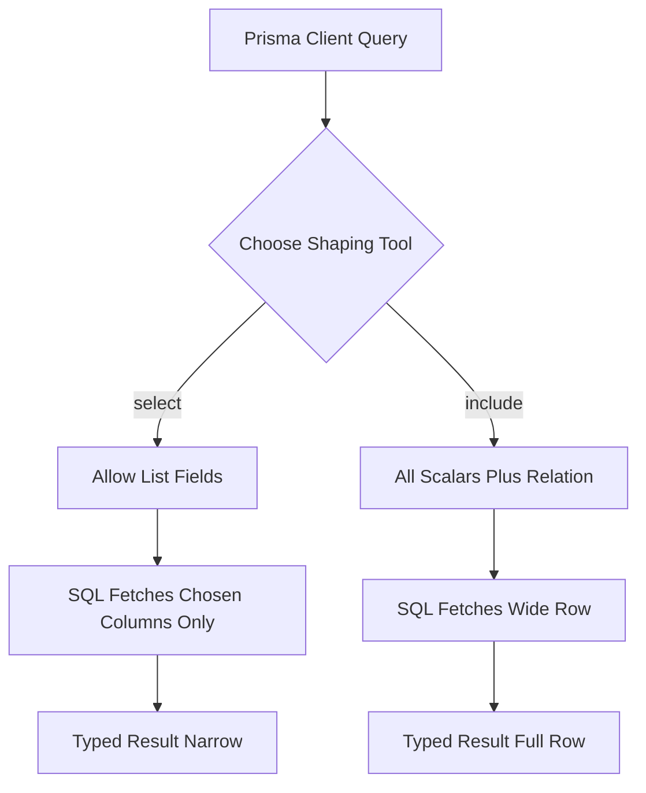

# Select vs Include: Shaping What Comes Back from the Database

## English

When you fetch a record with Prisma Client, the default is to return every scalar column of that model and nothing else. That default is convenient but rarely what a production query should do: pulling a wide row when you only need an id and a name wastes bandwidth between the database and your application, inflates memory, and can even defeat covering indexes. Prisma gives you two related tools to shape the result, `select` and `include`, and understanding the difference is one of the highest-leverage bits of knowledge for writing efficient queries.

`select` is an allow-list. You name exactly the fields you want, and Prisma builds a SQL statement that only fetches those columns. Anything you omit is simply absent from the returned object, and crucially the generated TypeScript type reflects that, so the compiler will stop you from reading a field you did not ask for. `include` is different in spirit: it says 'give me all the scalar fields as usual, and additionally pull in this relation.' It is a convenience for when you genuinely want the whole row plus a related collection, and it is roughly equivalent to selecting every scalar field explicitly plus the relation.

The two cannot be mixed at the same level. You either use `select` or `include` on a given query, not both, because they express contradictory intents. That rule trips people up at first, but it makes sense once you see them as two different mental models. In practice most teams standardise on `select` for anything user-facing, because it doubles as documentation of the API shape and prevents accidental leakage of columns such as password hashes or internal flags.

Relations can be shaped too, and this is where the real power lies. Inside a `select` or `include`, you can nest another `select` on the related model, picking only a few of its fields, and even nest further. You can also attach `where`, `orderBy`, `take` and `skip` to a relation, which Prisma translates into a filtered or limited sub-query rather than loading everything and trimming in memory. For example, selecting a user with their five most recent posts is a single nested `select` with `orderBy` and `take`, not a separate query per user.

A subtle point worth internalising: over-selecting is not free even when it looks harmless. Every extra column crosses the wire, gets deserialised, and is held in memory for the lifetime of the object. In hot paths, or when returning lists of hundreds of rows, trimming to the fields you actually render can be the difference between a snappy endpoint and a sluggish one. Reach for `select` by default, and treat `include` as the exception for cases where you truly need the whole record plus a relation.

## 中文

當你用 Prisma Client 取一筆記錄，預設會回傳該模型的所有純量欄位，其他一概不給。這預設很方便，但很少是生產查詢該做的事：只為拿一個 id 和 name 卻拉回一整列寬資料，會浪費資料庫與應用程式之間的頻寬、膨脹記憶體，甚至可能讓覆蓋索引（covering index）失效。Prisma 提供兩個相關工具來塑形結果：`select` 與 `include`，搞清兩者差別，是寫出高效查詢最高槓桿的知識之一。

`select` 是白名單。你逐一列出要的欄位，Prisma 就組出只抓那些欄位的 SQL。你略過的東西不會出現在回傳物件裡，而且關鍵是：產生的 TypeScript 型別會反映這點，編譯器會阻止你讀取沒要求的欄位。`include` 的精神不同：它說「照常給我所有純量欄位，另外再把這個關聯一併拉進來」。當你確實想要整列再加一個關聯集合時，它很方便，大致等同於明確選取每個純量欄位再加該關聯。

兩者在同一層不能混用。同一筆查詢你只能用 `select` 或 `include` 其中一個，不能兩者並用，因為它們表達互相矛盾的意圖。這規則一開始常讓人卡住，但一旦把它們看成兩種心智模型就說得通。實務上多數團隊對任何面向使用者的查詢都統一用 `select`，因為它同時充當 API 形狀的文件，並防止意外洩漏密碼雜湊或內部旗標之類的欄位。

關聯也能塑形，這才是真正威力所在。在 `select` 或 `include` 裡，你可以對關聯模型再嵌套一層 `select`，只挑它幾個欄位，甚至再往裡嵌套。你也可以在關聯上附加 `where`、`orderBy`、`take`、`skip`，Prisma 會把它翻成帶篩選或限量的子查詢，而不是先全載再於記憶體裡裁剪。例如「取出某使用者與其最近五篇貼文」就是一個帶 `orderBy` 和 `take` 的嵌套 `select`，而非每位使用者各發一次查詢。

一個值得內化的微妙重點：過度選取即使看似無害也非免費。每個多餘的欄位都要過網路、要反序列化、要在物件生命週期內佔著記憶體。在熱路徑上，或回傳數百列清單時，裁剪到真正要渲染的欄位，可能就是端點靈敏與遲滯之間的差別。預設就用 `select`，把 `include` 當例外，只在確實需要整筆記錄加關聯時才用。

## Key Takeaway

Default to `select` to fetch only the columns you need, and reserve `include` for the rarer case where you truly want the whole row plus a relation.

## Related Concepts
- Covering indexes
- Nested relation queries with where and orderBy

## Diagram

