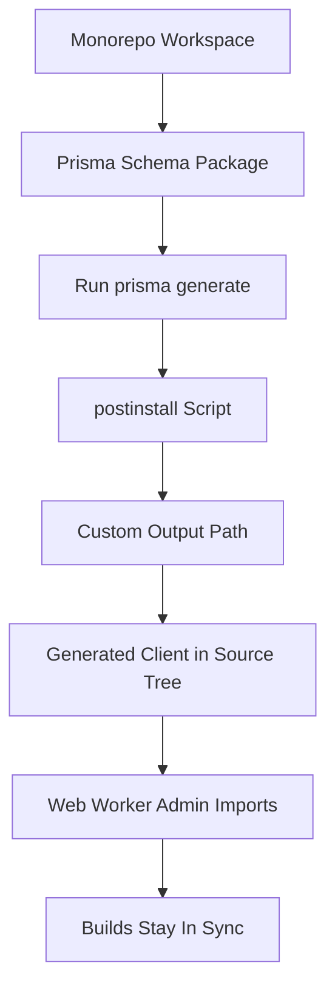

# Prisma in a Monorepo: Sharing a Client Without Breaking Builds

## English

Many teams keep their Prisma schema and generated client in one package of a monorepo and import it from several applications, such as a web frontend's server routes, a background worker, and an admin tool. This is a common and sensible arrangement, but it surfaces a set of build-time problems that are easy to hit and confusing to debug. The core issue is that Prisma Client is not a normal hand-written library: it is generated code, produced by running the Prisma CLI against your schema, and it carries platform-specific engine binaries (or, with newer driver-adapter setups, generated runtime code) that must match the environment where it runs.

The first trap is generation timing. If the client is generated only when you run a command manually, a fresh clone or a CI machine will have no client at all, and imports will fail with a module-not-found error that looks like a broken dependency. The fix is to make generation part of the package's lifecycle, typically a postinstall script that runs `prisma generate`, so that installing dependencies in any workspace also produces the client. This keeps every consumer in sync with the schema without anyone remembering to run a command.

The second trap is where the client lives. By default the generator writes into a location inside `node_modules`, which package managers may prune, hoist, or treat as disposable. In a monorepo that can mean one workspace's install wipes or shadows another's client. A robust pattern is to set a custom output path inside your own source tree, commit that path's parent directory to the ignore list appropriately, and import from that explicit path everywhere. Then the client is a normal file in your package, visible to the bundler and to TypeScript, rather than a hidden artefact buried in dependencies.

The third trap is deployment. Serverless bundlers and container builds often trace imports statically and include only files they can see. Generated engine binaries can be missed, leading to runtime errors about a missing query engine. The remedy is to ensure the build step runs generation before bundling and that the bundler is configured to include the generated directory and its binaries. With driver adapters, where the client talks to the database through a JavaScript driver, the binary problem largely disappears, but you still need generation to run before type-checking and bundling.

A practical checklist: pin the Prisma CLI version in the workspace that owns the schema, run generation on install and before builds, use an explicit output path for the client, and have consumers import from that path rather than relying on hoisting. Do this and the monorepo arrangement becomes invisible to developers; skip it and you will spend afternoons chasing 'works on my machine' import errors.

## 中文

許多團隊把 Prisma schema 與產生的 client 放在 monorepo 的某個套件裡，再從好幾個應用程式匯入，例如網頁前端的伺服器路由、背景 worker、以及管理工具。這是常見且合理的安排，但會浮現一組建置期問題，容易踩到又難除錯。核心在於：Prisma Client 不是普通手寫函式庫，它是產生的程式碼，由 Prisma CLI 對著你的 schema 執行而產生，並帶著平台專屬的引擎二進位檔（或在較新的 driver adapter 設定下，是產生的執行期程式碼），必須與執行環境相符。

第一個陷阱是產生時機。如果 client 只在你手動跑指令時才產生，全新 clone 或 CI 機器就完全沒有 client，匯入會以找不到模組的錯誤失敗，看起來像依賴壞了。解法是把產生納入套件的生命週期，通常是 postinstall 腳本執行 `prisma generate`，這樣在任何 workspace 安裝依賴時也一併產生 client，讓每個使用端都與 schema 同步，不必有人記得跑指令。

第二個陷阱是 client 放在哪。預設生成器會寫進 `node_modules` 裡的某個位置，而套件管理器可能修剪、提升（hoist）或視之為可丟棄。在 monorepo 裡，這可能導致某個 workspace 的安裝清掉或遮蔽另一個的 client。穩健做法是把自訂輸出路徑設在自己原始碼樹內，適當地把該路徑的上層目錄加入忽略清單，並在各處都從那個明確路徑匯入。如此 client 就是你套件裡的普通檔案，對打包器與 TypeScript 都可見，而不是埋在依賴裡的隱形產物。

第三個陷阱是部署。Serverless 打包器與容器建置常以靜態方式追蹤匯入，只納入看得見的檔案。產生的引擎二進位檔可能被漏掉，導致執行期出現找不到查詢引擎的錯誤。補救之道是確保建置步驟在打包前先跑產生，且打包器設定為納入產生的目錄及其二進位檔。若用 driver adapter、client 透過 JavaScript 驅動與資料庫對話，二進位檔問題大致消失，但你仍需要在型別檢查與打包之前先跑產生。

實用檢查清單：在擁有 schema 的 workspace 釘住 Prisma CLI 版本，在安裝時與建置前都跑產生，為 client 使用明確輸出路徑，並讓使用端從該路徑匯入而非依賴提升。做到這些，monorepo 安排對開發者就形同隱形；漏掉這些，你就會花整個下午追「在我機器上可以」的匯入錯誤。

## Key Takeaway

Treat Prisma Client as generated build output: generate on install and before builds, give it an explicit output path in your own source tree, and import it from there everywhere.

## Related Concepts
- Monorepo workspace hoisting
- Serverless bundling and file tracing

## Diagram

