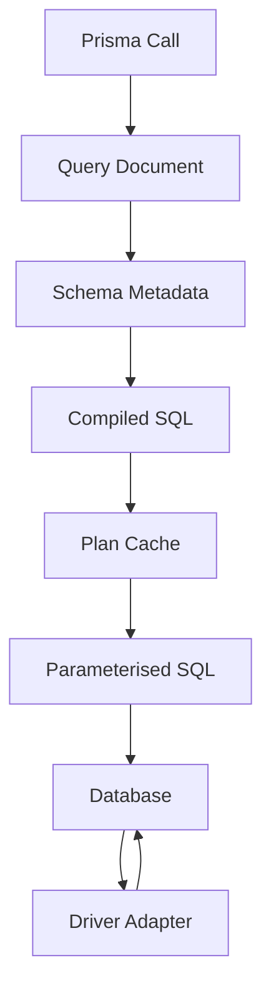

# Prisma Client's Query Plan Cache and the Prepared Statement Question

## English

When you call `prisma.user.findMany()`, Prisma does not simply glue strings together into SQL. The query engine parses your call into an internal query document, walks the schema metadata to decide which joins, subqueries or batched follow-up queries are needed, and then compiles that into a parameterised SQL statement. That compiled form is cached, keyed on the shape of the query rather than the values you passed. This is why the second call to the same query is cheaper than the first: the expensive planning work is amortised, and only the parameter values change between executions. The cache is bounded, so a service that builds queries with wildly varying shapes — different `select` fields per request, for example — will churn the cache and pay planning costs repeatedly.

The distinction that matters for performance is between Prisma's internal plan cache and the database's own prepared statement cache. Prisma sends parameterised SQL, so the database can in principle reuse a prepared plan. But whether it does depends on your driver and your connection pooler. Classic PostgreSQL wire-protocol pooling through PgBouncer in transaction mode, for instance, does not preserve session state across transactions, so server-side prepared statements can break or be silently disabled. This is one of the practical reasons Prisma's driver-adapter work matters: the adapter decides how statements are sent, and that decision interacts with whatever sits between your app and the database.

You can observe this behaviour rather than guess at it. Enabling query logging shows the SQL Prisma emits, and you will see the same statement text repeating with different bound parameters — that is the plan cache doing its job. If instead you see the statement text itself changing between calls that should be identical, something upstream is varying the query shape, often a conditional `select` or `include` built from request data. That is a code smell worth fixing before you reach for caching layers.

A concrete example: an endpoint that lets clients request arbitrary field subsets. Each distinct subset produces a distinct query shape, each needing its own plan. A hundred clients asking for a hundred combinations means a hundred plans, most used once. The fix is usually to constrain the allowed shapes — a small enum of projections — so the cache stays warm and the database sees a stable statement it can plan once and reuse.

None of this requires you to hand-tune anything in most applications. The point is to know which knobs exist and which layer owns them: Prisma owns query-shape compilation and its cache, the driver adapter owns how bytes reach the wire, and the database or pooler owns plan reuse. When latency is puzzling, checking all three in that order saves a lot of guessing.

## 中文

當你呼叫 `prisma.user.findMany()` 時，Prisma 並不是簡單地把字串拼成 SQL。查詢引擎會把你的呼叫解析成內部的查詢檔案，走訪 schema 中繼資料以決定需要哪些 join、子查詢或批次式的後續查詢，然後編譯成引數化的 SQL 語句。這個編譯後的形態會被快取，快取的鍵是查詢的「形狀」而不是你傳入的值。這就是為何同一個查詢第二次呼叫比第一次便宜：昂貴的規劃工作被攤薄，每次執行之間只有引數值改變。快取是有上限的，所以若一個服務產生形狀千變萬化的查詢——例如每個請求用不同的 `select` 欄位——就會不斷沖刷快取，反覆付出規劃成本。

對效能而言真正重要的區分，是 Prisma 內部計劃快取與資料庫自身預備語句快取之間的分別。Prisma 送出的是引數化 SQL，所以資料庫原則上可以重用已預備的計劃。但是否真的重用，取決於你的 driver 與連線池工具。例如經典的 PostgreSQL wire protocol 經 PgBouncer 以 transaction 模式池化時，並不會在交易之間保留 session 狀態，因此伺服器端的預備語句可能失效或被默默停用。這正是 Prisma 的 driver adapter 工作實際有意義的原因之一：adapter 決定語句如何送出，而這個決定會與應用程式和資料庫之間的任何東西互相影響。

你可以觀察這個行為而不是憑空猜測。開啟查詢日誌會顯示 Prisma 送出的 SQL，你會看到同一段語句文字重複出現、只有繫結的引數不同——這就是計劃快取在運作。相反，若你看到本應相同的呼叫之間語句文字本身在變，那就是上游有東西在改變查詢形狀，通常是根據請求資料動態建構的條件式 `select` 或 `include`。這是一個值得在引入快取層之前先修掉的程式碼壞味道。

一個具體例子：某個端點讓客戶端要求任意欄位子集。每個不同的子集產生不同的查詢形狀，各自需要自己的計劃。一百個客戶端要求一百種組合，就是一百個計劃，大多隻用一次。解法通常是限制允許的形狀——一個小小的 projection 列舉——讓快取保持溫熱，資料庫也看到穩定的語句，可以規劃一次然後重用。

在大多數應用中，這一切都不需要你手動調整任何東西。重點是要知道有哪些旋鈕存在、各自屬於哪一層：Prisma 負責查詢形狀的編譯與其快取，driver adapter 負責位元組如何上線，資料庫或池化器負責計劃重用。當延遲令人費解時，按這個順序檢查這三層，可以省下大量猜測。

## Key Takeaway

Prisma caches compiled query shapes, not values, so keeping your query shapes stable is what lets both Prisma and the database avoid re-planning work.

## Related Concepts
- Prepared statements
- PgBouncer transaction pooling

## Diagram

