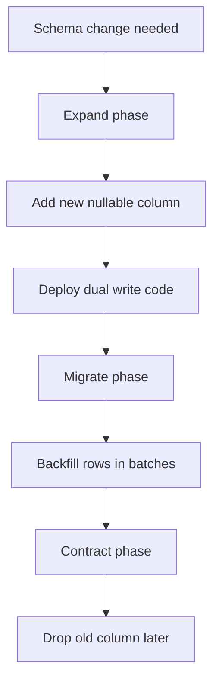

# Schema Evolution Without Downtime: The Expand-Contract Dance

## English

Prisma Migrate will happily generate SQL that renames a column or changes its type. What it cannot do is keep your running application alive while that SQL executes, because a rename is really a drop plus an add, and any code still reading the old name breaks the moment the migration lands. This is the central tension of schema evolution in production: the database and the application are two deployment targets that must not be changed simultaneously, yet a migration always changes one before the other.

The standard resolution is a three-phase pattern often called expand-contract. In the expand phase you add the new thing without removing the old: a new nullable column, a new table, a new index built concurrently. Deploy application code that writes to both old and new and reads from whichever is authoritative. In the migrate phase you backfill existing rows, usually in batches so you do not hold long locks or bloat the write-ahead log, and verify the new column matches. In the contract phase, once no running code touches the old column, you drop it in a later migration. Each step is individually safe, and each is reversible by rolling back the application deploy rather than the database.

Prisma's tooling supports this if you sequence it deliberately. Because `prisma migrate dev` diffs your schema against the migration history and generates the delta, you can write the schema in intermediate states — column present but nullable, then later required — and each intermediate state becomes its own migration file. The trap is treating the schema as a description of the final desired state and letting one migration jump straight there. That works on a laptop and fails on a live system with traffic.

Concrete example: renaming `userName` to `username`. A single migration renaming the column breaks every running instance still selecting `userName`. The expand-contract version adds `username` as nullable, deploys code writing both fields, backfills from `userName`, switches reads to `username`, then drops `userName` in a migration shipped after the old code is fully gone. Four migrations, zero downtime, and every intermediate state is a valid schema that some version of your app can run against.

There is a cost: more migrations, more discipline, and a period where two sources of truth exist and can disagree. That period is where bugs hide, so it deserves an explicit invariant — usually a database constraint or a check that the backfill is complete before the contract step. The reward is that deploys stop being scary, because no single step can break the running system.

## 中文

Prisma Migrate 會樂意為你產生重新命名欄位或改變其型別的 SQL。它做不到的，是在那段 SQL 執行時讓你的運行中應用程式保持存活，因為重新命名其實是刪除加新增，任何仍在讀取舊名稱的程式碼會在遷移落地的那一刻壞掉。這就是生產環境 schema 演進的核心張力：資料庫與應用程式是兩個部署目標，不能同時改變，但遷移永遠會先改變其中一個。

標準解法是一個三階段模式，常被稱為 expand-contract。在 expand 階段，你加入新東西而不移除舊的：一個新的可空欄位、一張新表、一個以 concurrently 建立的新索引。部署同時寫入新舊兩邊、並從權威那一邊讀取的應用程式碼。在 migrate 階段，你回填既有資料列，通常分批進行，以免長時間鎖定或膨脹 write-ahead log，並驗證新欄位與舊的一致。在 contract 階段，一旦沒有任何運行中的程式碼碰觸舊欄位，就在之後的遷移中把它刪掉。每一步單獨來看都是安全的，而且每一步都可以透過回滾應用程式部署（而非資料庫）來逆轉。

只要你刻意安排順序，Prisma 的工具是支援這件事的。因為 `prisma migrate dev` 會將你的 schema 與遷移歷史做差異比對並產生 delta，你可以把 schema 寫成中間狀態——欄位存在但可空，之後再改為必填——而每個中間狀態都成為自己的遷移檔。陷阱在於把 schema 當成最終期望狀態的描述，讓單一遷移直接跳到那裡。那在筆記型電腦上可行，在有流量的活系統上則會失敗。

具體例子：把 `userName` 改名為 `username`。單一遷移重新命名該欄位，會讓每個仍在 select `userName` 的運行實例壞掉。expand-contract 版本則先加入可空的 `username`，部署同時寫入兩個欄位的程式碼，從 `userName` 回填，把讀取切換到 `username`，然後在舊程式碼完全消失之後才以一個遷移刪掉 `userName`。四個遷移，零停機，而且每個中間狀態都是某個版本的應用程式可以正常運行的合法 schema。

這是有代價的：更多遷移、更多紀律，以及一段存在兩個真相來源、可能彼此不一致的時期。那段時期正是 bug 藏身之處，所以值得一個明確的不變式——通常是資料庫約束，或在 contract 步驟前確認回填完成的檢查。回報是部署不再令人心驚，因為沒有任何單一步驟能弄壞運行中的系統。

## Key Takeaway

Never let one migration jump from old schema to new schema; split it into expand, backfill and contract so each step is safe while the app is live.

## Related Concepts
- Zero-downtime deploys
- Online schema change

## Diagram

