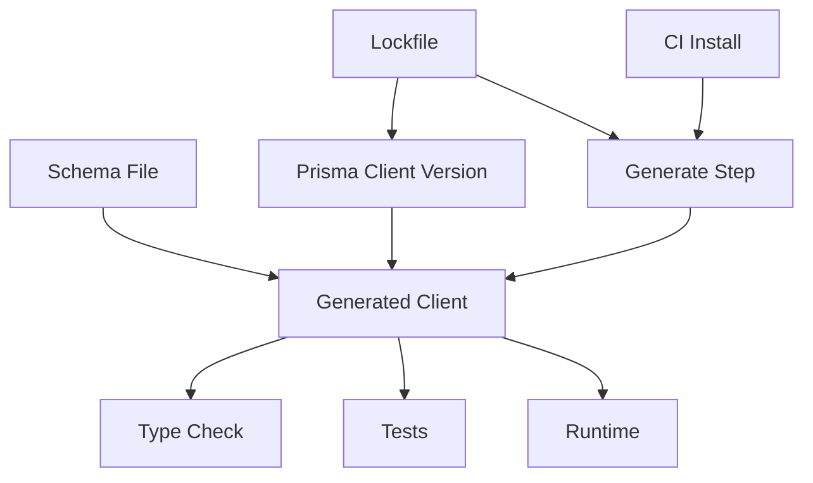

# The Generated Client Is a Dependency: Versioning, Lockfiles and CI

## English

It is tempting to think of the generated Prisma Client as a build artefact, like a compiled binary you can ignore. It is better understood as a dependency with its own version, and treating it that way prevents a whole class of confusing failures. The client is generated from two inputs: your schema and the `@prisma/client` package version. Change either and the generated code changes. If those two inputs are not pinned consistently across your machines and your CI, you get code that type-checks locally and fails in the pipeline, or worse, type-checks everywhere and misbehaves at runtime.

The lockfile is where this is enforced. `@prisma/client` and the `prisma` CLI should be kept on the same version, and the lockfile should be committed. When they drift — say the CLI is newer than the client — the schema features you use may not be understood by the generated runtime, or the generated types may not match what the CLI expects to find. Prisma generally warns about version mismatches, but warnings scroll past in a busy build log. Pinning both explicitly in `package.json` and letting the lockfile freeze the resolved versions is the cheap insurance.

Generation timing is the second half of the problem. The generated client lives outside your source tree, typically in a directory under `node_modules`, which means it is not committed and must be produced on every fresh checkout. A CI job that installs dependencies but never runs generation will either fail at import time or silently use a stale client left in a cache layer. The reliable pattern is a postinstall hook or an explicit generate step immediately after install, before any type-check or test runs. If your CI caches `node_modules`, make sure the cache key includes the schema file, or you will restore a client generated from last week's schema.

A concrete failure mode: a developer adds a field to the schema, runs generation locally, and everything passes. The CI cache key covers only `package.json`, so CI restores a cached `node_modules` containing a client generated before the field existed. TypeScript reports that the field does not exist on the model type, the build fails, and the error points at innocent application code rather than at the cache. Including the schema in the cache key, or skipping the cache for the generated directory, makes this disappear.

In a monorepo the stakes rise, because several packages may import the same generated client and each may resolve a different copy. Hoisting rules in your package manager decide which one wins, and a mismatch between packages can produce types that disagree about the same model. The durable fix is to generate once, in one place, and have every consumer import from that single package rather than each generating its own.

## 中文

人們很容易把產生的 Prisma Client 當成建置產物，像編譯出來的二進位檔一樣可以忽略。更好的理解是：它是一個有自己版本的依賴，而把它當作依賴來處理，可以避免一整類令人困惑的失敗。這個 client 由兩個輸入產生：你的 schema 與 `@prisma/client` 套件的版本。改變任何一個，產生的程式碼就會改變。如果這兩個輸入在你的機器與 CI 之間沒有被一致地釘住，你就會得到在本機通過型別檢查、在管線中失敗的程式碼，或者更糟：到處都通過型別檢查，執行時卻行為異常。

鎖定檔正是執行這件事的地方。`@prisma/client` 與 `prisma` CLI 應保持同一版本，而鎖定檔應該提交進版本庫。當兩者漂移——比如 CLI 比 client 新——你使用的 schema 功能可能不被產生的執行期理解，或者產生的型別與 CLI 預期找到的東西不符。Prisma 通常會對版本不符發出警告，但在繁忙的建置日誌中警告會被捲過去。在 `package.json` 中明確釘住兩者，並讓鎖定檔凍結解析出的版本，是便宜又好用的保險。

產生的時機是問題的另一半。產生的 client 位於你的原始碼樹之外，通常在 `node_modules` 下的某個目錄，這意味著它不會被提交，必須在每次全新 checkout 時產生。一個安裝了依賴但從未執行產生的 CI 工作，要麼在 import 時失敗，要麼默默使用快取層中留下的過期 client。可靠的做法是 postinstall 掛鉤，或在安裝之後、任何型別檢查或測試之前立即有一個明確的產生步驟。如果你的 CI 快取 `node_modules`，務必讓快取鍵包含 schema 檔，否則你會還原一個用上週 schema 產生的 client。

一個具體的失敗模式：某開發者在 schema 中加入一個欄位，在本機執行產生，一切通過。CI 的快取鍵只涵蓋 `package.json`，所以 CI 還原了一個包含「該欄位存在之前」所產生 client 的快取 `node_modules`。TypeScript 回報該欄位不存在於模型型別上，建置失敗，而錯誤指向無辜的應用程式碼而不是快取。把 schema 納入快取鍵，或對產生目錄跳過快取，這個問題就消失了。

在 monorepo 中風險更高，因為多個套件可能 import 同一個產生的 client，而每個都可能解析到不同的副本。套件管理器的 hoisting 規則決定哪一個勝出，而套件之間的不一致可能產生對同一個模型各說各話的型別。持久的解法是只在一處產生一次，讓每個消費者都從那個單一套件 import，而不是各自產生自己的。

## Key Takeaway

Treat the generated Prisma Client like any other dependency: pin the CLI and client to the same version, commit the lockfile, and regenerate deterministically in CI with the schema in your cache key.

## Related Concepts
- Lockfiles and reproducible builds
- Monorepo dependency hoisting

## Diagram

