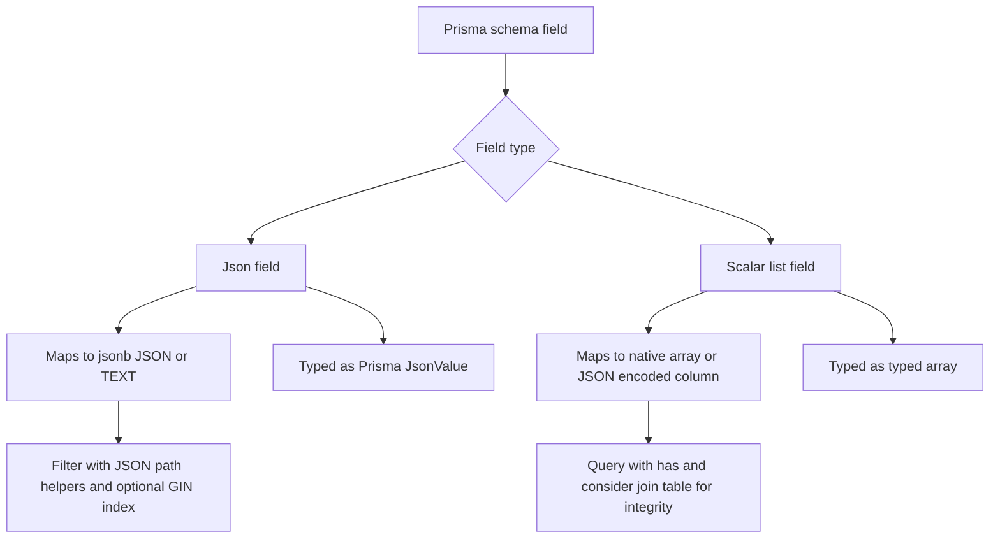

# Prisma's JSON and Scalar List Fields: Storing Flexible Data Without Losing Type Safety

## English

Relational databases are built around fixed columns, but real applications often need to store a blob of semi-structured data — a user's notification preferences, a webhook payload, a set of feature flags. Prisma models this with two field types that go beyond the classic scalar set: `Json` and scalar lists (for example `String[]` or `Int[]`). A `Json` field maps to PostgreSQL's `jsonb`, MySQL's `JSON`, or SQLite's `TEXT` (with Prisma parsing it), and a scalar list maps to a native array column on PostgreSQL or, elsewhere, to a JSON-encoded column that Prisma transparently serialises and deserialises. The key point is that Prisma still types these fields in the generated client: reading a `Json` field gives you a `Prisma.JsonValue`, and writing one requires a value that fits that union, so you cannot accidentally assign a function or a class instance.

The trade-off is that a `Json` column is opaque to the database planner. You can filter on it with Prisma's JSON path helpers — for example `where: { settings: { path: ['theme'], equals: 'dark' } }` — but the query engine has to do more work, and on PostgreSQL you generally want a GIN index on the column to keep those filters fast. Scalar lists have a similar story: querying `where: { tags: { has: 'urgent' } }` is convenient, but it does not replace a proper join table if you need referential integrity, counts across many rows, or the ability to attach metadata to each tag. A list of strings is great for a small, self-contained set of labels; it is a poor fit for anything that behaves like an entity in its own right.

A common mistake is reaching for `Json` because the schema feels awkward to model. If you find yourself querying deep inside a JSON blob, updating one nested key frequently, or needing constraints on the inner shape, that is usually a signal to promote those fields to real columns or a related table. Prisma makes this migration straightforward — you add the columns, write a script that reads the JSON and writes the structured fields, then drop the old field in a follow-up migration — but doing it early is cheaper than doing it after a million rows have accumulated. Think of `Json` as a pressure valve, not a foundation.

There is also a validation gap worth naming. Prisma's type system will tell you that a value is `Json`, but it will not tell you that the JSON has the shape your application expects. A `Json` field can hold `{"theme":"dark"}` today and `{"theme":42}` tomorrow, and both are valid `JsonValue`s. If the shape matters, validate at the boundary — parse the value through a schema validator (Prisma pairs naturally with Zod, which is covered elsewhere in this vault) before trusting it, and consider a database-level `CHECK` constraint if your database supports it. The type safety Prisma gives you stops at the JSON boundary; you have to pick it up on the other side.

Finally, be aware of how these fields interact with `select` and `include`. Selecting a `Json` column pulls the whole document over the wire, which can be surprisingly large if you have stored a full webhook body. If you only need one key, fetch the field and read the key in application code, or use a raw query with the database's own JSON extraction operators when the payload is big. Scalar lists behave more like normal columns but still cost bandwidth proportional to their length. The rule of thumb: structured data in columns, genuinely flexible data in `Json`, and anything you query often in a real table.

## 中文

關聯式資料庫係圍繞固定欄位而建，但真實應用程式經常要儲存一啲半結構化嘅資料——例如使用者嘅通知偏好、webhook 載荷、一組功能開關。Prisma 用兩種超出經典純量型別嘅欄位去建模呢啲情況：`Json` 同純量列表（例如 `String[]` 或 `Int[]`）。`Json` 欄位會對應 PostgreSQL 嘅 `jsonb`、MySQL 嘅 `JSON`，或者 SQLite 嘅 `TEXT`（由 Prisma 負責解析）；純量列表喺 PostgreSQL 會對應原生陣列欄位，喺其他地方就會對應一個由 JSON 編碼嘅欄位，Prisma 會透明咁幫你序列化同反序列化。關鍵係，Prisma 喺生成嘅 client 入面仍然會為呢啲欄位加上型別：讀一個 `Json` 欄位會得到 `Prisma.JsonValue`，寫入時就要求一個符合嗰個聯合型別嘅值，所以你唔會唔小心塞咗個函式或者類別例項入去。

代價係，`Json` 欄位對資料庫嘅查詢規劃器嚟講係不透明嘅。你可以用 Prisma 嘅 JSON 路徑輔助工具去過濾——例如 `where: { settings: { path: ['theme'], equals: 'dark' } }`——但查詢引擎要做多啲功夫，而喺 PostgreSQL 上面，你通常想喺嗰個欄位加個 GIN 索引，令呢啲過濾保持快速。純量列表嘅情況都類似：用 `where: { tags: { has: 'urgent' } }` 去查好方便，但如果你需要參照完整性、跨多行嘅計數，或者想為每個標籤附加額外資料，佢就取代唔到一個正式嘅關聯表。一串字串對於細小、自成一體嘅標籤集合係好嘅；但對於任何本身就似一個實體嘅嘢，就唔係好合適。

一個常見嘅錯誤，係因為覺得 schema 好難建模就改用 `Json`。如果你發現自己經常喺 JSON blob 深處查詢、頻繁更新某個巢狀鍵，或者需要對內部形狀加約束，咁通常就係一個訊號：應該將嗰啲欄位提升做真正嘅欄位或者關聯表。Prisma 令呢個遷移好直接——你加欄位、寫個指令碼讀 JSON 再寫入結構化欄位、然後喺下一次遷移入面刪走舊欄位——但早做平過等一百萬行資料累積咗之後才做。可以把 `Json` 睇成一個洩壓閥，而唔係地基。

仲有個值得講清楚嘅驗證缺口。Prisma 嘅型別系統會話你知一個值係 `Json`，但佢唔會話你知嗰個 JSON 係咪你應用程式期望嘅形狀。一個 `Json` 欄位今日可以裝 `{"theme":"dark"}`，聽日可以裝 `{"theme":42}`，兩者都係合法嘅 `JsonValue`。如果形狀重要，就要喺邊界驗證——喺信任個值之前，用 schema 驗證器（Prisma 同 Zod 好夾，本 vault 另有篇章講）解析一次，如果資料庫支援，可以考慮加個資料庫層面嘅 `CHECK` 約束。Prisma 俾你嘅型別安全喺 JSON 邊界就停咗；另一邊要你自己接返。

最後，要留意呢啲欄位同 `select`、`include` 點樣互動。選取一個 `Json` 欄位會將成份檔案拉過網路，如果你存咗成個 webhook body，體積可以好驚人。如果你只需要一個鍵，可以只取嗰個欄位再喺應用程式碼讀個鍵，或者當載荷好大時，用 raw query 配合資料庫自己嘅 JSON 抽取運運算元。純量列表嘅行為比較似普通欄位，但頻寬成本仍然同長度成正比。經驗法則：結構化資料放欄位，真正有彈性嘅資料放 `Json`，而你經常查詢嘅任何嘢就放返喺真正嘅表。

## Key Takeaway

Use Json and scalar lists as a pressure valve for genuinely flexible data, not as a shortcut around proper modelling — and remember that Prisma's type safety stops at the JSON boundary.

## Related Concepts
- Prisma's Data Validation with Zod
- Select vs Include: Shaping What Comes Back from the Database

## Diagram

