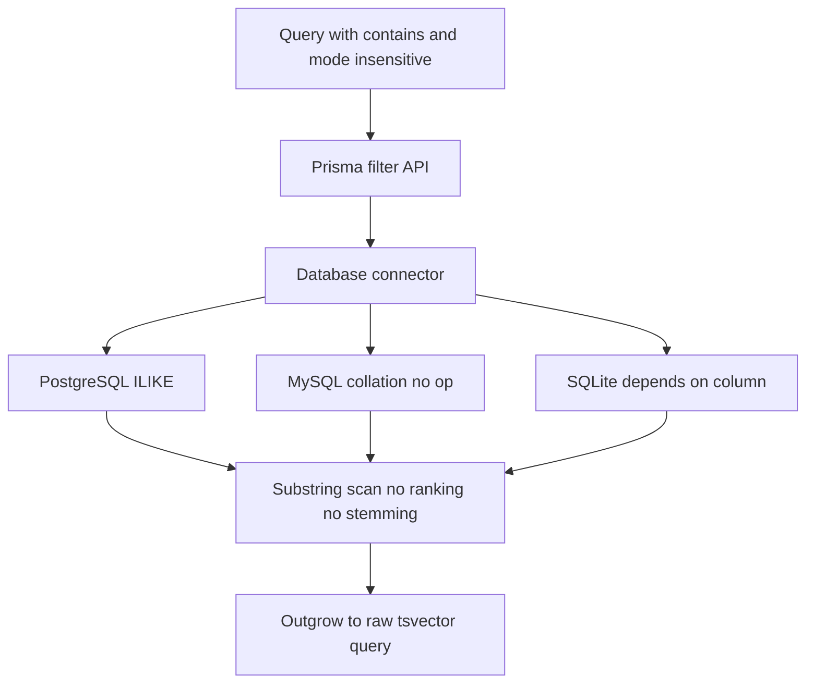

# Full-Text Search and Case-Insensitive Filtering: What Prisma Gives You and Where It Stops

## English

Sooner or later every application needs to search. Prisma's filter API covers the basics well: `contains`, `startsWith`, `endsWith`, and `mode: 'insensitive'` let you write `where: { title: { contains: 'prisma', mode: 'insensitive' } }` and get a sensible result on PostgreSQL, where this compiles to an `ILIKE` comparison. On MySQL the collation usually handles case-insensitivity already, so `mode` is often a no-op or unsupported depending on the connector. On SQLite the behaviour depends on how the column was declared. This is a good example of Prisma's general philosophy: the API is uniform, but the underlying SQL is whatever your database does, and the differences leak through in subtle ways.

The important limitation is that `contains` is a substring match, not a search engine. It cannot rank results by relevance, it cannot stem words (so searching 'running' will not match 'run'), it does not understand phrase queries or boolean operators, and on a large table a leading-wildcard `ILIKE '%term%'` cannot use a normal B-tree index — the database has to scan. For a few thousand rows this is fine. For a few million it is a performance cliff, and no amount of Prisma configuration fixes it, because the limitation lives in the query plan, not the ORM.

When you outgrow `contains`, the usual move is to lean on the database's native full-text capabilities. PostgreSQL has `tsvector` and `tsquery` with GIN indexes; you add a generated column or a trigger-maintained column, index it, and then query it. Prisma does not have a first-class `search` filter for every connector, so you typically express this as a raw query — `$queryRaw` with a parameterised `to_tsvector(...) @@ to_tsquery(...)` — and you can keep type safety by using TypedSQL, which lets you write SQL in a file and have Prisma generate typed functions from it. The result is a hybrid: Prisma Client for the 95% of queries that are ordinary CRUD, and a small, well-tested pocket of raw SQL for the search path.

A second option is to move search out of the database entirely. Dedicated search engines — Elasticsearch, OpenSearch, Meilisearch, Typesense — index your data separately and are purpose-built for ranking, typo tolerance, and faceting. The pattern is to write to your database through Prisma as usual, then propagate changes to the search index, either synchronously in the same request (simple but adds latency and a failure mode) or asynchronously via an outbox table or a change-data-capture stream (more moving parts, but resilient). Prisma does not manage this for you; it is an architectural decision, and the right answer depends on how much search quality matters to your product.

A practical middle path for small projects is to keep the search column denormalised: store a lowercased, concatenated copy of the searchable fields in a `String` column, index it, and query it with `contains` plus `mode: 'insensitive'`. This is cheap, portable across databases, and good enough for admin panels and small catalogues. The moment you need ranking, stemming, or fuzzy matching, though, you have outgrown it. Knowing where that line is — and being honest about it early — saves a painful rewrite later.

## 中文

每個應用程式遲早都需要搜尋。Prisma 嘅過濾 API 喺基礎層面覆蓋得幾好：`contains`、`startsWith`、`endsWith`，同埋 `mode: 'insensitive'`，令你可以寫 `where: { title: { contains: 'prisma', mode: 'insensitive' } }`，喺 PostgreSQL 上面得到合理嘅結果——呢句會編譯成 `ILIKE` 比較。喺 MySQL 上面，排序規則（collation）通常已經處理咗大小寫不敏感，所以 `mode` 好多時係無作用，或者視乎 connector 而唔支援。喺 SQLite 上面，行為就取決於欄位點樣宣告。呢個正好係 Prisma 整體哲學嘅好例子：API 統一，但底層 SQL 就係你資料庫本身做嘅嘢，而差異會喺微妙嘅地方滲出嚟。

最重要嘅限制係：`contains` 係子字串匹配，唔係搜尋引擎。佢唔可以按相關性排名，唔可以做詞幹分析（所以搜 'running' 唔會匹配 'run'），唔識短語查詢或者布林運運算元，而喺大表上面，前置萬用字元嘅 `ILIKE '%term%'` 用唔到普通 B-tree 索引——資料庫唯有做全表掃描。幾千行冇問題；幾百萬行就係效能懸崖，而且幾多 Prisma 設定都救唔到，因為限制係喺查詢計劃度，唔係喺 ORM 度。

當 `contains` 唔夠用，通常嘅做法係藉助資料庫原生嘅全文檢索能力。PostgreSQL 有 `tsvector` 同 `tsquery`，配 GIN 索引；你加一個生成欄位或者由觸發器維護嘅欄位、加索引，然後查詢佢。Prisma 並唔係每個 connector 都有第一級嘅 `search` 過濾器，所以通常要用 raw query 表達——用 `$queryRaw` 配引數化嘅 `to_tsvector(...) @@ to_tsquery(...)`——而你可以用 TypedSQL 保持型別安全，佢讓你喺檔案入面寫 SQL，再由 Prisma 生成有型別嘅函式。結果係一個混合體：日常 CRUD 嗰 95% 查詢用 Prisma Client，搜尋路徑就用一小塊寫得好、測試充足嘅 raw SQL。

第二個選擇係將搜尋完全移出資料庫。專用搜尋引擎——Elasticsearch、OpenSearch、Meilisearch、Typesense——會另外索引你嘅資料，專為排名、錯字容忍同分面搜尋而設。模式係：照常用 Prisma 寫入資料庫，然後將變更傳播去搜尋索引，可以喺同一個請求入面同步做（簡單，但增加延遲同多一個失敗模式），或者透過 outbox 表或變更資料擷取（CDC）串流非同步做（元件多啲，但更穩健）。Prisma 唔會幫你管理呢啲；呢個係架構決定，而正確答案取決於搜尋質素對你產品有幾重要。

對細專案嚟講，一個實用嘅中間路線係保留一個反正規化嘅搜尋欄位：將可搜尋欄位轉細寫、串接埋，存喺一個 `String` 欄位，加索引，然後用 `contains` 加 `mode: 'insensitive'` 去查。呢個做法便宜、跨資料庫通用，對於管理後臺同小型目錄已經夠用。但一旦你需要排名、詞幹分析或者模糊匹配，就已經超出佢嘅能力。知道條線喺邊——同埋早啲老實面對——可以省卻日後痛苦嘅重寫。

## Key Takeaway

Prisma's contains filter is a substring match, not a search engine; when you need ranking, stemming or fuzzy matching, reach for native full-text indexes via TypedSQL or a dedicated search engine.

## Related Concepts
- TypedSQL and Raw Queries: Escaping the ORM Without Losing Type Safety
- Query Performance: The N+1 Problem, Join Strategies and Bulk Writes

## Diagram

