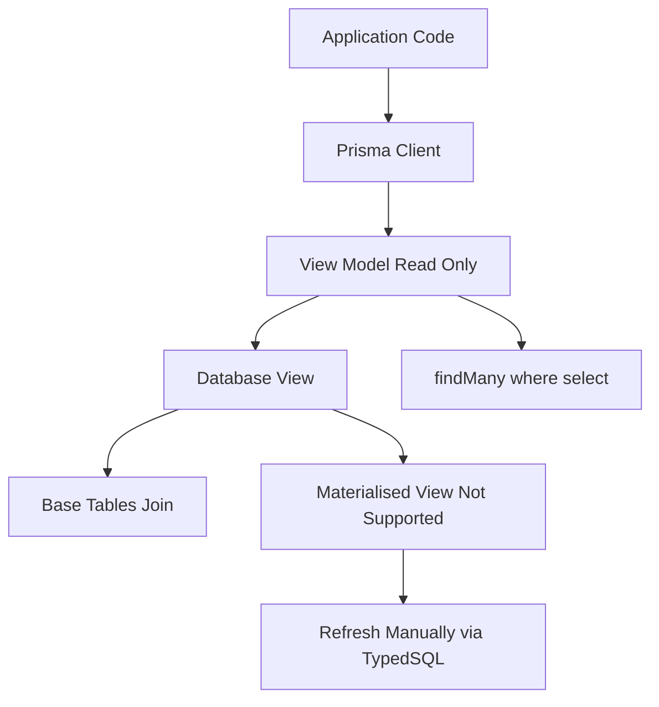

# Prisma and Database Views, Materialised Views and Read-Only Models

## English

Not every table in your database is something your application owns. Reporting queries, denormalised summaries, and legacy tables often live alongside your Prisma-managed schema, and Prisma has a specific answer for them: the `view` block in the schema, which lets you describe a database view and query it through Prisma Client with full type safety. A view is a stored query that behaves like a table — you select from it, and it returns rows — and Prisma treats it as a read-only model. You can run `findMany`, `findUnique`, `where` filters and `select` against it, but you cannot `create`, `update` or `delete` through it, because a view has no rows of its own to modify. One caveat comes first: support for views is still a Preview feature, so you must opt in by adding `views` to the `previewFeatures` list in your `generator` block, and the feature may still change between Prisma releases. A second caveat shapes what you can query. Because a view is a virtual table, it has no inherent primary key, so you cannot put `@id` or `@@id` on a `view` block — and `findUnique` requires a uniqueness attribute, which for views means an explicit `@unique` that the database does not actually enforce. Any `@unique` you declare on a view is advisory: it exists so Prisma can enable `findUnique` and cursor-based pagination, not because the database will reject a duplicate.

The practical value is that a view can encapsulate a complicated join. Imagine an `active_customers_with_revenue` view that joins customers, orders and payments and aggregates the totals. Without a view, every report would need the same multi-table query, duplicated across the codebase and prone to drift. With a view, you declare it once in SQL, describe it in the Prisma schema, and then your reporting code reads `prisma.activeCustomersWithRevenue.findMany({ where: { revenue: { gt: 1000 } } })`. The complexity stays in the database where it belongs, and the application code stays simple and typed.

Materialised views take this further. A regular view is recomputed every time you query it, so a heavy aggregation can be slow; a materialised view stores the result on disk and must be refreshed explicitly (in PostgreSQL, `REFRESH MATERIALIZED VIEW`, optionally `CONCURRENTLY` to avoid blocking reads). The trade-off is freshness versus speed: a materialised view is fast to read but can be stale, and the application must tolerate that. For dashboards and analytics this is usually exactly the right trade. Here Prisma draws a line, though: Prisma ORM does not support materialised views. You can create the materialised view in the underlying database yourself, but Prisma cannot describe it as a first-class view block, and there is no client method to refresh it. The documented workaround is to run the refresh through Prisma Client's TypedSQL functionality, and to schedule that yourself — a task, a cron job, or a trigger at the end of a batch job. This is a good example of a preview feature's boundary: the ordinary view case is well supported, and the materialised variant is left to you and your scheduler.

There is a subtlety around migrations. Because Prisma Migrate compares your schema to the database, and Prisma Migrate does not create or run any SQL related to views, the usual pattern is to create and alter views with hand-written SQL migrations — you run `migrate dev --create-only` to generate an empty migration and paste the `CREATE VIEW` statement in, so it is version-controlled alongside everything else. This keeps the view definition in the same migration history as the tables it depends on, which matters when a column it references is renamed or dropped. If you skip this and create the view manually, your schema and your database will drift, and the next `migrate dev` will be confusing.

Finally, treat read-only models as a boundary marker. If a table is genuinely owned by another service — a shared lookup table, a table written by a legacy system — you can still describe it in Prisma and query it, but you should resist writing to it from your application, because the other owner does not know about your constraints. Prisma's type system will happily let you call `update` on a model that maps to a foreign table; discipline, code review, and database permissions are what stop you. The schema is a description of reality, not a grant of authority.

## 中文

你資料庫入面唔係每一張表都係你應用程式擁有嘅。報表查詢、反正規化摘要，同埋遺留系統嘅表，經常同 Prisma 管理嘅 schema 並存，而 Prisma 對呢啲有一個特定答案：schema 入面嘅 `view` 區塊，讓你描述一個資料庫檢視（view），再透過 Prisma Client 以完整型別安全去查詢。檢視係一個儲存咗嘅查詢，行為好似一張表——你由佢選取，佢回傳行——而 Prisma 會當佢係一個唯讀模型。你可以對佢行 `findMany`、`findUnique`、`where` 過濾同 `select`，但你唔可以透過佢 `create`、`update` 或 `delete`，因為檢視本身冇自己嘅行可以改。不過有一個前提要先講：檢視支援到今日仍然係 Preview 功能，你要喺 `generator` 區塊嘅 `previewFeatures` 清單加入 `views` 先可以啟用，而且呢個功能喺 Prisma 各個版本之間仍可能改變。仲有第二個前提會影響你可以查詢啲乜。因為檢視係虛擬table，本身冇內建主鍵，所以喺 `view` 區塊唔可以寫 `@id` 或 `@@id`——而 `findUnique` 需要一個唯一性屬性，對檢視嚟講就意味住一個明確宣告、但資料庫其實唔會執行嘅 `@unique`。你喺檢視上宣告嘅任何 `@unique` 都只係建議性質：佢存在係為咗令 Prisma 可以啟用 `findUnique` 同游標分頁，而唔係因為資料庫會拒絕重複值。

實際價值在於，檢視可以封裝一個複雜嘅 join。想像一個 `active_customers_with_revenue` 檢視，join 客戶、訂單同付款，再聚合總額。冇檢視嘅話，每份報表都要重複同一個多表查詢，喺成個 codebase 散開，容易走樣。有檢視嘅話，你喺 SQL 宣告一次、喺 Prisma schema 描述一次，然後報表程式碼就讀 `prisma.activeCustomersWithRevenue.findMany({ where: { revenue: { gt: 1000 } } })`。複雜性留喺資料庫——佢本應喺嘅地方——而應用程式碼保持簡單同有型別。

物化檢視（materialised view）更進一步。普通檢視每次查詢都重新計算，所以重嘅聚合可以好慢；物化檢視將結果存喺磁碟，要明確刷新（喺 PostgreSQL 係 `REFRESH MATERIALIZED VIEW`，可以加 `CONCURRENTLY` 避免阻塞讀取）。代價係新鮮度對速度：物化檢視讀得快但可能過時，應用程式要容忍呢點。對於儀表板同分析嚟講，呢個通常正正係正確嘅取捨。不過喺呢度 Prisma 劃咗一條線：Prisma ORM 唔支援物化檢視。你可以自己喺底層資料庫建立物化檢視，但 Prisma 冇辦法將佢描述成一個第一級嘅 view block，client 亦冇刷新佢嘅方法。官方建議嘅做法係用 Prisma Client 嘅 TypedSQL 功能去執行刷新，而且要你自己排程——一個工作、一個 cron job，或者喺批次工作完結時觸發。呢個正正體現咗 Preview 功能嘅邊界：普通檢視嗰種情況支援得好，物化變體就交返俾你同你嘅排程器。

遷移方面有個微妙之處。因為 Prisma Migrate 會比較你嘅 schema 同資料庫，而 Prisma Migrate 其實唔會為檢視建立或執行任何 SQL，所以通常嘅模式係用手寫 SQL 遷移去建立同修改檢視——你行 `migrate dev --create-only` 生成一個空遷移，貼入 `CREATE VIEW` 語句，咁佢就連同其他嘢一齊納入版本控制。咁樣檢視定義就同佢依賴嘅表喺同一段遷移歷史入面，當佢引用嘅欄位被改名或者刪除時，呢點好重要。如果你跳過呢步、手動建立檢視，你嘅 schema 同資料庫就會漂移，下一次 `migrate dev` 就會令人困惑。

最後，將唯讀模型視為一個邊界標記。如果一張表真係屬於另一個服務——一個共用查閱表、一張由遺留系統寫入嘅表——你仍然可以喺 Prisma 描述佢同查詢佢，但你應該克制，唔好由你嘅應用程式寫入去，因為另一個擁有者唔知道你嘅約束。Prisma 嘅型別系統會好樂意讓你對一個映射到外部表嘅模型呼叫 `update`；阻止你嘅係紀律、程式碼審查同資料庫權限。Schema 係對現實嘅描述，唔係授權書。

## Key Takeaway

Prisma's view blocks (still a Preview feature, so opt in with `previewFeatures = ["views"]`) let you query database views with full type safety, but they are read-only by design and materialised views are not supported — create and alter views through hand-written SQL migrations so they stay in sync with the tables they depend on.

## Related Concepts
- Prisma and the Database User: Roles, Permissions and Least Privilege
- The Prisma Schema Language vs SQL DDL: What Maps and What Does Not

## Diagram

