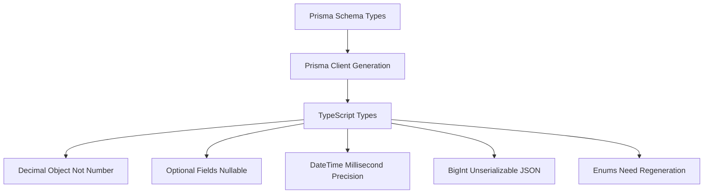

# Prisma Types at Runtime: Decimal, BigInt, DateTime and JSON Gotchas

## English

Prisma's schema language has its own type system (Int, BigInt, Float, Decimal, String, Boolean, DateTime, Json, Bytes, and enums), and Prisma Client generates TypeScript types from it. Most of the time the mapping is obvious, but there are edges where the two systems genuinely disagree, and understanding them prevents subtle bugs. The clearest example is `Decimal`. In the schema it maps to a fixed-precision numeric column (for example `DECIMAL(65,30)` on PostgreSQL), and in TypeScript it becomes a `Prisma.Decimal` object, not a JavaScript `number`. That is deliberate: JavaScript numbers are IEEE-754 doubles and cannot represent money exactly. If you do `total + item.price` where `price` is a Decimal, you get string concatenation or a runtime error, not arithmetic. You must call `.plus()`, `.times()`, or convert with `.toNumber()` when you know the precision is safe.

A second disagreement is nullability. In Prisma, a field is required unless you write `?`, and optional fields generate `string | null`. But the database may still contain NULLs in a column you declared required if the schema drifted, so the generated type is a promise the database does not independently enforce. Similarly, `DateTime` maps to a JavaScript `Date`, which has millisecond precision, while PostgreSQL `timestamp` can hold microseconds. Round-tripping a value can silently truncate. `BigInt` maps to JavaScript `bigint`, which JSON.stringify cannot serialise by default, so an API response containing a BigInt will throw unless you handle it.

A third area is enums. Prisma enums generate TypeScript union types and a runtime object, which is convenient, but adding a new enum value is a migration, and the generated client must be regenerated before TypeScript knows about it. If you deploy the new client before the migration runs, or vice versa, you get a mismatch that only appears at runtime. This is the same class of problem as any schema/client version skew, but enums make it especially visible because the value is embedded in application code.

Finally, JSON fields are typed as `Prisma.JsonValue`, a recursive union that includes `null`, arrays, and objects. That is accurate but not useful: it does not know your JSON shape. If you want real type safety for JSON columns, you need a validation layer (for example Zod) at the boundary. The lesson is that Prisma's generated types describe what the client believes the database looks like, not what it actually contains. Treat them as a strong contract, not an absolute guarantee, and validate at the edges where user input or external data enters.

In practice, the disagreements cluster around precision (Decimal, BigInt, DateTime), nullability, and structured data (JSON, enums). Knowing them lets you choose the right field type at schema design time instead of discovering the problem in production when a total is off by a cent or a serialisation call throws.

## 中文

Prisma 的 schema 語言有自己一套型別系統（Int、BigInt、Float、Decimal、String、Boolean、DateTime、Json、Bytes 以及 enum），Prisma Client 會據此產生 TypeScript 型別。大多數情況下兩者的對應很直觀，但有些邊界地帶兩套系統確實會有意見分歧，理解這些分歧可以避免微妙的 bug。最清楚的例子是 `Decimal`。在 schema 中它對應固定精度的數值欄位（例如 PostgreSQL 的 `DECIMAL(65,30)`），在 TypeScript 中則變成 `Prisma.Decimal` 物件，而不是 JavaScript 的 `number`。這是刻意的：JavaScript 的 number 是 IEEE-754 雙精度浮點，無法精確表示金錢。如果你寫 `total + item.price` 而 `price` 是 Decimal，你會得到字串串接或執行期錯誤，而不是算術運算。你必須呼叫 `.plus()`、`.times()`，或在確定精度安全時用 `.toNumber()` 轉換。

第二個分歧是可為空性。在 Prisma 中，欄位除非寫 `?` 否則就是必填，可選欄位會產生 `string | null`。但資料庫中你宣告為必填的欄位仍可能含 NULL（如果 schema 漂移了），所以產生的型別只是承諾，資料庫本身並不獨立強制。同樣地，`DateTime` 對應 JavaScript 的 `Date`，只有毫秒精度，而 PostgreSQL 的 `timestamp` 可以存到微秒。值來回轉換可能悄悄截斷。`BigInt` 對應 JavaScript 的 `bigint`，而 `JSON.stringify` 預設無法序列化它，所以包含 BigInt 的 API 回應會拋錯，除非你處理。

第三個領域是 enum。Prisma enum 會產生 TypeScript 聯合型別和一個執行期物件，很方便，但新增 enum 值是一次遷移，而且必須重新產生 client，TypeScript 才會知道。如果你在新遷移執行前就部署了新 client，或反之，就會出現只在執行期才顯現的不匹配。這和任何 schema／client 版本錯位是同一類問題，但 enum 讓它特別明顯，因為值嵌入在應用程式碼中。

最後，JSON 欄位被型別化為 `Prisma.JsonValue`，一個遞迴聯合型別，包含 `null`、陣列和物件。這很準確但沒什麼用：它不知道你的 JSON 形狀。若想要 JSON 欄位真正的型別安全，你需要在邊界加一層驗證（例如 Zod）。教訓是：Prisma 產生的型別描述的是 client 相信資料庫長什麼樣，而不是它實際含有什麼。把它們當作強契約，而非絕對保證，並在使用者輸入或外部資料進入的邊緣做驗證。

實務上，分歧集中在精度（Decimal、BigInt、DateTime）、可為空性，以及結構化資料（JSON、enum）。了解它們讓你在 schema 設計時就選對欄位型別，而不是在生產環境發現總額差了一分錢或序列化呼叫拋錯。

## Key Takeaway

Prisma's generated TypeScript types are a strong contract but not a guarantee — Decimal, BigInt, DateTime, JSON and enums are where the two type systems genuinely diverge, so design for precision and validate at the edges.

## Related Concepts
- Decimal precision in databases
- TypeScript structural typing

## Diagram

