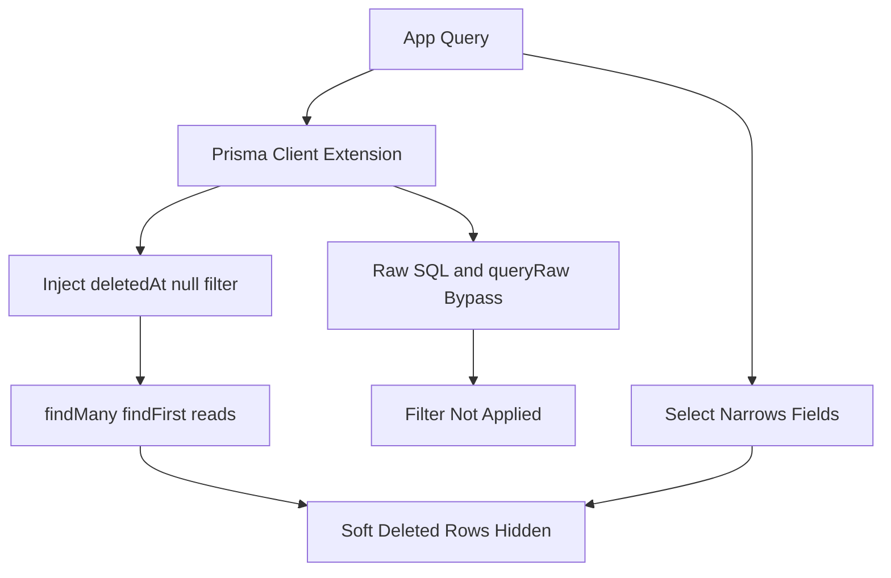

# Soft Deletes and Partial Selects: Schema-Level Patterns That Change How You Query

## English

Some of the most useful Prisma patterns are not features of the ORM at all — they are conventions you build on top of the schema. Soft deletes are the classic example. Instead of removing a row, you add a nullable `deletedAt DateTime?` column and set it to the current time. The row stays, so foreign keys, audit trails, and historical reports keep working. But now every query must remember to filter `where: { deletedAt: null }`, and forgetting once leaks deleted records into your UI. The usual fix is a Prisma Client extension (the modern replacement for middleware) that intercepts `findMany`, `findFirst`, and similar reads and injects the filter automatically, plus a `$extends` that renames `delete` to a soft-delete operation. The trade-off is that raw SQL, `$queryRaw`, and any code path that bypasses the client will not get the filter, so soft deletes are a discipline as much as a feature.

Partial selects are the other half of the story. By default, `findMany` returns every scalar column, which is wasteful when a table has a large `body` text column or a `Bytes` blob. The `select` option lets you name exactly the fields you want, and the generated TypeScript type narrows accordingly — you get a type with only those keys, so the compiler catches any code that assumes a field you did not fetch. `include` is different: it loads relations and returns the full model plus the related models. Mixing `select` and `include` at the same level is not allowed; you pick one shape per query. This is a small constraint that forces you to think about what the caller actually needs.

There is a subtle interaction with relations. If you `select` a relation, you must also specify what fields of that relation to return, or use `include` to get the whole thing. Nested selects compose, so you can fetch a user with only `id` and `email`, and their posts with only `title` and `publishedAt`. That is powerful for API responses that should not leak internal columns like password hashes or internal flags. It also means the shape of your API is expressed in the query, not in a separate serialiser, which reduces the chance of accidentally exposing a field.

Both patterns interact with migrations and indexes. A soft-delete column should usually be indexed together with the columns you filter on, otherwise `WHERE deletedAt IS NULL` becomes a full scan on large tables. Partial indexes (for example `CREATE INDEX ... WHERE deleted_at IS NULL`) are a database feature Prisma does not model directly in the schema, so you add them via a manual migration. Similarly, selecting fewer columns does not reduce the number of rows scanned, only the bytes transferred, so partial selects help most when wide columns are involved.

The takeaway is that Prisma gives you primitives — nullable columns, `select`, `include`, extensions — and the patterns you build from them (soft delete, projection, audit columns) are where real application design happens. Know which parts are enforced by the client and which are conventions that raw SQL can bypass.

## 中文

有些最有用的 Prisma 模式其實根本不是 ORM 的功能，而是你建立在 schema 之上的慣例。軟刪除是經典例子。你不刪除資料列，而是加一個可為空的 `deletedAt DateTime?` 欄位並設為當前時間。資料列留著，所以外鍵、稽核軌跡和歷史報表繼續運作。但現在每個查詢都必須記得過濾 `where: { deletedAt: null }`，忘了一次就會讓已刪除的記錄洩漏到 UI。常見的解法是 Prisma Client extension（middleware 的現代替代品），攔截 `findMany`、`findFirst` 等讀取並自動注入過濾條件，再用 `$extends` 把 `delete` 重新命名為軟刪除操作。代價是原始 SQL、`$queryRaw` 以及任何繞過 client 的程式路徑不會套用過濾，所以軟刪除既是功能也是紀律。

部分選取是故事的另一半。預設 `findMany` 回傳每個純量欄位，當表有大型 `body` 文字欄位或 `Bytes` blob 時很浪費。`select` 選項讓你精確指定要的欄位，產生的 TypeScript 型別也相應收窄——你得到只有那些鍵的型別，所以編譯器會抓到任何假設了你沒抓的欄位的程式碼。`include` 不同：它載入關聯並回傳完整模型加上關聯模型。同一層混用 `select` 和 `include` 是不允許的；每個查詢選一種形狀。這個小限制強迫你思考呼叫者真正需要什麼。

與關聯有一個微妙的互動。如果你 `select` 一個關聯，你也必須指定該關聯要回傳哪些欄位，或用 `include` 取得整個。巢狀 select 可以組合，所以你可以只抓使用者的 `id` 和 `email`，以及他們貼文的 `title` 和 `publishedAt`。這對不該洩漏密碼雜湊或內部旗標等內部欄位的 API 回應很強大。它也意味著 API 的形狀表達在查詢中，而不是另一個序列化器，減少意外暴露欄位的機會。

兩個模式都與遷移和索引互動。軟刪除欄位通常應與你過濾的欄位一起建索引，否則 `WHERE deletedAt IS NULL` 在大表上會變成全表掃描。部分索引（例如 `CREATE INDEX ... WHERE deleted_at IS NULL`）是 Prisma 不在 schema 中直接建模的資料庫功能，所以要透過手動遷移加入。同樣地，選較少欄位不會減少掃描的資料列數，只減少傳輸的位元組，所以部分選取在涉及寬欄位時最有幫助。

重點是 Prisma 給你原語——可為空欄位、`select`、`include`、extension——而你從它們建立的模式（軟刪除、投影、稽核欄位）才是真正應用設計所在。要知道哪些部分由 client 強制，哪些是原始 SQL 可以繞過的慣例。

## Key Takeaway

Soft deletes and partial selects are conventions built on Prisma primitives, not ORM features — the client enforces them only on the paths that go through it, so treat them as discipline plus database-level support like partial indexes.

## Related Concepts
- Prisma Client extensions
- Partial indexes in SQL

## Diagram

