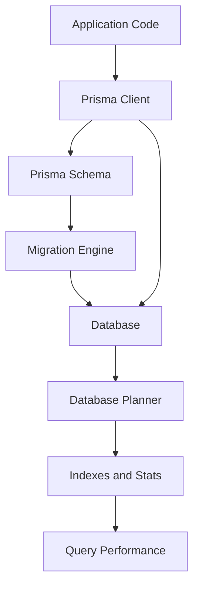

# Prisma's Ecosystem Boundary: What It Deliberately Does Not Do

## English

Prisma is often described as an ORM, but that label hides as much as it reveals. It is a set of tools: a schema language, a migration engine, a query client, and a studio. It is not a database, not a connection pooler, not a caching layer (Accelerate is a separate product), and not a full application framework. Knowing the boundary matters because a lot of production pain comes from expecting Prisma to do something it was never designed to do. For example, Prisma does not manage database users, roles, or permissions — that is your database's job, and Prisma connects as whatever user you give it. It does not do point-in-time recovery, backups, or replication; those are infrastructure concerns. It does not route reads to replicas by itself; you either configure a read-replica URL or use a driver adapter with your own routing logic.

On the query side, Prisma is not a query optimiser in the database sense. It translates your client calls into SQL and lets the database plan them. That means the quality of your indexes, the statistics the planner has, and the shape of your queries (N+1, missing joins) still determine performance. Prisma can help — `select` reduces columns, `include` can be replaced with `relationLoadStrategy: 'join'` in some setups to avoid N+1 — but it cannot fix a missing index or a badly modelled schema. Similarly, Prisma's full-text search support is limited: it exposes `contains`, `startsWith`, and `mode: 'insensitive'` for case-insensitive matching, but true full-text search (PostgreSQL `tsvector`, ranking, stemming) requires raw SQL or a database-specific extension. Prisma does not pretend otherwise, and that honesty is a feature.

Prisma is also not a validation framework. The schema enforces types and some constraints at the database level, but business rules (an email must be unique across tenants, an order total must match its line items) belong in your application or in database constraints you add via migrations. Zod or a similar library is the usual companion. And Prisma is not an authorisation system: row-level security, tenant isolation, and field-level access control are patterns you implement, often with extensions or by scoping every query.

The boundary extends to the runtime. Prisma Client is a generated artefact that ships with your application; it is not a service you call over the network (unless you use Accelerate). That means cold starts, bundle size, and version skew between client and database are your problems, not Prisma's. It also means you can run Prisma anywhere Node runs, including serverless and edge runtimes, provided you use a compatible driver adapter.

Finally, the ecosystem boundary is not a criticism. Every tool has a scope, and Prisma's scope is deliberately narrow: model the data, generate a typed client, manage migrations, and get out of the way. The teams that succeed with Prisma are the ones that pair it with the right neighbours — a migration-safe database, a validation library, a connection pooler for serverless, and observability for slow queries — rather than asking the ORM to be all of those things.

## 中文

Prisma 常被描述為一個 ORM，但這個標籤掩蓋的和揭示的一樣多。它是一組工具：一個 schema 語言、一個遷移引擎、一個查詢 client，和一個 studio。它不是資料庫、不是連線池、不是快取層（Accelerate 是獨立產品），也不是完整的應用框架。了解這條邊界很重要，因為很多生產環境的痛苦來自期待 Prisma 做它從未被設計去做的事。例如 Prisma 不管理資料庫使用者、角色或權限——那是資料庫的職責，Prisma 以你給它的使用者身分連線。它不做時間點復原、備份或複寫；那些是基礎設施關注點。它本身不把讀取路由到複本；你要嘛設定讀取複本 URL，要嘛用 driver adapter 搭配自己的路由邏輯。

在查詢方面，Prisma 不是資料庫意義上的查詢優化器。它把你的 client 呼叫翻譯成 SQL，讓資料庫去規劃。那意味著索引品質、規劃器有的統計資訊，以及查詢形狀（N+1、缺少 join）仍然決定效能。Prisma 可以幫忙——`select` 減少欄位，在某些設定下可以用 `relationLoadStrategy: 'join'` 取代 `include` 以避免 N+1——但它無法修復缺少的索引或建模不良的 schema。同樣地，Prisma 的全文搜尋支援有限：它暴露 `contains`、`startsWith` 和 `mode: 'insensitive'` 做大小寫不敏感匹配，但真正的全文搜尋（PostgreSQL 的 `tsvector`、排名、詞幹化）需要原始 SQL 或資料庫特定擴充。Prisma 不假裝不然，這種誠實是優點。

Prisma 也不是驗證框架。schema 在資料庫層強制型別和某些約束，但業務規則（電子郵件在租戶間必須唯一、訂單總額必須匹配其明細）屬於你的應用程式，或屬於你透過遷移加入的資料庫約束。Zod 或類似函式庫是常見搭檔。而 Prisma 不是授權系統：列級安全、租戶隔離和欄位級存取控制是你實作的模式，通常用 extension 或透過限定每個查詢來達成。

邊界延伸到執行期。Prisma Client 是隨應用程式出貨的產生 artefact；它不是你在網路上呼叫的服務（除非你用 Accelerate）。那意味著冷啟動、bundle 大小，以及 client 與資料庫之間的版本錯位是你的問題，不是 Prisma 的。它也意味著你可以在任何 Node 執行的地方執行 Prisma，包括 serverless 和 edge runtime，前提是你用相容的 driver adapter。

最後，生態邊界不是批評。每個工具都有範圍，而 Prisma 的範圍刻意狹窄：建模資料、產生型別化 client、管理遷移，然後讓開。成功使用 Prisma 的團隊是那些把它與正確的鄰居配對的團隊——一個遷移安全的資料庫、一個驗證函式庫、一個給 serverless 的連線池，以及給慢查詢的可觀測性——而不是要求 ORM 成為所有那些東西。

## Key Takeaway

Prisma is a narrow, honest tool — schema, migrations, typed client, studio — and production success comes from pairing it with the right neighbours (validation, pooling, observability, database constraints) rather than expecting it to be a framework.

## Related Concepts
- Database connection poolers
- Application-layer validation

## Diagram

