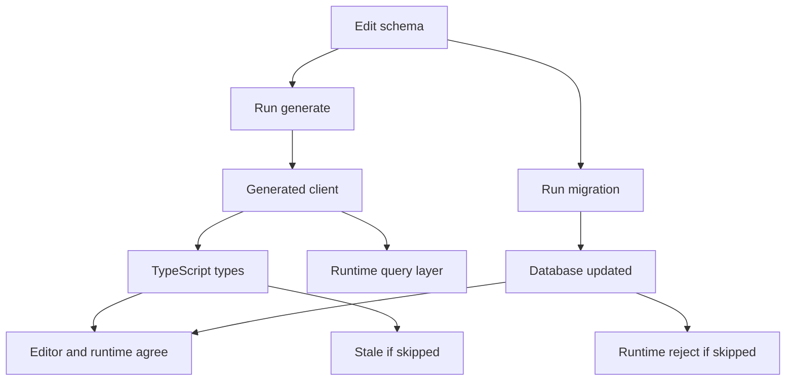

# Prisma's Generated Client and the Art of the Regeneration Loop

## English

One of the least discussed but most consequential aspects of Prisma is the regeneration loop: the cycle of editing the schema, running a command to regenerate the client, and then having your TypeScript code reflect the new shape. The generated client lives in a directory (by default under node_modules/.prisma/client, with an alias exported from @prisma/client) and is, in effect, a piece of build output. Every time you change a model, a field, an enum, or a relation, you must regenerate the client before your editor and runtime agree on what exists. This is why the Prisma CLI exposes a generate command, and why many teams wire it into a postinstall hook or a dev script so it runs automatically after installing dependencies or after a migration.

The subtlety is that the generated client is not a source file you should edit, commit, or reason about as hand-written code. It is a projection of the schema into TypeScript types plus a runtime layer that knows how to translate method calls into queries. If you skip regeneration, you get the classic symptom: your schema says a column exists, but your editor red-flags it because the types on disk are stale. Conversely, if you regenerate but forget to run the migration, your types are correct but the database rejects the query at runtime. The two artefacts — the migration that changes the database and the client that changes your types — must move together.

In a monorepo or a CI pipeline this matters even more. The generated client is a dependency of every package that imports it, so caching strategies and lockfiles need to account for it. A common pattern is to treat generation as part of the build step: run it once at the top of the pipeline, then let downstream tasks consume the output. Editors like VS Code sometimes need a TypeScript server restart to pick up regenerated types, which is why you occasionally see engineers close and reopen the file or run a command to reload the window after a schema change.

A useful mental model is that the schema is the source of truth and the client is a compiled artefact, much like a .js file produced by tsc from a .ts file. You would not hand-edit the .js output, and you would not expect changes to the .ts source to appear in the .js without a compile step. Prisma's generate command is that compile step, and treating it as such — running it deliberately, caching its output, and understanding its lifecycle — saves a lot of confusion.

## 中文

Prisma 其中一個最少人討論、但影響最深遠的環節，就是「重新生成迴圈」：修改 schema、執行指令重新生成 client、然後讓 TypeScript 程式碼反映新的形狀。生成的 client 放在一個目錄裡（預設在 node_modules/.prisma/client，並由 @prisma/client 匯出一個別名），本質上是一份建置產物。每次你改動 model、欄位、enum 或關聯，都必須先重新生成 client，編輯器和執行環境才會對「什麼存在」達成一致。這就是為什麼 Prisma CLI 提供 generate 指令，也是為什麼許多團隊把它接進 postinstall hook 或 dev script，讓它在安裝依賴或跑完遷移後自動執行。

微妙之處在於：生成的 client 不是你應該手動編輯、提交、或當成手寫程式碼來推理的原始碼檔案。它是 schema 投射到 TypeScript 型別的一層，再加上一層知道如何把方法呼叫翻譯成查詢的執行時層。如果你跳過重新生成，就會出現經典症狀：schema 說某欄位存在，但編輯器對它畫紅線，因為磁碟上的型別是舊的。反過來說，如果你重新生成了卻忘了跑遷移，型別是對的，但執行時資料庫會拒絕查詢。兩個產物——改變資料庫的遷移、改變你型別的 client——必須同步移動。

在 monorepo 或 CI pipeline 裡，這件事更加重要。生成的 client 是每個 import 它的套件的依賴，所以快取策略和 lockfile 都要把它算進去。常見做法是把生成視為建置步驟的一部分：在 pipeline 最頂端跑一次，讓下游任務消費輸出。像 VS Code 這類編輯器有時需要重啟 TypeScript server 才認得重新生成的型別，這就是為什麼工程師偶爾會在改完 schema 後關掉重開檔案，或執行重新載入視窗的指令。

一個好用的心智模型是：schema 是真相來源，client 是編譯出來的產物，就像 tsc 從 .ts 檔產生的 .js 檔。你不會手動改 .js 輸出，也不會期待 .ts 原始碼的改動在沒有編譯步驟的情況下出現在 .js 裡。Prisma 的 generate 指令就是那個編譯步驟；把它當成編譯步驟來對待——刻意執行、快取輸出、理解它的生命週期——可以省下很多困惑。

## Key Takeaway

Treat the generated Prisma Client as build output that must be regenerated in lockstep with schema changes, never as hand-edited source.

## Related Concepts
- The Prisma Client Generation Step and the Generated Types
- Schema Migrations as a First-Class Concept

## Diagram

