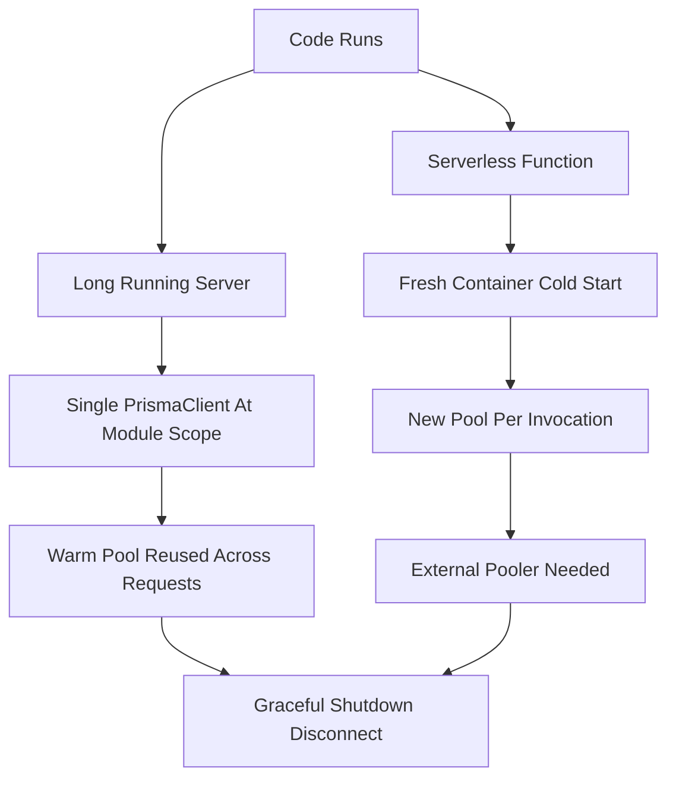

# Prisma's Connection Lifecycle in Long-Running Servers vs Ephemeral Functions

## English

Prisma Client maintains a connection pool to your database, and the shape of that pool depends heavily on where your code runs. In a long-running Node.js server — an Express app, a NestJS service, a background worker — you typically instantiate one PrismaClient for the lifetime of the process and reuse it across all requests. The client lazily opens connections on first query and keeps them warm, so subsequent queries skip the TCP handshake and authentication round-trips. This is why the common advice is to create a single instance at module scope and export it, rather than calling new PrismaClient() inside a request handler, which would leak connections and exhaust the pool.

In a serverless environment the picture flips. Each function invocation may spin up a fresh container with no warm pool, so every cold start pays the cost of establishing connections. Worse, if many concurrent invocations each open their own pool, the database can run out of connection slots — a failure mode that looks like mysterious timeouts rather than an obvious error. This is the reason external poolers such as PgBouncer (for PostgreSQL) exist, and why Prisma has documented guidance on running behind a pooler, including caveats about which pooling modes are compatible with prepared statements and transactions.

The lifecycle also includes graceful shutdown. When your process receives a termination signal, you want to stop accepting new work, let in-flight queries finish, and then close the client so connections are released cleanly. Prisma Client exposes a disconnect method for this purpose, and wiring it into your signal handlers prevents the database from holding half-open connections until a timeout fires. In containers, a missing disconnect can turn a rolling deploy into a wave of connection-limit errors as old and new instances overlap.

A practical rule of thumb: think of the Prisma Client instance as owning a resource (the pool), and apply the same discipline you would to a database driver or an HTTP agent. Instantiate once per process, share it, and close it deliberately. When you move code between a monolith and a Lambda, revisit that assumption — the lifecycle that is correct in one context is often wrong in the other.

## 中文

Prisma Client 會維護一個連到資料庫的連線池，而這個池的形狀很大程度上取決於你的程式碼在哪裡執行。在長時間執行的 Node.js 伺服器裡——Express 應用、NestJS 服務、背景 worker——你通常會在整個 process 生命週期內例項化一個 PrismaClient，並在所有請求間重用它。client 會在第一次查詢時延遲開啟連線並保持溫暖，所以後續查詢可以跳過 TCP 握手和認證往返。這就是為什麼常見建議是在 module scope 建立單一例項並匯出它，而不是在請求處理函式裡呼叫 new PrismaClient()，那樣會洩漏連線並耗盡連線池。

在 serverless 環境裡，情況正好相反。每次函式呼叫可能啟動一個全新的容器，沒有溫暖的連線池，所以每次冷啟動都要付出建立連線的代價。更糟的是，如果大量並行呼叫各自開啟自己的連線池，資料庫可能耗盡連線名額——這種故障模式看起來像神秘的逾時，而不是明顯的錯誤。這就是為什麼會有 PgBouncer（針對 PostgreSQL）這類外部連線池工具存在，也是為什麼 Prisma 有官方指引說明如何在連線池後面執行，包括哪些池化模式與 prepared statement 和交易相容的注意事項。

生命週期還包括優雅關閉。當 process 收到終止訊號，你希望停止接受新工作、讓進行中的查詢完成、然後關閉 client 以便連線乾淨釋放。Prisma Client 提供 disconnect 方法就是為此，把它接進訊號處理器可以避免資料庫一直握著半開連線直到逾時。在容器環境裡，少了 disconnect 可能讓一次滾動部署變成一波連線上限錯誤，因為舊例項和新例項會重疊。

一個實用的經驗法則：把 Prisma Client 例項想成擁有一項資源（連線池），套用你對資料庫 driver 或 HTTP agent 會有的紀律。每個 process 例項化一次、共享它、刻意關閉它。當你把程式碼從單體搬到 Lambda 時，要重新檢視這個假設——在一個情境裡正確的生命週期，在另一個情境裡往往是錯的。

## Key Takeaway

The correct Prisma Client lifecycle depends on your runtime: share one instance in long-running servers, but plan for cold starts and external poolers in serverless.

## Related Concepts
- The Prisma Client Lifecycle: Instantiation, Connection Pooling and Graceful Shutdown
- Connection Pooling, Serverless and PgBouncer: Why Your Database Runs Out of Connections

## Diagram

