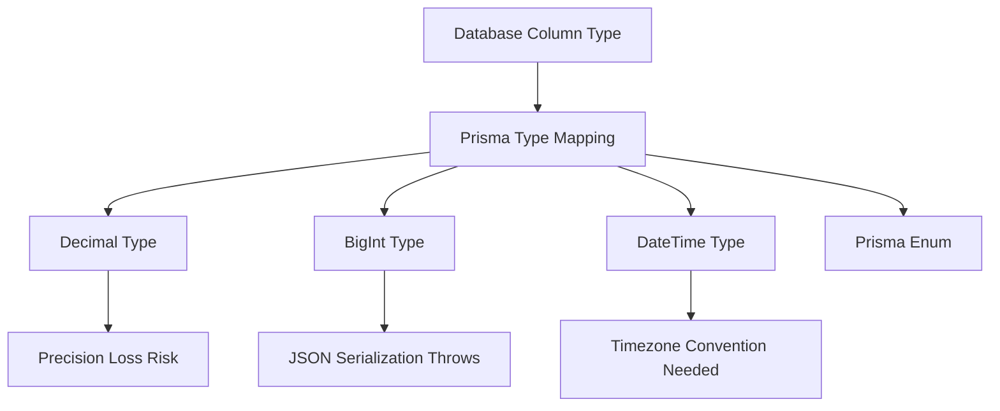

# Prisma's Type System vs Your Database's: The Places They Quietly Disagree

## English

Prisma's type system is a pragmatic translation layer, not a perfect mirror of your database's. Most of the time the mapping is obvious — a Postgres integer becomes a number, a varchar becomes a string — but there are corners where the two systems disagree in ways that only surface at runtime. Knowing those corners is the difference between code that works in development and code that fails in production.

Consider numeric precision. Databases have precise decimal types (Postgres numeric, MySQL decimal) that can hold values with fixed scale, which matters for money. Prisma maps these to a Decimal type from a library rather than to JavaScript's number, precisely because IEEE 754 floating point cannot represent many decimal fractions exactly. If you treat a Decimal as a number — for example by passing it through JSON.stringify or doing arithmetic without converting — you can silently lose precision. Similarly, 64-bit integers (bigint in Postgres) map to JavaScript BigInt, which behaves differently from number in comparisons and serialisation; JSON.stringify throws on BigInt by default. These are not bugs; they are the type system being honest about the mismatch between SQL and JavaScript.

Dates are another area. Databases often store timestamps with or without time zone, and Prisma exposes them as DateTime. The type does not carry the time-zone-ness of the underlying column, so a timestamp without time zone and a timestamp with time zone both look like DateTime in TypeScript. That means the correctness of comparisons and displays depends on conventions in your application, not on the type checker. Enums are similar: Prisma enums map to database enums where supported, but adding a value to an enum is a migration, and removing one can be blocked by existing rows.

JSON columns are the most flexible and the most dangerous. Prisma lets you type a JSON column, but the type is often a broad JsonValue rather than the precise shape you expect, because the database does not enforce a schema on JSON. If you want real type safety over JSON, you either validate at the boundary (with a library like Zod) or model the data as proper columns. The general lesson: Prisma's types are a contract between your code and the client, not a guarantee about what the database will accept or return. Treat the seams — decimals, bigints, dates, JSON — as places to be deliberate.

## 中文

Prisma 的型別系統是一個務實的翻譯層，而不是你資料庫的完美鏡像。大多數時候對應關係很明顯——Postgres 的 integer 變成 number、varchar 變成 string——但有些角落兩個系統會分歧，而這些分歧只在執行時才浮現。認識這些角落，就是「開發時能跑」和「上線後炸掉」之間的差別。

先看數值精度。資料庫有精確的十進位型別（Postgres 的 numeric、MySQL 的 decimal），可以存放固定小數位的值，這對金錢很重要。Prisma 把這些對應到某個函式庫提供的 Decimal 型別，而不是 JavaScript 的 number，正是因為 IEEE 754 浮點數無法精確表示許多十進位分數。如果你把 Decimal 當 number 用——例如直接丟進 JSON.stringify、或不轉換就做算術——你可能會悄悄失去精度。同樣地，64 位元整數（Postgres 的 bigint）對應到 JavaScript 的 BigInt，它在比較和序列化上的行為與 number 不同；JSON.stringify 預設對 BigInt 會拋錯。這些不是 bug，而是型別系統在誠實面對 SQL 與 JavaScript 之間的不匹配。

日期是另一個領域。資料庫常以「有時區」或「無時區」儲存 timestamp，Prisma 一律暴露為 DateTime。這個型別並不攜帶底層欄位有沒有時區的資訊，所以 timestamp without time zone 和 timestamp with time zone 在 TypeScript 裡都長得像 DateTime。這意味著比較和顯示的正確性取決於你應用程式裡的慣例，而不是型別檢查器。Enum 也類似：Prisma 的 enum 在支援的資料庫上對應到資料庫 enum，但新增一個值是一次遷移，移除一個值可能被現有資料列擋下。

JSON 欄位最彈性也最危險。Prisma 讓你標註 JSON 欄位的型別，但那個型別往往是寬鬆的 JsonValue，而不是你期待的具體形狀，因為資料庫並不對 JSON 強制 schema。如果你想要對 JSON 有真正的型別安全，你要嘛在邊界驗證（用 Zod 這類函式庫），要嘛把資料建模成正式欄位。整體的教訓是：Prisma 的型別是你程式碼與 client 之間的契約，而不是對資料庫會接受或回傳什麼的保證。把接縫處——decimal、bigint、日期、JSON——當成需要刻意處理的地方。

## Key Takeaway

Prisma's types describe the contract with the client, not the database's exact semantics, so decimals, bigints, dates and JSON need deliberate handling at the seams.

## Related Concepts
- Prisma Types at Runtime: Decimal, BigInt, DateTime and JSON Gotchas
- Prisma's Type System vs TypeScript's: Where They Disagree

## Diagram

