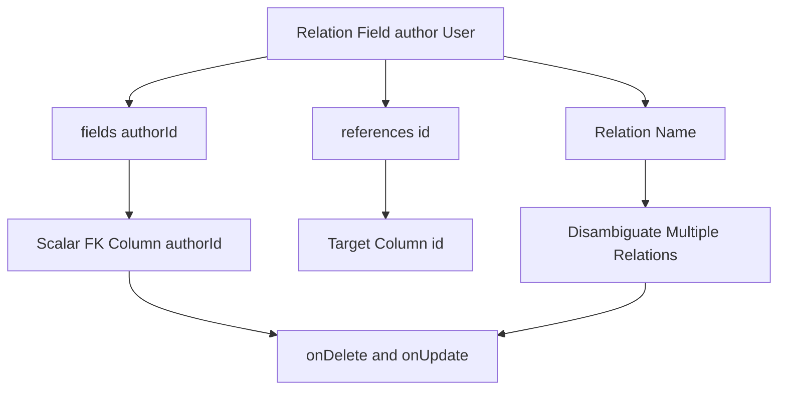

# Prisma's `@relation` Attributes and Foreign Key Mapping: Naming, Fields and References

## English

When you declare a relation between two models, Prisma needs to know which column in the child table holds the parent's identifier. By default, Prisma infers this from convention: a `Post` model with an `author User` field expects a column called `authorId` on the `Post` table. But real databases rarely follow Prisma's naming conventions, and legacy schemas often use names like `usr_id` or `created_by_fk`. The `@relation` attribute's `fields` and `references` arguments let you map the Prisma-side relation to whatever columns actually exist. `fields: [authorId]` names the scalar field on the current model that holds the foreign key; `references: [id]` names the scalar field on the target model it points at. You can also give the relation a `name` to disambiguate when two models relate to each other more than once — for example, a `User` with both `writtenPosts` and `editedPosts` needs two distinct relation names or Prisma will complain about an ambiguous relation.

The `onDelete` and `onUpdate` arguments on `@relation` control what the database does when the parent row is deleted or its key changes. These map directly to SQL's `ON DELETE` and `ON UPDATE` clauses: `Cascade`, `Restrict`, `NoAction`, `SetNull` and `SetDefault`. Importantly, whether the database actually enforces these depends on the database engine and whether Prisma's migration generated the constraint. Prisma's default for required relations is `Restrict`, and for optional relations it is `SetNull` — but you should always set them explicitly, because defaults have changed across Prisma versions and implicit behaviour is a debugging nightmare.

A subtle point: Prisma distinguishes between the relation field (the virtual field like `author User`) and the foreign key scalar (the actual column like `authorId Int`). If you only declare the relation, Prisma will create the scalar column for you with a conventional name. If you declare both — the relation with `fields: [authorId]` and a separate `authorId Int` field — you can query the foreign key directly without loading the related record. This is often the difference between a query that fetches one row and a query that fetches one row plus a join.

In relational modelling, this matters because many-to-many relations are represented differently depending on whether you use implicit or explicit join tables. With an explicit join model (a `PostTag` model with `postId` and `tagId`), you control the join table's columns, add extra fields like `assignedAt`, and use `@@id([postId, tagId])` for the composite primary key. This is the escape hatch when you need metadata on the relationship itself.

Finally, be aware that Prisma's `@relation` is a schema-level declaration, not a runtime behaviour. It shapes the generated types and the migration DDL, but at query time, `include` or `select` on the relation field triggers a second query (or a join, depending on the strategy). Understanding this boundary — schema declares, client queries — is what separates someone who uses Prisma from someone who understands it.

## 中文

當你喺兩個 model 之間宣告關聯，Prisma 需要知道子表入面邊一欄裝住父表嘅識別碼。預設情況下，Prisma 會根據慣例推斷：一個有 `author User` 欄位嘅 `Post` model，會預期 `Post` 表上面有一欄叫 `authorId`。但真實嘅資料庫好少會跟足 Prisma 嘅命名慣例，遺留系統經常會用 `usr_id` 或者 `created_by_fk` 呢類名。`@relation` 屬性嘅 `fields` 同 `references` 參數就係用嚟將 Prisma 側嘅關聯對應到實際存在嘅欄位。`fields: [authorId]` 指定當前 model 上面裝住外鍵嘅純量欄位；`references: [id]` 指定目標 model 上面佢指向嘅純量欄位。你亦可以俾個關聯一個 `name`，喺兩個 model 之間有多過一條關聯嗰陣用嚟區分——例如一個 `User` 同時有 `writtenPosts` 同 `editedPosts`，就需要兩個唔同嘅關聯名，否則 Prisma 會投訴關聯含糊。

`@relation` 上面嘅 `onDelete` 同 `onUpdate` 參數控制父行被刪除或者主鍵改變嗰陣資料庫會做咩。呢啲直接對應 SQL 嘅 `ON DELETE` 同 `ON UPDATE` 子句：`Cascade`、`Restrict`、`NoAction`、`SetNull` 同 `SetDefault`。重點係，資料庫究意會唔會真正執行呢啲行為，取決於資料庫引擎同 Prisma 嘅遷移有冇產生相應嘅約束。Prisma 對必要關聯嘅預設係 `Restrict`，對可選關聯就係 `SetNull`——但你應該每次都明確設定，因為預設值喺唔同 Prisma 版本之間改過，隱含行為係除錯嘅惡夢。

有個微妙嘅地方：Prisma 區分關聯欄位（即係好似 `author User` 咁嘅虛擬欄位）同外鍵純量（即係實際嘅欄位好似 `authorId Int`）。如果你淨係宣告關聯，Prisma 會用慣例名幫你建立純量欄位。如果你兩個都宣告——關聯用 `fields: [authorId]`，再加一個獨立嘅 `authorId Int` 欄位——你就可以直接查詢外鍵，唔使載入相關嗰筆記錄。呢個往往就係查一列同查一列加一個 join 之間嘅分別。

喺關聯式建模入面，呢點好重要，因為多對多關聯會因為你用隱含定明確嘅 join 表而有唔同嘅表示方式。用明確嘅 join model（一個有 `postId` 同 `tagId` 嘅 `PostTag` model），你就可以控制 join 表嘅欄位、加額外欄位好似 `assignedAt`，仲可以用 `@@id([postId, tagId])` 做複合主鍵。呢個就係你需要喺關聯本身加 metadata 嗰陣嘅逃生門。

最後要留意，Prisma 嘅 `@relation` 係 schema 層面嘅宣告，唔係執行期行為。佢塑造生成嘅型別同遷移嘅 DDL，但查詢嗰陣，喺關聯欄位上用 `include` 或者 `select` 會觸發第二個查詢（或者一個 join，視乎策略）。理解呢條界線——schema 負責宣告，client 負責查詢——就係「用 Prisma」同「明白 Prisma」嘅分別。

## Key Takeaway

The @relation attribute is where Prisma's conventions meet your database's reality: fields and references map the relation to real columns, name disambiguates multiple relations between the same models, and onDelete/onUpdate control cascade behaviour.

## Related Concepts
- Referential Actions
- Explicit vs Implicit Join Tables

## Diagram

