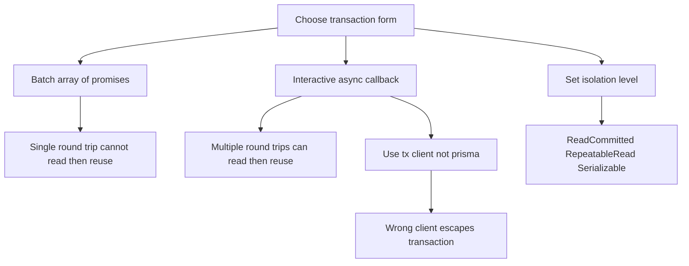

# Prisma's `$transaction` API: Interactive vs Batch, and What Isolation Actually Buys You

## English

Prisma exposes two flavours of transaction, and the difference is not cosmetic. The batch form takes an array of Prisma promises and runs them inside a single transaction: `prisma.$transaction([prisma.user.create(...), prisma.post.create(...)])`. The interactive form takes an async callback that receives a transaction client: `prisma.$transaction(async (tx) => { ... })`. The batch form is simpler and compiles to a single round trip on some databases, but it cannot read a value in one statement and use it in the next. The interactive form can — you can create a user, read the generated id, and then insert related rows — but each statement is a separate round trip, and you must remember to use `tx`, not `prisma`, inside the callback. Using the outer client inside a transaction callback is a classic bug: the queries silently run outside the transaction and your rollback does nothing.

Isolation levels are the part most people skip. Prisma lets you pass an `isolationLevel` option to `$transaction`, mapping to the database's own levels: `ReadUncommitted`, `ReadCommitted`, `RepeatableRead` and `Serializable`. The default depends on the database — PostgreSQL's default is `ReadCommitted`, MySQL's is `RepeatableRead`. Understanding what each level prevents is essential: `ReadCommitted` stops dirty reads but allows non-repeatable reads (reading the same row twice and getting different values) and phantom reads (a query returning different rows because another transaction inserted some). `RepeatableRead` stops non-repeatable reads. `Serializable` stops phantoms too, at the cost of more contention and possible serialisation failures that you must retry.

A concrete example: two concurrent requests each try to decrement a stock count if it is above zero. Under `ReadCommitted`, both can read the count as 1, both decide to proceed, and both write 0 — you have sold two items from one unit. Under `Serializable`, one transaction will be aborted with a serialisation failure and can be retried. Prisma surfaces this as an error you can catch and retry. This is the difference between a transaction that is correct and one that merely exists.

Timeouts matter too. Interactive transactions hold a database connection and locks for their duration, so Prisma enforces a default timeout (typically 5 seconds) and a max wait for acquiring the transaction. Long-running interactive transactions are a common cause of connection pool exhaustion in production — the pool fills up with transactions waiting on slow queries, and unrelated requests start timing out. Keep interactive transactions short: do the minimum inside the callback, and do expensive work (calling external APIs, sending emails) outside it.

Finally, transactions interact with Prisma's query engine in ways that are easy to miss. Nested writes — creating a user with nested posts in a single `create` call — are already wrapped in a transaction by Prisma, so wrapping them in another `$transaction` is redundant. And with driver adapters, transaction behaviour is delegated to the underlying driver, so the exact semantics (and whether `isolationLevel` is honoured) depend on the adapter. Read the docs for your adapter before assuming a level is enforced.

## 中文

Prisma 提供兩種交易形式，而箇中差別絕對唔係裝飾。批次形式收一個 Prisma promise 陣列，喺單一交易入面執行：`prisma.$transaction([prisma.user.create(...), prisma.post.create(...)])`。互動形式收一個 async callback，收到一個交易 client：`prisma.$transaction(async (tx) => { ... })`。批次形式簡單啲，喺某啲資料庫上面仲會編譯成單一來回，但佢唔可以喺一個 statement 讀一個值再喺下一個 statement 用。互動形式就得——你可以建立一個 user、讀返生成嘅 id、然後插入相關嘅行——但每個 statement 都係獨立嘅來回，而且你必須記住喺 callback 入面用 `tx` 而唔係 `prisma`。喺交易 callback 入面用外層 client 係經典 bug：啲查詢會靜靜雞喺交易外面執行，你嘅 rollback 完全冇用。

隔離級別係最多人跳過嘅部分。Prisma 俾你傳 `isolationLevel` 選項俾 `$transaction`，對應資料庫自己嘅級別：`ReadUncommitted`、`ReadCommitted`、`RepeatableRead` 同 `Serializable`。預設值視乎資料庫——PostgreSQL 嘅預設係 `ReadCommitted`，MySQL 係 `RepeatableRead`。理解每個級別防止啲咩係關鍵：`ReadCommitted` 阻止汙讀，但容許不可重複讀（同一行讀兩次得到唔同值）同幻讀（因為另一個交易插入咗資料，令查詢返回唔同嘅行）。`RepeatableRead` 阻止不可重複讀。`Serializable` 連幻讀都阻止，代價係更多競爭同可能出現序列化失敗，你要重試。

一個具體例子：兩個並發請求各自嘗試喺庫存大過零嗰陣扣減庫存。喺 `ReadCommitted` 之下，兩個都可以讀到庫存係 1，兩個都決定繼續，兩個都寫 0——你由一件貨賣咗兩件。喺 `Serializable` 之下，其中一個交易會被中止，報序列化失敗，可以重試。Prisma 會將呢個呈現為一個你可以捕捉同重試嘅錯誤。呢個就係一個正確嘅交易同一個僅僅存在嘅交易之間嘅分別。

超時都好重要。互動交易喺佢哋持續期間會揸住一個資料庫連線同鎖，所以 Prisma 會強制一個預設超時（通常 5 秒）同埋一個取得交易嘅最長等待時間。長時間運行嘅互動交易係生產環境連線池耗盡嘅常見原因——連線池俾等緊慢查詢嘅交易填滿，無關嘅請求就開始超時。保持互動交易簡短：喺 callback 入面做最少嘅嘢，將昂貴嘅工作（呼叫外部 API、寄電郵）放喺外面。

最後，交易同 Prisma 查詢引擎嘅互動方式好容易走漏眼。巢狀寫入——喺單一個 `create` 呼叫入面建立一個 user 連巢狀 posts——Prisma 本身已經用交易包住，所以再包多層 `$transaction` 係多餘嘅。而用 driver adapter 嘅話，交易行為會交俾底層 driver，所以確切嘅語義（同埋 `isolationLevel` 會唔會俾尊重）取決於個 adapter。假設某個級別會強制執行之前，睇清楚你個 adapter 嘅文件。

## Key Takeaway

Prisma gives you batch and interactive transactions plus configurable isolation levels, but correctness depends on choosing the right level for the race you are preventing and keeping interactive transactions short enough not to starve the connection pool.

## Related Concepts
- Isolation Levels
- Connection Pooling

## Diagram

