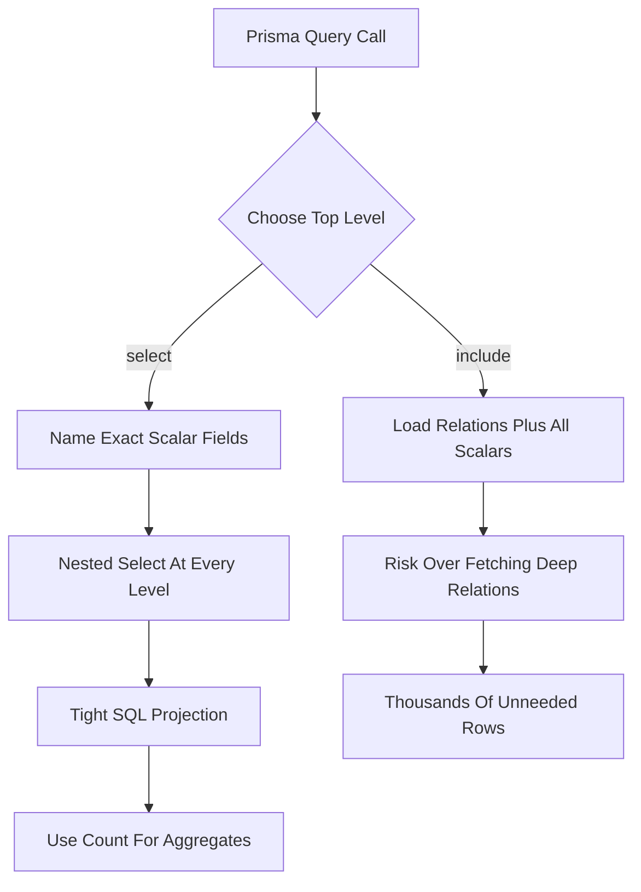

# Prisma's `select` and `include` in Depth: Field Selection, Nested Shapes and the Over-Fetching Trap

## English

Every Prisma query returns whole rows by default, which is convenient in development and wasteful in production. The `select` argument lets you name exactly which scalar fields you want; `include` lets you name which relations to load alongside the full scalar set. They are mutually exclusive at the top level of a single query — you cannot use both on the same model in the same call — but they nest, and understanding the nesting rules unlocks real performance gains. `select: { id: true, title: true, author: { select: { name: true } } }` returns only those four fields, nothing else. `include: { author: true }` returns all Post scalars plus the full author row. The difference is not just bytes on the wire: Prisma generates a SQL projection, and on a wide table with JSON or `Bytes` columns, `select` can be the difference between a 2 KB and a 200 KB response.

The trap is over-fetching through nesting. `include: { author: { include: { posts: true } } }` on a single Post loads the post, its author, and every post that author has ever written. In a social app with a prolific author, that is thousands of rows for a page that needed one. Prisma will happily do it because you asked. The fix is to think in terms of the shape the UI needs, not the shape of the schema: use `select` at every level, not just the top, and reach for `include` only when you genuinely need the whole related record.

There is a related subtlety with `_count`. Prisma supports `_count: { select: { posts: true } }` to return a count of related rows without loading them. This is a single aggregate query, far cheaper than loading the posts and counting in JavaScript. It is one of the few places where Prisma's API exposes an aggregate directly, and it is underused. Similarly, `select` can include computed relations via Prisma's `$queryRaw` or extensions, but those are escape hatches, not the default.

One more layer: `select` affects the generated TypeScript types. If you select only `id` and `title`, the return type is `{ id: number; title: string }` — asking for `post.author` in the same block is a compile error, which is exactly what you want. This is the type-safety payoff in action: the shape of your data is checked at compile time, not discovered at runtime when `undefined` blows up a template. But it also means that refactoring a query to select fewer fields will surface every downstream usage as a type error, which is a feature, not a bug.

Finally, `select` interacts with Prisma's relation loading strategy. Under the default query engine, nested relations are typically loaded in separate queries (one per relation level), not one giant join. That means `select` on a nested relation does not necessarily reduce the number of queries — it reduces the columns per query. If you care about query count, look at `relationLoadStrategy` where supported, or restructure the query. Understanding both dimensions — columns and queries — is what lets you tune Prisma deliberately instead of guessing.

## 中文

每個 Prisma 查詢預設都會返回整行，喺開發環境好方便，喺生產環境就好浪費。`select` 引數俾你明確指定想要邊啲純量欄位；`include` 就俾你指定要載入邊啲關聯，同時保留完整嘅純量集合。喺單一查詢嘅頂層，佢哋係互斥嘅——同一個呼叫入面唔可以喺同一個 model 上面兩個都用——但佢哋可以巢狀，而理解巢狀規則先至可以真正提升效能。`select: { id: true, title: true, author: { select: { name: true } } }` 只會返回嗰四個欄位，其他乜都唔返。`include: { author: true }` 就返回所有 Post 純量加埋完整嘅 author 行。差別唔止係網路上嘅位元組：Prisma 會生成 SQL 投影，喺一張有 JSON 或者 `Bytes` 欄位嘅闊表上面，`select` 可以係 2 KB 同 200 KB 回應之間嘅分別。

陷阱係透過巢狀造成嘅過度抓取。喺單一個 Post 上面用 `include: { author: { include: { posts: true } } }` 會載入嗰個 post、佢嘅 author，同埋嗰個 author 歷來寫過嘅每一個 post。喺一個有高產 author 嘅社交 app 入面，一個只需要一筆記錄嘅頁面就會載入幾千行。Prisma 會樂意咁做，因為你叫咗。解決辦法係諗 UI 需要咩形狀，而唔係 schema 咩形狀：喺每一層都用 `select`，唔止頂層，只有喺你真正需要完整相關記錄嗰陣先用 `include`。

有個相關嘅微妙位關於 `_count`。Prisma 支援 `_count: { select: { posts: true } }`，返回相關行嘅數目而唔使載入佢哋。呢個係單一聚合查詢，比載入啲 posts 再喺 JavaScript 數平好多。呢個係 Prisma API 少數直接暴露聚合嘅地方，而且好少人用。同樣，`select` 可以透過 Prisma 嘅 `$queryRaw` 或者擴充套件包含計算關聯，但嗰啲係逃生門，唔係預設。

仲有一層：`select` 會影響生成嘅 TypeScript 型別。如果你只選 `id` 同 `title`，返回型別就係 `{ id: number; title: string }`——喺同一塊入面要 `post.author` 會係編譯錯誤，而呢個正正就係你想要嘅。呢個就係型別安全嘅回報：你資料嘅形狀喺編譯時檢查，而唔係喺執行期 `undefined` 搞爆個 template 嗰陣先發現。但佢亦意味住重構一個查詢去選少啲欄位，會將所有下游用法浮現為型別錯誤，呢個係功能，唔係 bug。

最後，`select` 同 Prisma 嘅關聯載入策略有互動。喺預設查詢引擎之下，巢狀關聯通常會用獨立查詢載入（每個關聯層一個），而唔係一個巨型 join。咁即係喺巢狀關聯上面用 `select` 唔一定會減少查詢數目——佢減少嘅係每個查詢嘅欄位數。如果你關心查詢數目，睇下支援嘅 `relationLoadStrategy`，或者重構個查詢。同時理解兩個維度——欄位同查詢——先至可以刻意調校 Prisma，而唔係靠估。

## Key Takeaway

select and include control the shape and size of what comes back, and the real skill is thinking in terms of the UI's needs rather than the schema's shape — choosing fields at every nesting level and using _count instead of loading rows just to count them.

## Related Concepts
- The N+1 Problem
- Query Performance Tuning

## Diagram

