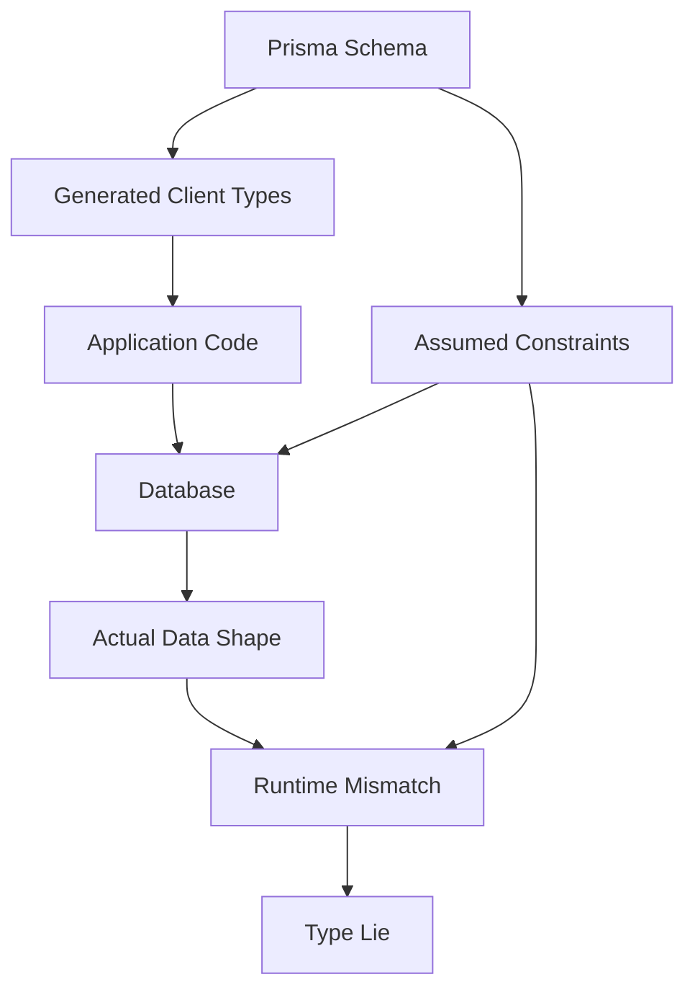

# Prisma and the Shape of Your Data: When the Schema Lies About Reality

## English

A Prisma schema is a promise about the shape of your data, but a database is a living thing that can break that promise in ways the schema cannot see. The most common example is the difference between what the schema declares and what the database actually enforces: Prisma's `String` maps to `VARCHAR` or `TEXT`, but if you never set a length limit, the database may accept values of any size, and your application code will happily send a megabyte into a column you thought was short. Likewise, `DateTime` in Prisma is a timestamp with timezone handling decided by the database, not by Prisma — if the underlying column is `TIMESTAMP WITHOUT TIME ZONE`, the value you read back may not be the value you wrote, depending on server settings. The schema is a model, and models are always simplifications.

A subtler version of this problem is nullable drift. Prisma distinguishes `String` from `String?`, and this distinction is enforced in the generated TypeScript types. But if a migration adds a column as nullable in the database and the schema still says non-nullable, Prisma Client will trust the schema and hand you a `string` that is actually `null` at runtime — a type lie that only surfaces when a real row arrives. The opposite is also possible: a column that is `NOT NULL` with a default in the database, but declared optional in Prisma, will make you write defensive `if (row.field !== null)` checks that never fire. These mismatches accumulate silently, and the only defence is to treat the schema and the database as two artefacts that must be kept honest together, ideally by generating the schema from the database or by making the database the source of truth for constraints.

Enums are a classic trap. Prisma's `enum` type is enforced at the application layer, but on databases without native enum support — or when the enum is mapped to a plain `TEXT` column — the database will accept any string. Someone running a manual `UPDATE` or an old version of the application can insert a value outside the enum, and Prisma Client will happily return it typed as the enum, because TypeScript types are erased at runtime and Prisma does not validate on read. The schema is not a runtime validator; it is a compile-time contract. If you need the database to reject bad values, you need a `CHECK` constraint, a native enum type, or a foreign key to a lookup table.

There is also the question of what Prisma does not model at all. Partial indexes, expression indexes, exclusion constraints, row-level security policies, and generated columns are all real parts of a database's behaviour that have no first-class representation in the Prisma schema language. You can add them via raw SQL inside a migration, but Prisma will not know about them, will not include them in `prisma db pull` in a lossless way, and will not warn you when a future migration would drop them. This is not a flaw so much as a boundary: Prisma models tables, columns, relations, and indexes, and treats the rest of the database as outside its vocabulary. Knowing where that boundary sits is what separates a developer who trusts the schema blindly from one who knows which invariants live in Prisma and which live in the database.

The practical lesson is to ask, for every field in your schema, a simple question: if the database disagreed with this declaration, would I find out? For nullability, types, and enums, the answer is often no until production. The remedy is to lean on the database for the invariants that matter — constraints, foreign keys, `CHECK`s — and to treat the Prisma schema as documentation of intent that is verified by the database, not as a substitute for it. When the two disagree, the database always wins, and the schema is the one that is wrong.

## 中文

Prisma schema 係對你資料形狀嘅一個承諾，但資料庫係一個活生生嘅東西，可以用 schema 睇唔到嘅方式打破呢個承諾。最常見嘅例子，就係 schema 所宣告嘅嘢同資料庫實際執行嘅嘢之間嘅落差：Prisma 嘅 `String` 對應 `VARCHAR` 或者 `TEXT`，但如果你冇設定長度上限，資料庫可能會接受任何大小嘅值，而你嘅應用程式碼會好開心咁將一 MB 嘅資料送入你以為好短嘅欄位。同樣，Prisma 嘅 `DateTime` 係一個時間戳，而時區處理係由資料庫決定，唔係由 Prisma 決定 —— 如果底層欄位係 `TIMESTAMP WITHOUT TIME ZONE`，你讀返嚟嘅值可能唔係你寫入嘅值，視乎伺服器設定而定。Schema 係一個模型，而模型永遠都係簡化。

呢個問題更微妙嘅版本，係可空性漂移（nullable drift）。Prisma 區分 `String` 同 `String?`，而呢個區分會喺生成嘅 TypeScript 型別入面強制執行。但如果一個遷移喺資料庫加咗一個可空欄位，而 schema 仍然話佢係非空，Prisma Client 會信 schema，喺執行時畀你一個實際上係 `null` 嘅 `string` —— 一個型別謊言，只有當真實嘅資料列返嚟先會浮現。相反情況都有可能：一個喺資料庫有預設值嘅 `NOT NULL` 欄位，但喺 Prisma 宣告為可選，會令你寫啲永遠都唔會觸發嘅防禦性 `if (row.field !== null)` 檢查。呢啲唔匹配會靜靜咁累積，唯一嘅防禦方法，就係將 schema 同資料庫視為兩件必須一齊保持誠實嘅產物，最好係由資料庫生成 schema，或者令資料庫成為約束嘅真相來源。

列舉（enum）係經典陷阱。Prisma 嘅 `enum` 型別喺應用層強制執行，但喺冇原生列舉支援嘅資料庫 —— 或者當列舉對應到純 `TEXT` 欄位 —— 資料庫會接受任何字串。有人手動跑 `UPDATE`，或者舊版本嘅應用程式，可以插入一個列舉以外嘅值，而 Prisma Client 會好開心咁將佢當成列舉型別返畀你，因為 TypeScript 型別喺執行時已經被抹除，而 Prisma 喺讀取時唔會驗證。Schema 唔係執行時驗證器，佢係編譯時嘅合約。如果你需要資料庫拒絕壞值，你需要 `CHECK` 約束、原生列舉型別，或者指向查找表嘅外鍵。

仲有一個問題：Prisma 根本冇建模嘅嘢。部分索引（partial index）、表達式索引、排除約束（exclusion constraint）、行級安全策略（row-level security policy），同生成欄位（generated column），全部都係資料庫行為嘅真實部分，但喺 Prisma schema 語言入面冇一級公民嘅表示。你可以喺遷移入面用原始 SQL 加佢哋，但 Prisma 唔會知道佢哋，唔會喺 `prisma db pull` 入面無損咁包含佢哋，亦都唔會喺將來嘅遷移會刪除佢哋時警告你。呢個唔算係缺陷，而係一條界線：Prisma 建模資料表、欄位、關聯同索引，並將資料庫其餘部分視為佢詞彙以外嘅嘢。知道呢條界線喺邊，就係盲信 schema 嘅開發者同知道邊啲不變量住喺 Prisma、邊啲住喺資料庫嘅開發者之間嘅分別。

實際嘅教訓係：對 schema 入面每一個欄位，問一個簡單問題 —— 如果資料庫同呢個宣告唔一致，我會唔會知道？對於可空性、型別同列舉，答案通常係「唔會」，直到生產環境先會知。補救方法係倚賴資料庫處理真正重要嘅不變量 —— 約束、外鍵、`CHECK` —— 並將 Prisma schema 視為意圖嘅文件，由資料庫驗證，而唔係資料庫嘅替代品。當兩者唔一致，資料庫永遠贏，而錯嘅係 schema。

## Key Takeaway

The Prisma schema is a compile-time contract, not a runtime validator — invariants that must actually hold belong in the database as constraints, because the database always wins when the two disagree.

## Related Concepts
- Schema drift between Prisma and the database
- Database constraints vs application-level validation

## Diagram

