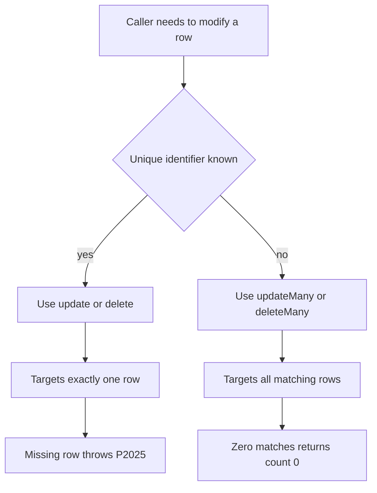

# Partial Updates and the `update` vs `updateMany` Distinction

## English

One of the quietest sources of bugs in Prisma code is the difference between `update`, `updateMany`, `upsert`, and `createMany`, and what each of them does when the row does not exist or when several rows match. `update` takes a `where` clause that must identify exactly one row — Prisma requires a unique field or a compound unique in the `where`, and if no row matches, it throws `P2025` ("record not found"). `updateMany` takes any filter, updates every matching row, and returns a count. These sound similar but behave completely differently at the boundaries: `update` is a single-row operation that fails loudly, `updateMany` is a bulk operation that succeeds silently with `{ count: 0 }` when nothing matches. If you write `updateMany` where you meant `update`, a typo in the filter will look like success.

The same distinction applies to `delete` versus `deleteMany`. `delete` requires a unique identifier and throws `P2025` if the row is gone; `deleteMany` accepts any filter and returns a count, so a bug that deletes zero rows is indistinguishable from a bug that deletes the wrong rows until you check the count. In code review, the rule of thumb is: use the singular forms when you have a unique identifier and want the operation to fail if the target is missing, and use the plural forms when you genuinely mean "all rows matching this predicate" and are prepared to check the count. Mixing them up is the kind of mistake that passes tests and fails in production.

`upsert` deserves its own paragraph because it hides a race condition. Prisma's `upsert` is implemented as a find-then-create-or-update in many configurations, which means two concurrent requests can both find no row and both attempt to create, and one will fail with a unique constraint violation (`P2002`). On databases that support native upsert (PostgreSQL's `INSERT ... ON CONFLICT`, MySQL's `INSERT ... ON DUPLICATE KEY UPDATE`), Prisma can compile to that, but the exact behaviour depends on the database and the Prisma version. If you rely on `upsert` for idempotency — for example, in a webhook handler that may receive the same event twice — you should either catch `P2002` and retry, or ensure the operation is safe to run twice anyway. Never assume `upsert` is atomic across the find and the write unless you have verified it against your specific database and Prisma version.

There is also the question of what `update` does with nested writes. If you pass `{ data: { posts: { create: { title: 'x' } } } }` to `update`, Prisma performs the parent update and the child create inside a single transaction, which is convenient but can surprise you when the child fails: the whole thing rolls back, and the error you see is the child's, not the parent's. This is usually what you want, but it means an `update` with nested writes is not a cheap single-statement operation — it is a multi-statement transaction, and it will hold locks for longer than you might expect. For hot paths, prefer explicit `$transaction` blocks so the boundaries are visible, or split the parent and child operations if they do not need to be atomic.

Finally, there is the question of partial updates and the `undefined` versus `null` distinction. In Prisma, passing `undefined` for a field in `data` means "do not touch this field", while passing `null` means "set this field to NULL". This is a genuinely useful design, but it is easy to get wrong when building an update payload from user input: if your form sends an empty string for an optional field, you need to decide whether that means `null` (clear it) or `undefined` (leave it alone), and if you spread a partial object into `data`, any key that is present with value `undefined` will be treated as "do not touch" — which is usually right, but occasionally hides a bug where you meant to clear a field and accidentally left it alone. The safest pattern is to build the update payload explicitly, field by field, rather than spreading arbitrary objects into `data`.

## 中文

Prisma 程式碼入面最靜嘅 bug 來源之一，就係 `update`、`updateMany`、`upsert` 同 `createMany` 之間嘅分別，以及當資料列唔存在或者多過一列符合時，每個操作會做啲乜。`update` 收一個 `where` 子句，必須識別出恰好一列 —— Prisma 要求 `where` 入面有唯一欄位或者複合唯一鍵，如果冇列符合，佢會拋出 `P2025`（「找不到記錄」）。`updateMany` 收任何過濾條件，更新所有符合嘅列，並返回一個數量。聽落好似，但喺邊界行為上完全唔同：`update` 係單列操作，會大聲失敗；`updateMany` 係批量操作，乜都唔中嘅時候會靜靜咁以 `{ count: 0 }` 成功。如果你喺應該用 `update` 嘅地方寫咗 `updateMany`，過濾條件打錯字會睇落好似成功。

同樣嘅區分適用於 `delete` 同 `deleteMany`。`delete` 要求唯一識別碼，如果列已經冇咗會拋 `P2025`；`deleteMany` 接受任何過濾條件並返回數量，所以一個刪除零列嘅 bug，同一個刪錯列嘅 bug，喺你檢查數量之前係分辨唔到嘅。喺 code review 入面，經驗法則係：當你有唯一識別碼而且想操作喺目標唔存在時失敗，就用單數形式；當你真正意思係「所有符合呢個謂詞嘅列」並且準備好檢查數量，就用複數形式。搞亂兩者，就係嗰種會通過測試但喺生產環境失敗嘅錯誤。

`upsert` 值得自己一段，因為佢隱藏咗一個競爭條件（race condition）。Prisma 嘅 `upsert` 喺好多配置下係先查詢再創建或更新，意思係兩個並行請求可以同時搵唔到列，然後兩個都嘗試創建，其中一個會因為唯一約束違規（`P2002`）而失敗。喺支援原生 upsert 嘅資料庫（PostgreSQL 嘅 `INSERT ... ON CONFLICT`、MySQL 嘅 `INSERT ... ON DUPLICATE KEY UPDATE`），Prisma 可以編譯成嗰個，但確切行為視乎資料庫同 Prisma 版本。如果你靠 `upsert` 做冪等性（idempotency）—— 例如喺一個可能收到同一個事件兩次嘅 webhook handler 入面 —— 你應該要麼捕捉 `P2002` 並重試，要麼確保操作本身跑兩次都安全。除非你已經喺你特定嘅資料庫同 Prisma 版本驗證過，否則永遠唔好假設 `upsert` 喺查詢同寫入之間係原子嘅。

仲有一個問題：`update` 對嵌套寫入（nested write）會做啲乜。如果你傳 `{ data: { posts: { create: { title: 'x' } } } }` 畀 `update`，Prisma 會喺單一交易入面執行父更新同子創建，好方便，但當子操作失敗時會令你意外：成件事會回滾，而你見到嘅錯誤係子操作嘅，唔係父操作嘅。呢個通常係你想要嘅，但意思係一個帶嵌套寫入嘅 `update` 唔係便宜嘅單語句操作 —— 佢係多語句交易，會比你想像中持鎖更耐。對於熱路徑，寧願用顯式 `$transaction` 區塊令邊界可見，或者如果父同子操作唔需要原子性就分開佢哋。

最後，係部分更新同 `undefined` 對 `null` 嘅區分。喺 Prisma 入面，喺 `data` 入面傳 `undefined` 畀一個欄位，意思係「唔好掂呢個欄位」，而傳 `null` 意思係「將呢個欄位設為 NULL」。呢個係真正有用嘅設計，但當你由使用者輸入建立更新負載時好容易搞錯：如果你嘅表單對一個可選欄位送空字串，你需要決定嗰個意思係 `null`（清空）定 `undefined`（唔好掂），而如果你將一個部分物件 spread 入 `data`，任何存在但值為 `undefined` 嘅鍵都會被當成「唔好掂」—— 通常係對嘅，但偶爾會隱藏一個你本想清空欄位但唔小心冇掂到嘅 bug。最安全嘅模式係逐個欄位顯式建立更新負載，而唔係將任意物件 spread 入 `data`。

## Key Takeaway

Singular `update`/`delete` fail loudly on missing rows while plural `updateMany`/`deleteMany` succeed silently with a count — and `upsert` is not guaranteed atomic, so treat it as a convenience, not an idempotency primitive.

## Related Concepts
- Prisma error codes P2025 and P2002
- Idempotent writes in webhook handlers

## Diagram

