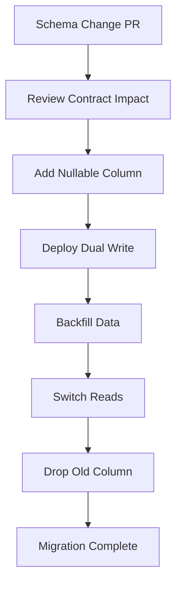

# The Schema as a Contract With Your Team: Reviewing Prisma Changes

## English

A Prisma schema change is not just a code change — it is a change to a shared contract that every service, every background job, and every analyst querying the database depends on. This makes schema review a different discipline from ordinary code review. When a pull request adds a field, the reviewer's first question should not be "does this compile?" but "what happens to code that has not been updated yet?" A new non-nullable column with no default will break every existing insert path the moment the migration runs, including inserts from older deployed versions of the application that are still serving traffic during a rolling deploy. A renamed column will break every query that still references the old name, and Prisma's generated client will not catch those references if they live in raw SQL, in another service, or in a BI dashboard.

The standard answer to this is the expand-contract pattern, sometimes called parallel change: add the new column as nullable (or with a default), deploy code that writes to both old and new, backfill, switch reads to the new column, and only then drop the old one in a later migration. Each step is a separate deploy, and each step leaves the database in a state that both old and new code can tolerate. This is slower than a single migration, but it is the only way to change a schema without downtime when more than one version of the application is running at once — which is the normal state of any service behind a load balancer. The Prisma schema is where you record each step, but the discipline is organisational, not technical.

Reviewers should also ask about the cost of the migration itself. Adding an index on a large table can lock writes for the duration of the build on some databases; adding a column with a volatile default can rewrite the whole table on older PostgreSQL versions; changing a column type can force a full table rewrite. Prisma Migrate will generate the SQL, but it will not tell you whether that SQL is safe to run against a table with fifty million rows during business hours. Reading the generated migration file before applying it is not optional — it is the whole point of migrations as code. If the generated SQL is dangerous, you write a custom migration by hand and split it into safe steps.

There is also the question of what the schema communicates to people who are not writing code against it. Analysts, data scientists, and support engineers read the schema to understand what the data means, and the comments and field names are part of that contract. A field called `status` with no comment is a field whose meaning lives only in the head of whoever wrote it; a field called `status` with a comment listing the allowed values and their meanings is documentation that survives staff turnover. Prisma supports `///` doc comments that are preserved in the generated client and shown in editor tooltips, which makes them cheap to write and valuable to keep. Treating the schema as the canonical description of the data model — not just a build input — is what makes it useful to the whole organisation.

Finally, schema review should include a check on what the change does to the generated client's public surface. Renaming a field changes the TypeScript type that every consumer imports; removing a field removes a property that downstream code may still reference; changing a relation's name changes the include key that callers use. These are breaking changes to an API, even though they are not HTTP endpoints. Semantic versioning of the client, lockfile discipline, and a clear changelog for schema changes are the tools that make these breaks visible before they reach production. The schema is code, and like any code with consumers, it deserves the same care about backwards compatibility that you would give to a public function.

## 中文

Prisma schema 嘅改動唔單止係程式碼改動 —— 佢係對一個共享合約嘅改動，每個服務、每個背景工作、每個查詢資料庫嘅分析師都依賴呢個合約。呢個令 schema 審查成為一門同普通 code review 唔同嘅學問。當一個 pull request 加一個欄位，審查者嘅第一個問題唔應該係「呢個編譯得到嗎？」，而係「未更新嘅程式碼會點？」一個冇預設值嘅新非空欄位，喺遷移一跑嘅時候就會打破每一條現有嘅插入路徑，包括喺滾動部署期間仍然服務流量嘅舊版本應用程式嘅插入。一個重新命名嘅欄位會打破每一條仍然引用舊名嘅查詢，而 Prisma 生成嘅 client 唔會捕捉到嗰啲引用，如果佢哋住喺原始 SQL、另一個服務，或者一個 BI 儀錶板入面。

標準答案就係 expand-contract 模式，有時叫做平行變更（parallel change）：將新欄位加為可空（或者帶預設值），部署寫入舊同新欄位嘅程式碼，回填（backfill），將讀取切換到新欄位，然後先喺之後嘅遷移刪除舊欄位。每一步都係獨立部署，每一步都令資料庫處於舊同新程式碼都能夠容忍嘅狀態。呢個比單一遷移慢，但當多過一個版本嘅應用程式同時執行時 —— 亦即係任何喺負載平衡器後面嘅服務嘅正常狀態 —— 呢個係唯一可以無停機改 schema 嘅方法。Prisma schema 係你記錄每一步嘅地方，但紀律係組織性嘅，唔係技術性嘅。

審查者亦都應該問遷移本身嘅成本。喺大表加索引，喺某啲資料庫會喺建立期間鎖住寫入；加一個帶 volatile 預設值嘅欄位，喺較舊嘅 PostgreSQL 版本會重寫成張表；改欄位型別會強制全表重寫。Prisma Migrate 會生成 SQL，但佢唔會話你知嗰啲 SQL 喺營業時間對住一張五千萬列嘅表跑安唔安全。喺套用之前讀生成嘅遷移檔案唔係可選嘅 —— 佢就係「遷移即程式碼」嘅重點。如果生成嘅 SQL 危險，你就手寫自訂遷移，並將佢拆成安全嘅步驟。

仲有一個問題：schema 對唔係寫程式碼嘅人傳達啲乜。分析師、資料科學家同支援工程師會讀 schema 嚟理解資料嘅意思，而註解同欄位名係嗰個合約嘅一部分。一個叫 `status` 但冇註解嘅欄位，係一個意義只存在於寫佢嗰個人腦海入面嘅欄位；一個叫 `status` 但註解列出允許值同佢哋意思嘅欄位，係一份經得起人員流動嘅檔案。Prisma 支援 `///` 檔案註解，會保留喺生成嘅 client 入面並顯示喺編輯器工具提示，令佢哋寫起來便宜、保留起來有價值。將 schema 視為資料模型嘅正典描述 —— 唔單止係建置輸入 —— 就係令佢對整個組織有用嘅原因。

最後，schema 審查應該包括檢查改動對生成 client 公開表面嘅影響。重新命名一個欄位會改變每個消費者 import 嘅 TypeScript 型別；移除一個欄位會移除下游程式碼可能仍然引用嘅屬性；改變一個關聯嘅名會改變呼叫者用嘅 include 鍵。呢啲係對 API 嘅破壞性變更，即使佢哋唔係 HTTP 端點。Client 嘅語意化版本、lockfile 紀律，同埋清晰嘅 schema 改動變更日誌，就係令呢啲破壞喺到達生產環境之前可見嘅工具。Schema 係程式碼，而同任何有消費者嘅程式碼一樣，佢值得你給予公開函式同等嘅向後相容關注。

## Key Takeaway

A Prisma schema change is a change to a shared contract with every consumer of the database, so review it for backwards compatibility, migration cost, and documentation value — not just for whether it compiles.

## Related Concepts
- Expand-contract schema evolution
- Backwards-compatible API changes in generated clients

## Diagram

