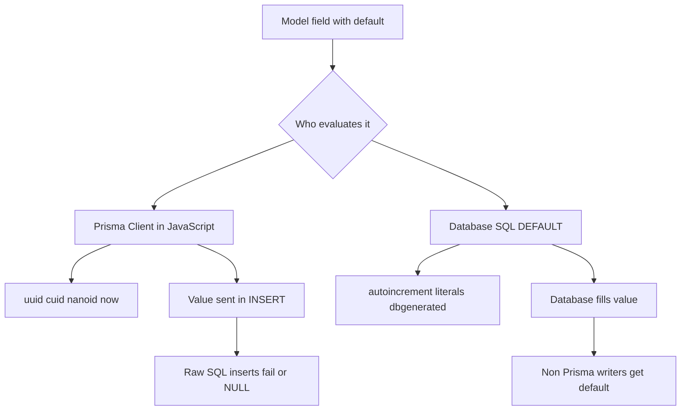

# The `@default` Attribute: Where Defaults Actually Live

## English

Every column in a Prisma model can declare a `@default(...)`, but the crucial thing to understand is *who* applies that default. Some defaults are evaluated by Prisma Client in JavaScript before the query is sent, and others are pushed into the database as a real SQL `DEFAULT` clause. The difference matters enormously when something other than Prisma writes to the table.

Prisma-level defaults include `@default(uuid())`, `@default(cuid())`, `@default(nanoid())`, and `@default(now())` in many configurations. These are generated client-side: Prisma Client computes a value and includes it in the INSERT statement. If a background job, an admin script, or another service inserts a row with raw SQL and omits the column, the database has no default and the insert fails or stores NULL. `@default(autoincrement())` is the opposite — it maps to a database sequence or identity column and lives entirely in the database.

Literal defaults like `@default("draft")` or `@default(0)` are also pushed down as SQL defaults during migration, so they behave predictably for everyone. The subtle case is functions. `@default(now())` historically generated timestamps in the client, which means clock skew between application servers can produce slightly out-of-order timestamps. If you need the database's own clock, you may prefer `@default(dbgenerated("now()"))`, which tells Prisma to let the database fill the value and to treat the field as optional on create.

The `dbgenerated()` wrapper is the general escape hatch. It says: Prisma, do not try to generate this; the database will. It is used for things like `@default(dbgenerated("gen_random_uuid()"))` on PostgreSQL, or for columns populated by triggers. The trade-off is that Prisma Client no longer knows the value at insert time, so the field becomes optional in the generated `create` input and may come back as `undefined` unless you re-read the row.

A practical rule: if the column's correctness matters to code outside Prisma, prefer a database-side default. If it is purely a convenience for Prisma-managed writes, a client-side default is fine. When reviewing a schema, ask of each `@default`: who is responsible for this value, and what happens when someone else inserts a row? That single question catches a surprising number of production surprises.

## 中文

Prisma 模型中的每個欄位都可以宣告 `@default(...)`，但真正關鍵的問題是：這個預設值是由「誰」套用的？有些預設值是由 Prisma Client 在 JavaScript 端先算好、再塞進 SQL 語句；有些則會被下推成資料庫真正的 `DEFAULT` 子句。這個差別在「不是 Prisma 寫入這張表」時會變得非常重要。

Prisma 端的預設值包括 `@default(uuid())`、`@default(cuid())`、`@default(nanoid())`，以及許多設定下的 `@default(now())`。這些值由 client 端產生：Prisma Client 會算出一個值，然後放進 INSERT 語句裡。如果背景任務、管理腳本或另一個服務用原生 SQL 插入一列並省略了該欄位，資料庫本身並沒有預設值，插入就會失敗或存成 NULL。`@default(autoincrement())` 則相反——它對應到資料庫的 sequence 或 identity 欄位，完全活在資料庫裡。

像 `@default("draft")` 或 `@default(0)` 這類字面值預設，在遷移時也會被下推成 SQL 預設值，所以對所有寫入者行為一致。真正微妙的是函式型預設。`@default(now())` 在歷史上是由 client 端產生時間戳，這代表應用伺服器之間的時鐘偏移可能造成時間戳略微亂序。如果你需要資料庫自己的時鐘，可以考慮 `@default(dbgenerated("now()"))`，它告訴 Prisma 讓資料庫自己填值，並在 create 時把該欄位視為可選。

`dbgenerated()` 是通用的逃生口。它的意思是：Prisma，你不要自己產生，資料庫會負責。它常用於 `@default(dbgenerated("gen_random_uuid()"))`（PostgreSQL）或由 trigger 填入的欄位。代價是 Prisma Client 在插入時並不知道該值，因此該欄位在產生的 `create` 輸入型別中會變成可選，而且除非你重新讀取該列，否則可能拿到 `undefined`。

實用原則是：如果這個欄位的正確性對 Prisma 以外的程式碼有影響，就優先選資料庫端預設；如果它只是 Prisma 寫入時的方便，client 端預設就夠了。審閱 schema 時，對每個 `@default` 都問一句：這個值由誰負責？別人插入一列時會發生什麼事？光是這個問題，就能攔下不少生產環境的意外。

## Key Takeaway

A Prisma default is either computed by the client or pushed into the database — knowing which one applies tells you whether non-Prisma writers will get a value at all.

## Related Concepts
- dbgenerated() and Database-Side Defaults
- Schema as a Contract With Your Team

## Diagram

