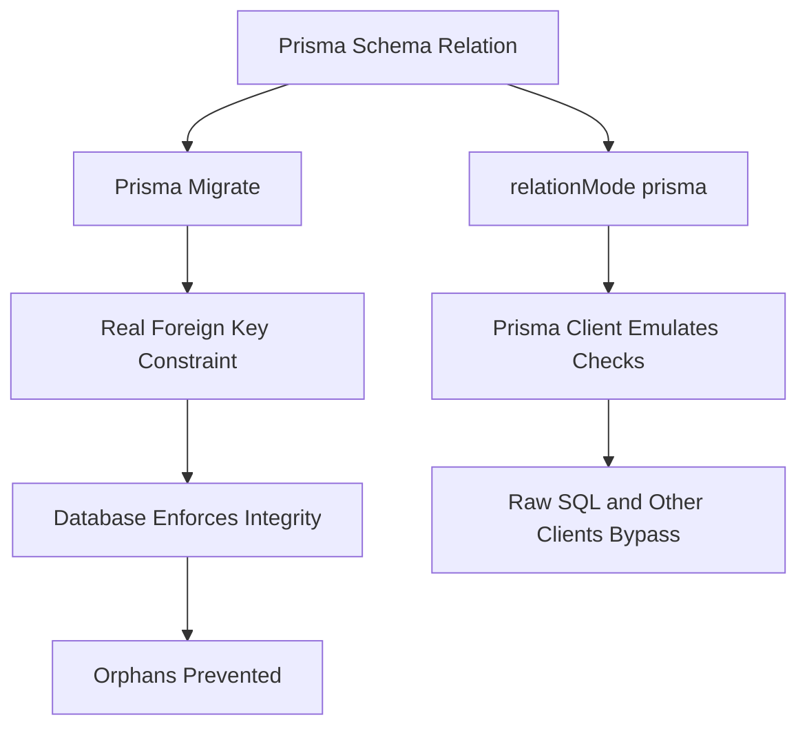

# Referential Integrity in Prisma: What the ORM Enforces vs What the Database Enforces

## English

Prisma's schema language lets you express relations, and it also lets you express them in ways your database may or may not actually enforce. Understanding this gap is essential for anyone who assumes the ORM is the last line of defence for data integrity.

When you write a relation like `posts Post[]` on `User` and `author User @relation(fields: [authorId], references: [id])` on `Post`, Prisma Migrate will normally generate a real foreign key constraint in the underlying database. That means the database itself refuses to insert a `Post` whose `authorId` does not exist, and it refuses to delete a `User` who still has posts (unless a referential action says otherwise). This is the strong case: the constraint exists at the storage layer, and any tool — psql, a migration script, another service — is bound by it.

The weaker case is `relationMode = "prisma"`, which you set in the datasource block. Some databases (notably PlanetScale's MySQL offering, historically) do not support foreign keys, or you may deliberately turn them off to avoid locking overhead. In that mode, Prisma Client emulates referential integrity in application code: it checks existence before inserts and updates, and it performs the cascade or restrict behaviour itself when you delete through Prisma. But raw SQL, other services, and direct database access bypass those checks entirely. The database will happily store orphaned rows.

Even in the strong case, there is a subtlety about *when* the check happens. Prisma Client does not necessarily know the state of the database when you call `connect` on a nested write; it may issue a query and let the database reject it with a foreign key violation. That error surfaces as a `PrismaClientKnownRequestError` with a specific code (for example P2003 for a foreign key constraint failure), which your code must handle. The ORM is not pre-validating every reference — it is relaying the database's verdict.

A related trap is that Prisma's `@relation` does not change how the database behaves; it describes it. If you add a relation to the schema but your migration is missing the constraint (because you edited SQL by hand, or because you are on `relationMode = "prisma"`), your TypeScript types will still look correct and your queries will still compile. The type system is a compile-time promise; the constraint is a runtime one. Keep them in sync by letting Prisma Migrate own the DDL, and by testing against a real database where the constraint actually exists.

## 中文

Prisma 的 schema 語言讓你表達關聯，同時也讓你用「資料庫未必真的會強制執行」的方式表達關聯。對於任何假設 ORM 是資料完整性最後防線的人來說，理解這個落差至關重要。

當你在 `User` 上寫 `posts Post[]`、在 `Post` 上寫 `author User @relation(fields: [authorId], references: [id])` 時，Prisma Migrate 通常會在底層資料庫產生真正的外鍵約束。這代表資料庫本身會拒絕插入 `authorId` 不存在的 `Post`，也會拒絕刪除仍有貼文的 `User`（除非參照動作另有規定）。這是強約束的情況：約束存在於儲存層，任何工具——psql、遷移腳本、另一個服務——都受它約束。

較弱的情況是 `relationMode = "prisma"`，在 datasource 區塊設定。有些資料庫（歷史上特別是 PlanetScale 的 MySQL 方案）不支援外鍵，或者你為了避免鎖定開銷而刻意關掉。在這個模式下，Prisma Client 在應用程式碼裡模擬參照完整性：插入與更新前先檢查存在性，刪除時由 Prisma 自己執行 cascade 或 restrict 行為。但原生 SQL、其他服務、直接存取資料庫都會完全繞過這些檢查。資料庫會若無其事地存下孤兒列。

即使在強約束的情況下，也有一個關於「檢查時機」的微妙點。當你在巢狀寫入中呼叫 `connect`，Prisma Client 未必知道資料庫當下的狀態；它可能直接發出查詢，讓資料庫以外部鍵違反來拒絕。這個錯誤會以 `PrismaClientKnownRequestError` 搭配特定代碼浮現（例如外部鍵約束失敗的 P2003），你的程式碼必須處理它。ORM 並不是在預先驗證每個參照——它是在轉達資料庫的判決。

另一個相關陷阱是：Prisma 的 `@relation` 不會改變資料庫行為，它只是描述。如果你在 schema 加了關聯，但遷移裡缺少該約束（因為你手改了 SQL，或因為你用了 `relationMode = "prisma"`），你的 TypeScript 型別看起來仍然正確，查詢也仍然能編譯。型別系統是編譯期的承諾；約束是執行期的。讓 Prisma Migrate 掌握 DDL，並且在真的存在約束的真實資料庫上測試，才能讓兩者保持一致。

## Key Takeaway

Prisma relations describe constraints; whether they are actually enforced depends on the database and on relationMode, so never assume the ORM is validating references for you.

## Related Concepts
- relationMode and Foreign Key Emulation
- Referential Actions: What Happens to Children When a Parent Dies

## Diagram

