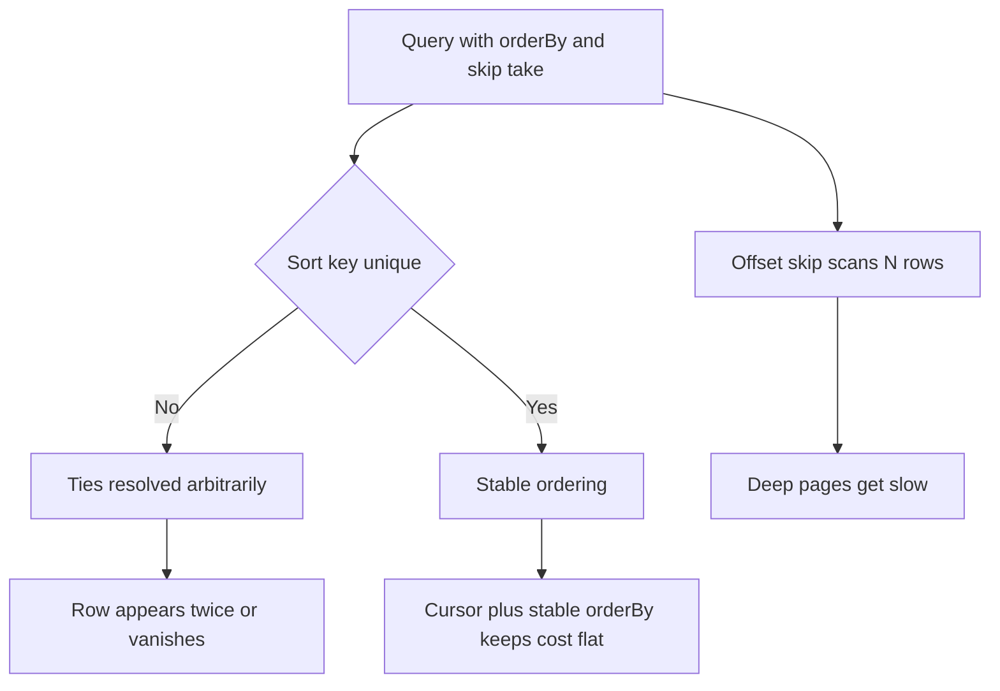

# Sorting, Pagination and Stable Ordering: Why `skip` and `take` Are Trickier Than They Look

## English

Prisma's `orderBy`, `skip` and `take` look like a simple pagination toolkit, and for small tables they are. But pagination is one of the places where a naive ORM call quietly produces wrong results at scale, and understanding why is a genuinely useful piece of database literacy.

The first issue is ordering stability. SQL does not guarantee any order unless you ask for one, and even when you do, ties are resolved arbitrarily unless the sort key is unique. If you call `orderBy: { createdAt: 'desc' }` and two rows share the exact same timestamp, the database may return them in different orders on different queries. For offset pagination (`skip: 20, take: 10`), that means a row can appear on two pages or vanish entirely between requests. The fix is to add a unique tiebreaker: `orderBy: [{ createdAt: 'desc' }, { id: 'desc' }]`. This is not a Prisma quirk — it is how SQL works — but Prisma makes it easy to forget because the API reads so smoothly.

The second issue is that `skip` is not free. Offset pagination in most databases means the engine must scan and discard the first N rows before returning the page. Page 1 is cheap; page 1000 is not. This is the classic reason large APIs switch to cursor pagination, where you say 'give me rows after this one' rather than 'skip N'. Prisma supports this pattern through `cursor` and `skip: 1`, combined with a stable `orderBy`. You fetch the last row's unique key, then ask for the next page starting after it. The database can use an index seek instead of a scan, so the cost stays roughly constant no matter how deep you are.

A third subtlety is that `take` interacts with relations. If you `include` a to-many relation and also apply `take`, the limit applies to the parent rows, not the children. To limit children per parent you need a nested `take` inside the relation's `select` or `include`, and even then the semantics are per-parent, not global. This is a common source of confusion when building things like 'latest three comments per post', where people expect one number to do two jobs.

Finally, there is the question of total counts. Prisma offers `count()` as a separate call, and there is no built-in 'return rows plus total' in a single query. For a UI showing 'page 3 of 47', you either run a second count query (which can be expensive on large tables) or accept an approximate count. Recognising these trade-offs early — stable ordering, cursor pagination, per-parent limits, and the cost of counting — turns pagination from a one-liner into a deliberate design decision.

## 中文

Prisma 的 `orderBy`、`skip` 和 `take` 看起來是一套簡單的分頁工具，對小表而言確實如此。但分頁正是那種「樸素的 ORM 呼叫在規模變大後悄悄產生錯誤結果」的地方，理解原因是一項很實用的資料庫素養。

第一個問題是排序穩定性。除非你要求，SQL 不保證任何順序；即使你要求了，若排序鍵不唯一，同值列的順序也是任意的。如果你呼叫 `orderBy: { createdAt: 'desc' }`，而有兩列的 timestamp 完全相同，資料庫在不同查詢中可能以不同順序回傳它們。對偏移分頁（`skip: 20, take: 10`）而言，這代表某一列可能在兩頁都出現，或在請求之間完全消失。解法是加上唯一的決勝鍵：`orderBy: [{ createdAt: 'desc' }, { id: 'desc' }]`。這不是 Prisma 的怪癖——這就是 SQL 的運作方式——但 Prisma 的 API 讀起來太順，容易讓人忘記。

第二個問題是 `skip` 並不免費。在大多數資料庫中，偏移分頁意味著引擎必須掃描並丟棄前 N 列，才回傳這一頁。第 1 頁很便宜；第 1000 頁不是。這是大型 API 轉向遊標分頁的經典原因：你說「給我這一列之後的資料」，而不是「跳過 N 列」。Prisma 透過 `cursor` 搭配 `skip: 1`，再加上穩定的 `orderBy` 支援這個模式。你取得最後一列的唯一鍵，然後要求從它之後開始的下一頁。資料庫可以用索引 seek 取代掃描，所以無論你翻得多深，成本大致不變。

第三個微妙點是 `take` 與關聯的互動。如果你 `include` 一對多關聯又套用 `take`，限制作用在父列，而不是子列。若要限制每個父列的子列數，你得在該關聯的 `select` 或 `include` 裡放巢狀 `take`，而且即便如此，語意也是「每個父列」，不是全域。這在打造「每篇貼文最新三則留言」這類功能時常造成混淆，人們以為一個數字能同時做兩件事。

最後是總數問題。Prisma 把 `count()` 當成獨立呼叫，並沒有內建「一次查詢回傳資料列加總數」。若 UI 要顯示「第 3 頁，共 47 頁」，你要嘛再跑一次 count 查詢（在大表上可能很貴），要嘛接受近似計數。及早認清這些取捨——穩定排序、遊標分頁、逐父列限制、計數成本——就能把分頁從一行程式碼變成有意識的設計決策。

## Key Takeaway

Pagination in Prisma is only correct when your ordering is deterministic and your strategy matches your scale — offset is easy but unstable and slow deep, cursors are stable and cheap but require a unique sort key.

## Related Concepts
- Cursor Pagination and Stable Ordering
- The N+1 Problem and Query Cost

## Diagram

