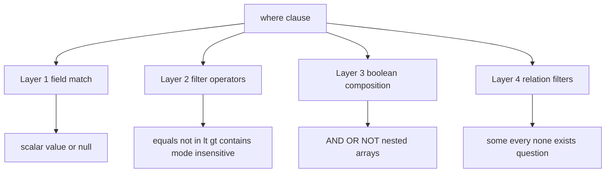

# The `where` Clause as a Filter Language: Operators, Boolean Logic and the Shape of a Query

## English

Most people meet Prisma's `where` object on day one and assume it is a simple equality map: `{ email: "a@b.com" }`. In reality `where` is a small expression language with three layers stacked on top of each other, and knowing the layers is what separates queries that read well from queries that quietly return the wrong rows. The first layer is the plain field match — a scalar value, or `null` for `IS NULL`. The second layer is the filter object: instead of a bare value you pass an object of operators such as `equals`, `not`, `in`, `notIn`, `lt`, `lte`, `gt`, `gte`, `contains`, `startsWith`, `endsWith`, and the case-sensitivity modifier `mode: 'insensitive'` on the databases that support it (PostgreSQL and MongoDB; MySQL's default collation is already case-insensitive, and SQLite needs care). So `{ name: { contains: 'ada', mode: 'insensitive' } }` becomes a `LIKE '%ada%'` with a case-folding collation or `ILIKE` depending on the connector.

The third layer is composition. Every field key can also take a list, which Prisma reads as AND: `{ name: { startsWith: 'A' }, email: { endsWith: '.org' } }` means both. To express OR you use the top-level `OR` array, and to express NOT you use `NOT`, which itself accepts a filter object or an array (an array of NOTs is read as NOT (a OR b), which surprises people — read the docs carefully before you rely on it). You can nest `AND` and `OR` arrays arbitrarily, and Prisma will translate the tree into a parenthesised SQL boolean expression. This is why a `where` that looks flat in TypeScript can compile to a surprisingly deep `WHERE (... AND (... OR ...))` in SQL.

Relations add a fourth dimension. A relation filter does not compare a column — it asks an existence question. Passing `{ posts: { some: { published: true } } }` compiles to an `EXISTS` subquery (or a join, depending on the connector and query shape), while `every`, `none` and `some` are the four quantifiers you get. `none` is the one people forget: `{ posts: { none: { published: false } } }` means "has no unpublished posts", which is not the same as "has at least one published post". Getting the quantifier right is often the difference between a report that is correct and one that is subtly wrong for months.

Finally, remember that `where` is shared across `findMany`, `findFirst`, `findUnique`, `updateMany`, `deleteMany`, `count`, `aggregate` and `groupBy`, but `findUnique` is special: it only accepts unique fields (or a compound unique), because it is compiled to a lookup by primary key or unique index rather than a general filter. If you find yourself writing `findFirst` with a `where` on a unique column, you are usually paying for a scan you did not need. A useful habit is to sketch the SQL you expect before you write the Prisma call; if the two do not match, one of them is wrong, and it is usually the mental model.

## 中文

大部分人第一次接觸 Prisma 的 `where` 物件時，都會以為它只是簡單的等值對照：`{ email: "a@b.com" }`。實際上 `where` 是一門小型表達式語言，由一層層疊起來的三個層次組成；分得清這幾層，正是「讀起來順眼」的查詢與「靜靜地回傳錯誤資料列」的查詢之間的分界線。第一層是純欄位比對——一個純量值，或者用 `null` 表示 `IS NULL`。第二層是篩選物件：你不傳裸值，而是傳一個運算子物件，例如 `equals`、`not`、`in`、`notIn`、`lt`、`lte`、`gt`、`gte`、`contains`、`startsWith`、`endsWith`，以及在支援的資料庫上可用的大小寫修飾符 `mode: 'insensitive'`（PostgreSQL 與 MongoDB 支援；MySQL 的預設 collation 本身已不分大小寫，SQLite 則要小心處理）。所以 `{ name: { contains: 'ada', mode: 'insensitive' } }` 會視乎連接器，變成帶大小寫折疊 collation 的 `LIKE '%ada%'` 或 `ILIKE`。

第三層是組合。每個欄位鍵也可以接受一個陣列，Prisma 會把它讀成 AND：`{ name: { startsWith: 'A' }, email: { endsWith: '.org' } }` 代表兩者都要成立。要表達 OR，就用頂層的 `OR` 陣列；要表達 NOT，就用 `NOT`，而 `NOT` 本身接受一個篩選物件或一個陣列（一個 NOT 陣列會被讀成 NOT (a OR b)，這一點常令人意外——依賴它之前請先仔細看文件）。`AND` 與 `OR` 陣列可以任意嵌套，Prisma 會把整棵樹翻譯成加了括號的 SQL 布林表達式。這就是為甚麼在 TypeScript 裡看起來扁平的 `where`，編譯出來的 SQL 可能是一層頗深的 `WHERE (... AND (... OR ...))`。

關聯會加上第四個維度。關聯篩選並不是比較某個欄位——它問的是一個存在性問題。傳入 `{ posts: { some: { published: true } } }` 會編譯成 `EXISTS` 子查詢（或 join，視乎連接器與查詢形狀），而 `every`、`none`、`some` 就是你手上的四個量詞。`none` 是最多人忘記的一個：`{ posts: { none: { published: false } } }` 的意思是「沒有任何未發佈的文章」，跟「至少有一篇已發佈文章」並不相同。量詞選錯，往往就是一份報表正確與否、而且錯誤可能潛伏幾個月的關鍵。

最後要記住，`where` 在 `findMany`、`findFirst`、`findUnique`、`updateMany`、`deleteMany`、`count`、`aggregate` 與 `groupBy` 之間是共用的，但 `findUnique` 很特別：它只接受唯一欄位（或複合唯一鍵），因為它會被編譯成按主鍵或唯一索引的查找，而不是一般篩選。如果你發現自己在唯一欄位上用 `findFirst` 加 `where`，你多數是在付一個不必要的全表掃描代價。一個好習慣是：寫 Prisma 呼叫之前，先草擬你預期會產生的 SQL；如果兩者對不上，其中一個一定錯了——而錯的通常是你的心智模型。

## Key Takeaway

Prisma's `where` is not a flat equality map but a layered expression language — field operators, boolean composition, and relation quantifiers — and getting the quantifier and nesting right is what keeps queries correct.

## Related Concepts
- SQL WHERE clause semantics
- EXISTS subqueries

## Diagram

