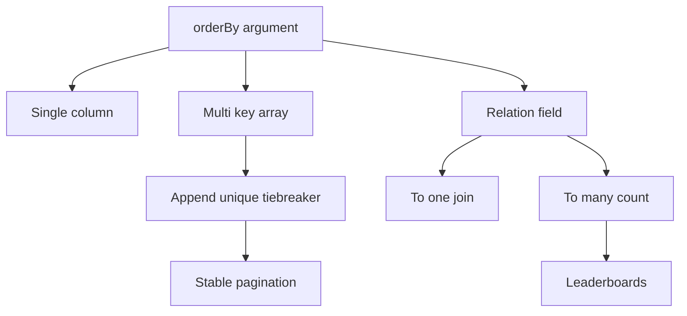

# Ordering by a Relation: `orderBy` Beyond a Single Column

## English

`orderBy` looks like the simplest argument in the whole client: pass `{ createdAt: 'desc' }` and you are done. But Prisma's `orderBy` accepts more than a column name, and the extra shapes are where real applications live. The first is the multi-key form: an array of order objects, applied left to right, exactly like SQL's `ORDER BY a, b DESC`. `orderBy: [{ lastName: 'asc' }, { firstName: 'asc' }]` is the difference between a contact list that is stable and one that shuffles between page loads. If you only sort by a non-unique column, the database is free to return ties in any order it likes, and that order can change between queries — which is why pagination by `skip`/`take` on a non-unique sort key can drop or duplicate rows. Always append a unique tiebreaker.

The second shape is ordering by a related record's field. For a to-one relation you write `orderBy: { author: { name: 'asc' } }`, and Prisma compiles it to a join plus an `ORDER BY` on the joined table's column. For a to-many relation you must say how to collapse the many into one value: Prisma supports `_count` aggregates in `orderBy`, so `orderBy: { posts: { _count: 'desc' } }` sorts users by how many posts they have. That is a genuinely useful primitive — leaderboards, "most active" lists, dashboards — and it compiles to a correlated subquery or a grouped join depending on the connector. What Prisma does not give you is ordering by an arbitrary aggregate like `SUM(price)` or `MAX(createdAt)` of a relation; for those you reach for `groupBy`/`aggregate` or a raw query.

The third thing to know is where `orderBy` interacts badly with other features. `findMany` with `distinct` plus `orderBy` on a non-selected column can behave differently across connectors, because `DISTINCT` and `ORDER BY` are evaluated in a specific order by the SQL standard and some engines reject ordering by a column not in the select list. Similarly, `cursor`-based pagination depends on a stable, unique ordering — a cursor is just "start after this row", and if the sort is ambiguous the cursor points into fog.

On the performance side, an `ORDER BY` on a column with no index forces a sort of the whole result set before the limit is applied. A composite index whose column order matches your `orderBy` (and your `where`) lets the database walk the index instead of sorting — this is why `@@index([userId, createdAt])` is such a common line in real schemas. If you see a query that is fast for small tables and slow for big ones, the sort is usually the culprit, not the filter. Reading the query plan (via `EXPLAIN` in `$queryRaw` or your database's tooling) will show a `Sort` node where you expected an index scan, and that is your cue to add the index rather than to rewrite the query.

## 中文

`orderBy` 看起來是整個 client 裡最簡單的參數：傳 `{ createdAt: 'desc' }` 就完事。但 Prisma 的 `orderBy` 接受的東西不止一個欄位名，而那些額外的形狀，正是真實應用所在之處。第一種是多鍵形式：一個排序物件陣列，由左至右套用，跟 SQL 的 `ORDER BY a, b DESC` 完全一樣。`orderBy: [{ lastName: 'asc' }, { firstName: 'asc' }]` 就是「穩定」與「每次載入都重新洗牌」的通訊錄之間的分別。如果你只按一個非唯一欄位排序，資料庫可以任意決定並列項的次序，而這個次序可能在兩次查詢之間改變——這就是為甚麼在非唯一排序鍵上用 `skip`/`take` 分頁，會漏掉或重複資料列。永遠要附加一個唯一的決勝鍵。

第二種形狀是按關聯記錄的欄位排序。對於 to-one 關聯，你寫 `orderBy: { author: { name: 'asc' } }`，Prisma 會編譯成 join 加上對被 join 資料表欄位的 `ORDER BY`。對於 to-many 關聯，你必須說明如何把「多」壓成「一」：Prisma 在 `orderBy` 支援 `_count` 聚合，所以 `orderBy: { posts: { _count: 'desc' } }` 會按用戶有多少篇文章來排序。這是一個真正有用的原語——排行榜、最活躍名單、儀表板——視乎連接器，它會編譯成相關子查詢或分組 join。Prisma 沒有給你的，是按關聯的任意聚合（例如 `SUM(price)` 或 `MAX(createdAt)`）排序；那些情況你要用 `groupBy`／`aggregate` 或原生查詢。

第三件要知道的事，是 `orderBy` 與其他功能互動時容易出問題的地方。`findMany` 搭配 `distinct`，再加上對未被選取欄位的 `orderBy`，在不同連接器上行為可能不同，因為 SQL 標準規定了 `DISTINCT` 與 `ORDER BY` 的求值次序，而某些引擎會拒絕按不在 select 清單中的欄位排序。同樣地，以 `cursor` 為基礎的分頁依賴穩定且唯一的排序——cursor 的意思只是「由這一列之後開始」，如果排序有歧義，cursor 就指向一片迷霧。

在效能方面，對沒有索引的欄位做 `ORDER BY`，會迫使資料庫在套用 limit 之前先排序整個結果集。一個欄位次序與你的 `orderBy`（以及 `where`）吻合的複合索引，可以讓資料庫沿索引行走而不必排序——這就是為甚麼 `@@index([userId, createdAt])` 在真實 schema 中如此常見。如果你見到某個查詢在小表上很快、在大表上很慢，罪魁禍首通常是排序而不是篩選。讀查詢計劃（在 `$queryRaw` 裡用 `EXPLAIN`，或你資料庫自己的工具）會在你預期索引掃描的地方顯示一個 `Sort` 節點，那就是提示你加索引、而不是改寫查詢的信號。

## Key Takeaway

`orderBy` supports multi-key and relation-based ordering, but stable pagination and good performance both depend on a unique tiebreaker and an index whose column order matches the sort.

## Related Concepts
- SQL ORDER BY and sort stability
- Composite index column order

## Diagram

