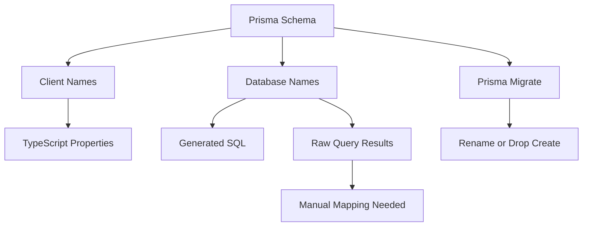

# Client-Side Field Mapping: `@map` and `@@map` and Living With a Legacy Schema

## English

Prisma lets you name things twice. The name in your schema — the one that becomes a TypeScript property — does not have to be the name in the database. `@map` renames a single column, `@@map` renames a whole table, and the same pair exists for enum values (`@map` on an enum member). This sounds like a cosmetic feature until you meet a database you did not design: tables called `tbl_usr_mst`, columns called `usr_nm`, or a schema where every column is prefixed with the table abbreviation because that was the convention in 2004. Without mapping, you either rename the database (a migration nobody wants to run) or you accept ugly names in your application code forever. With mapping, the schema stays idiomatic — `model User { id Int @id @map("usr_id") name String @map("usr_nm") @@map("tbl_usr_mst") }` — and the generated client exposes `user.name` while the SQL says `usr_nm`.

The mechanism is purely at the client and migration layers. The Prisma schema is the source of truth for the mapping, and the generated SQL uses the database names; the generated TypeScript uses the schema names. That means the mapping is not free of consequences: when you read a raw query result with `$queryRaw`, you get the database column names back, not the mapped ones, so a `SELECT usr_nm FROM tbl_usr_mst` returns `{ usr_nm: '...' }` and you have to map it yourself. TypedSQL has the same property — it types the SQL you wrote, against the SQL names. This is a common source of confusion in codebases that mix the client and raw queries.

Mapping also matters for migrations. When you add `@map` to an existing field, Prisma Migrate sees the database name change and will generate a rename (or, depending on the connector and how you have configured things, a drop-and-create). Renaming a column is one of those operations that looks harmless and is not: it can break views, triggers, stored procedures and any application still running the old code during a rolling deploy. The safe pattern is to add the new column, backfill, dual-write, then remove the old one — the expand-contract dance — and treat the Prisma rename as the last step, not the first.

There is a subtler point about consistency. If half your models use `@@map` and half do not, your schema becomes a map of historical accidents, and new team members cannot tell which names are "real" and which are aliases. A useful convention is to decide early: either the schema mirrors the database exactly (no mapping, ugly names, zero surprises) or the schema is the canonical domain language and every table and column is mapped (clean names, one extra layer to check when debugging SQL). Both are defensible; drifting between them is not. Whichever you choose, document it in the schema file itself, because the person reading it in two years will not have the context you have today.

## 中文

Prisma 讓你為同一樣東西取兩個名字。schema 裡的名字——也就是會變成 TypeScript 屬性的那個——不必等於資料庫裡的名字。`@map` 重新命名單一欄位，`@@map` 重新命名整張表，而 enum 值也有同樣的一對（在 enum 成員上用 `@map`）。這聽起來像裝飾性功能，直到你遇上一個不是由你設計的資料庫：表叫 `tbl_usr_mst`、欄位叫 `usr_nm`，或者整個 schema 每個欄位都加上表縮寫前綴，因為那是 2004 年的慣例。沒有映射，你要麼重新命名資料庫（一個沒人想跑的遷移），要麼永遠在應用程式碼裡接受醜陋的名字。有了映射，schema 可以保持地道——`model User { id Int @id @map("usr_id") name String @map("usr_nm") @@map("tbl_usr_mst") }`——生成的 client 對外提供 `user.name`，而 SQL 裡寫的是 `usr_nm`。

這個機制純粹存在於 client 與遷移層。Prisma schema 是映射的唯一真相來源，生成的 SQL 使用資料庫名字，生成的 TypeScript 使用 schema 名字。這意味著映射並非沒有後果：當你用 `$queryRaw` 讀取原生查詢結果時，拿到的是資料庫欄位名而不是映射後的名字，所以 `SELECT usr_nm FROM tbl_usr_mst` 會回傳 `{ usr_nm: '...' }`，你得自己映射。TypedSQL 也有同樣的性質——它為你寫的 SQL 提供型別，對應的是 SQL 名字。在同時混用 client 與原生查詢的專案裡，這是常見的混淆來源。

映射對遷移也有影響。當你為一個既有欄位加上 `@map`，Prisma Migrate 會看到資料庫名字改變，並生成一個重新命名（或者，視乎連接器與你的設定，可能是刪除再建立）。重新命名欄位正是那種看起來無害、實際上不是的操作：它可能弄壞 view、trigger、stored procedure，以及滾動部署期間仍在跑舊版程式的任何應用。安全的做法是先加新欄位、回填、雙寫，然後移除舊欄位——也就是 expand-contract 的做法——並把 Prisma 的重新命名當成最後一步，而不是第一步。

還有一點更微妙的關於一致性。如果你一半 model 用 `@@map`、一半不用，schema 就變成了一張歷史意外地圖，新加入的團隊成員分不清哪些名字是「真」的、哪些是別名。一個有用的慣例是及早決定：要麼 schema 完全鏡像資料庫（不用映射、名字醜、零意外），要麼 schema 就是正典的領域語言、每張表每個欄位都映射（名字乾淨，除錯 SQL 時多一層要查）。兩者都站得住腳；在兩者之間漂移則不行。無論你選哪一種，都把它寫在 schema 檔案裡，因為兩年後讀它的人不會有你今天擁有的背景。

## Key Takeaway

`@map` and `@@map` let your schema speak domain language while the database keeps its legacy names, but the mapping only exists at the client layer — raw queries and migrations still see the real names.

## Related Concepts
- Legacy database schema migration
- Expand-contract schema evolution

## Diagram

