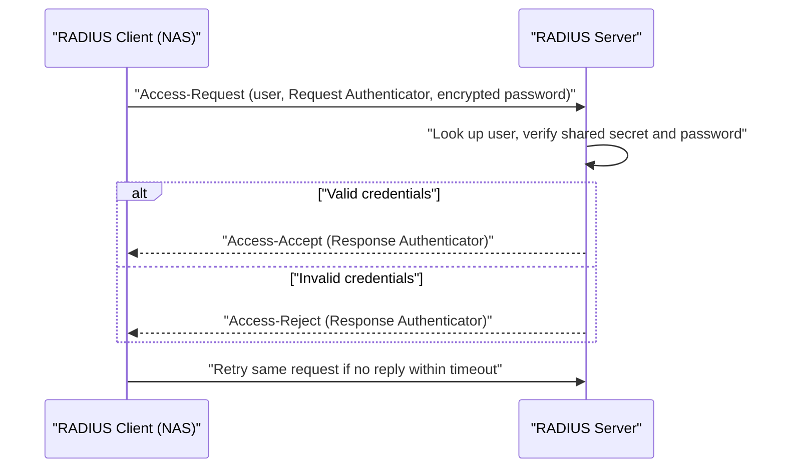

# How RADIUS Talks: Packets, Codes, and Shared Secrets

### English

RADIUS is a client/server protocol that lets a device ask a central server a simple question: "may this user connect?" The device asking is the RADIUS client (NAS — Network Access Server) and the answering server is the RADIUS server (FreeRADIUS is the most common open-source one). They talk over UDP, normally port 1812 for authentication and 1813 for accounting.

Every message is a RADIUS packet, and every packet starts with a Code byte that says what kind of message it is. The three you will meet first are Access-Request (1), Access-Accept (2), and Access-Reject (3). The full exchange is a three-step handshake. The client sends an Access-Request containing the user's name, a request authenticator (a random 16-byte value), and the encrypted password. The server replies with either Access-Accept or Access-Reject, and its reply includes a Response Authenticator computed from the request's authenticator, the shared secret, and the reply packet.

That shared secret is the heart of the security model. Each client/server pair is configured with a long random string, and it is used as a key to scramble the password with the Request Authenticator, so the password is never sent in clear text. It also authenticates the server to the client. This is like a locked mailbox: anyone without the key can read the envelope and see a message, but cannot produce one the server will accept.

The same shared secret also protects the integrity of the whole packet, so replies cannot be tampered with. Because RADIUS is UDP and connectionless, the client normally retries a request if no reply arrives within a few seconds, using the same authenticator so the server can recognise a duplicate.

RADIUS is intentionally simple: one question, one answer, one shared secret per link. That simplicity is why it is supported by every VPN, firewall, and Wi-Fi controller ever made.

### 中文

RADIUS 是一個客戶端／伺服器協定，讓裝置向中央伺服器問一個簡單問題：「這個用戶可以連線嗎？」發問的裝置叫 RADIUS 客戶端（NAS，網絡接入伺服器），回答的一方叫 RADIUS 伺服器（最常見的開源實作是 FreeRADIUS）。兩者用 UDP 溝通，慣常 1812 埠處理驗證、1813 埠處理會計（accounting）。

每個訊息都是一個 RADIUS 封包，開頭的 Code 位元組說明封包種類。最常見的是 Access-Request（1）、Access-Accept（2）同 Access-Reject（3）。整個流程是三步握手：客戶端送出 Access-Request，內含用戶名稱、請求 authenticator（隨機 16 位元組值），以及經加密的密碼；伺服器比對後回覆 Access-Accept 或 Access-Reject，並附上用共享密鑰與請求 authenticator 計算出來的 Response Authenticator。

共享密鑰（shared secret）是整個安全模型的核心。每對客戶端與伺服器都配置一條長隨機字串，它用來把密碼連同 Request Authenticator 一起擾亂，令密碼絕不會以明文傳送，同時亦證明伺服器身分。整個封包也有完整性保護，回覆無法被篡改。由於 RADIUS 是無連線的 UDP，若數秒內收不到回覆，客戶端通常會以相同 authenticator 重試，讓伺服器認出重複請求。

RADIUS 刻意保持簡單：一問一答、每條鏈路一條共享密鑰。正因如此，各種 VPN、防火牆與無線控制器幾乎全部支援它。

## Key Takeaway
RADIUS authenticates with a three-packet Access-Request/Accept/Reject exchange, and a per-pair shared secret both encrypts the password and proves the identity of the server.

## Related Concepts
- RADIUS attributes (AVP: Attribute-Value Pairs)
- Request and Response Authenticators
- MD5-based request authentication
- UDP retransmission and duplicate detection

## Diagram

