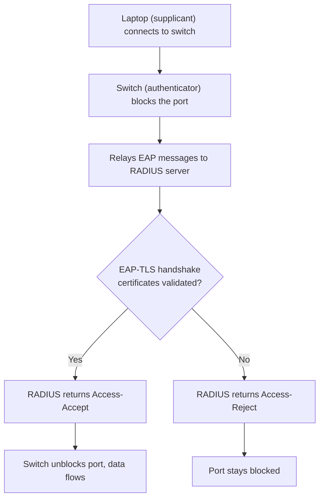

# EAP and 802.1X: How Network Access Authentication Really Works

### English

Plain RADIUS authentication has a problem: the server has to receive something it can check, which for a password means the password itself travels over the network (encrypted, but still checkable). Extensible Authentication Protocol (EAP) was designed to fix this. EAP is a framework, not one method: it defines how a client and an authentication server can run a multi-round conversation where the server proves it knows the secret without ever receiving the password itself. Each EAP type (EAP-MD5, EAP-TLS, EAP-TTLS, PEAP, LEAP) is one such conversation.

The best-known type today is EAP-TLS. It runs inside TLS, the same encrypted transport used for HTTPS. The server presents a digital certificate, the client presents a certificate too (or a password inside the TLS channel), and both sides validate each other using public-key cryptography. The user's password never leaves the machine in a form the server can read. A simple analogy: instead of showing the guard your secret to prove who you are, you both hold a government-issued ID that the guard can check against a public list.

EAP usually runs inside 802.1X, the IEEE standard that makes port-based network access control work. 802.1X defines three roles: the supplicant (the client device, e.g. a laptop), the authenticator (the switch or wireless access point that holds the physical port), and the authentication server (which is normally a RADIUS server behind the authenticator). When you plug into a corporate wired network, the switch does not forward your traffic at all — it puts the port in a "blocked" state and relays EAP messages between your laptop and the RADIUS server. Only after the server says "Accept" does the switch open the port and let your frames through.

This is why RADIUS and EAP are complementary rather than competing: RADIUS transports the conversation and carries the accounting, while EAP defines the conversation itself and 802.1X defines the network plumbing. EAP-TLS over 802.1X is what modern "certificate-based network access" deployments use.

### 中文

傳統 RADIUS 驗證有一個問題：伺服器必須收到可以核對的東西，即係密碼本身要經過網絡（雖然已加密，但仍可被檢視）。Extensible Authentication Protocol（EAP）正係為解決呢點而設計。EAP 係一個框架而唔係單一方法：它定義客戶端與驗證伺服器可以進行多輪對話，由伺服器證明自己知道密碼，而密碼本身從不需要送出伺服器。每種 EAP 類型（EAP-MD5、EAP-TLS、EAP-TTLS、PEAP、LEAP）就係一種對話方式。

今日最常用的是 EAP-TLS。它跑喺 TLS 內部，即係同 HTTPS 相同的加密傳輸層。伺服器出示數碼證書，客戶端亦出示證書（或喺 TLS 通道內使用密碼），雙方用公鑰密碼學互相驗證。用戶密碼唔會以伺服器可讀嘅形式離開機器。可以咁理解：唔係攞秘密出嚟俾衛兵睇嚟證明身分，而係大家都有政府發出嘅身分證，衛兵可以對住公開名單核實。

EAP 通常跑喺 802.1X 之內。802.1X 定義三個角色：supplicant（客戶端裝置，例如手提電腦）、authenticator（持有實體連接埠的交換器或無線接入點）、authentication server（通常係背後的 RADIUS 伺服器）。當你插上司營網絡，交換器一開始完全唔會轉發任何封包，會將連接埠設為封鎖狀態，只在客戶端與 RADIUS 伺服器之間轉送 EAP 訊息；伺服器回覆 Accept 之後，連接埠先打開，數據可以通過。

所以 RADIUS 同 EAP 係互補而唔係競爭：RADIUS 負責傳送對話同記錄會計，EAP 定義對話本身，802.1X 定義網絡層的接駁方式。EAP-TLS over 802.1X 就係現時基於證書的網絡接入方案。

## Key Takeaway
EAP lets the server verify the user without ever receiving the password, and 802.1X keeps the network port blocked until that verification succeeds.

## Related Concepts
- EAP-TLS and public-key cryptography
- 802.1X port-based access control
- Supplicant, authenticator, and authentication server roles
- Certificate distribution via SCEP or MDPS

## Diagram

