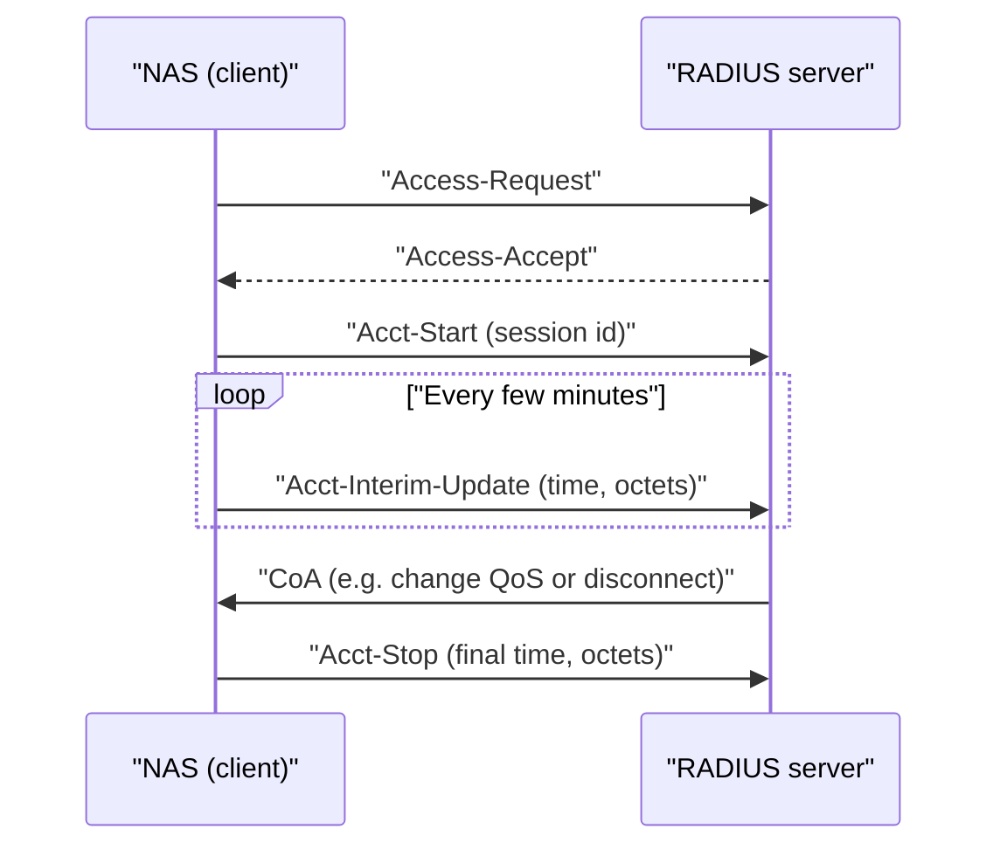

# Accounting, CoA, and Running RADIUS Safely in Production

### English

Authentication tells you who connected; accounting tells you what happened afterwards, for how long, and how much data moved. The accounting flow uses a different packet family: Acct-Start, Acct-Stop, Acct-Interim-Update, and Acct-Status-Server. A typical session sends Acct-Start when the user is authorised, an Acct-Interim-Update every few minutes as a checkpoint, and Acct-Stop when the session ends — with attributes such as Acct-Session-Id, Acct-Session-Time, and Acct-Input-Octets/Acct-Output-Octets. This is what turns a VPN into something you can bill: think of it as the difference between a nightclub door check (authentication) and the door counter that records how long each guest stayed (accounting).

A modern RADIUS setup also needs to be able to change a live session, not just observe it. Two protocols exist for that. CoA (Change of Authorize) lets the server push a new instruction to the NAS — suspend the session, change the QoS profile, or disconnect it — and CoPP (Change of Password) lets the server instruct the NAS to change the user's password on the next connection. Both are client-initiated requests in the reverse direction, authenticated with the same shared secret.

The operational security rules are the part people learn the hard way. Shared secrets must be long and random, treated like API keys, and rotated on a schedule; a leaked secret lets an attacker forge Access-Accept packets for any user. Secrets should never travel in clear text across untrusted networks, and the management interface of the RADIUS server should be reachable only from admin networks. FreeRADIUS ships with `radtest`, a command-line tool that sends a real Access-Request so you can test a server without a real client, and `raddebug` to inspect the packets a live server receives — the standard way to debug a failed login. Redundant pairs of servers behind a load balancer, with the same shared secret configured on each, give you failover for a single server failure.

### 中文

驗證講明「邊個連接咗」，會計（accounting）就講明「之後發生咗咩事、連咗幾耐、傳咗幾多資料」。會計用另一組封包：Acct-Start、Acct-Stop、Acct-Interim-Update 同 Acct-Status-Server。典型流程係用戶獲批時送 Acct-Start，之後每隔幾分鐘送一次 Acct-Interim-Update 做檢查點，離線時送 Acct-Stop，內含 Acct-Session-Id、Acct-Session-Time、Acct-Input-Octets／Acct-Output-Octets 等屬性。呢個就係令 VPN 可以收費的關鍵：比喻夜總會門口查票係驗證，而門口的計數器記住每位客停留幾耐就係會計。

現代 RADIUS 部署仲要能夠改動進行中的連線，唔只係觀察。呢方面有兩個協定：CoA（Change of Authorize）畀伺服器主動推送新指示去 NAS，例如暫停連線、改變 QoS 或強制斷線；CoPP（Change of Password）就係指示 NAS 喺下次連線時更改用戶密碼。兩者方向同一般請求相反，都用同一條共享密鑰驗證。

操作安全規則往往係付出代價先學到。共享密鑰必須夠長、夠隨機，當作 API key 保管，並定期更換；一旦外洩，攻擊者可以為任何用戶偽造 Access-Accept。密鑰唔應該喺不可信網絡上以明文傳送，RADIUS 伺服器的管理介面亦只應由管理網絡存取。FreeRADIUS 內置 `radtest` 工具，可以發送真正嘅 Access-Request，唔使有真實客戶端就能測試伺服器；`raddebug` 則可檢視伺服器收到的封包，係排查登入失敗的標準方法。以負載平衡器後面放一對設定相同共享密鑰的伺服器，就可以做到單機故障時自動 failover。

## Key Takeaway
Accounting packets and CoA/CoPP turn RADIUS from a login checker into a controllable, billable session-management system, and shared-secret hygiene is the whole security story.

## Related Concepts
- Acct-Start / Acct-Stop / Acct-Interim-Update attributes
- CoA and CoPP session control
- radtest and raddebug troubleshooting tools
- Shared secret rotation and high availability

## Diagram

