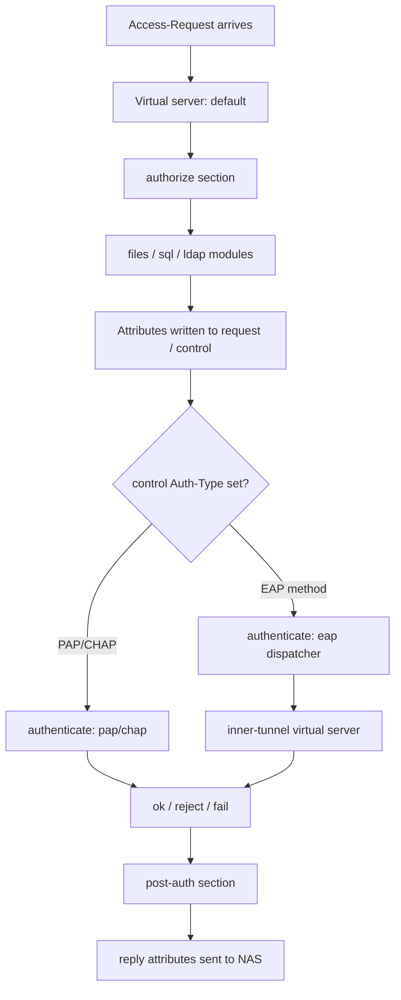

# Inside FreeRADIUS: Virtual Servers, Section Processing, and the Unlang Policy Language

### English

FreeRADIUS is not just a lookup table; it is a **policy engine**. When a packet arrives, the server runs it through a fixed sequence of processing **sections** — `authorize`, `authenticate`, `post-auth`, `preacct`, `accounting`, `session`, and in v4 also `recv` and `send`. Each section is a list of **modules** and **unlang** statements, and the whole thing executes in the context of a **virtual server**. The default configuration ships several virtual servers (`default`, `inner-tunnel`, `post-proxy`, `originate`), each with its own `listen` directives, and each may have its own version of every section — which is why an operator can make a change to `authorize` in one server and find that it has no effect on tunneled traffic.

The mental model that makes all of this click is: **modules look things up, unlang decides what happens next.** A module such as `files` or `sql` reads information and writes attributes into one of several *lists*. The list that matters most is `control`, which holds internal decisions ("what should happen next?"), as opposed to `request` (the original attributes from the network device), `reply` (what goes back to the NAS), `check` (credentials to verify), and `session` (per-session state). Writing to `reply` affects the client; writing to `control` affects the server's own logic.

```unlang
server default {
    authorize {
        preprocess
        files
        sql
        if (&control:Auth-Type == "pap") {
            update control { Auth-Type := Accept }
        }
    }

    authenticate {
        Auth-Type PAP {
            pap
        }
    }

    post-auth {
        Post-Auth-Type REJECT {
            attr_filter.access_reject
        }
    }
}
```

Unlang itself is deliberately minimal — if/else, comparisons, regex matching, attribute editing, and module invocation with return-code branching. It is not a general-purpose language: no loops, no recursion, no subroutines. Its simplicity is a feature, because a RADIUS configuration is security-critical code that many different people touch over the years. When you genuinely need complexity, the documented escape hatch is to write a module in Perl (`rlm_perl`) or Python (`rlm_python`).

Return codes are the vocabulary of the flow. A module returns `ok`, `updated`, `fail`, `reject`, `notfound`, `noop`, `userlock`, `invalid`, or `handled`. The difference between `fail` and `reject` matters: `reject` is a definitive negative answer (the credentials are wrong, so stop), while `fail` means "I could not decide" (the database was unreachable, so try something else). Modules like `pap` return `reject` for a bad password and `fail` for a missing password, and the `redundant` combinator tries the next module on `fail` while stopping immediately on `reject`:

```unlang
authorize {
    redundant {
        sql
        ldap
        files
    }
}
```

Module ordering is therefore a performance decision. Putting `files` (a local text file) before `sql` (a network round trip) means most authentications never touch the network — a good reason the default config runs `files` first. The `eap` module is a special case: rather than deciding by itself, it sets `control:Auth-Type` to the specific EAP method (`EAP-TLS`, `PEAP`, and so on), and the `authenticate` section then dispatches to the right inner handler. This two-stage design is exactly why `inner-tunnel` exists as a separate virtual server: PEAP and TTLS carry a second, encrypted authentication exchange that must be handled by its own policy set.

For shared logic, put reusable unlang snippets in `raddb/policy.d/` and call them by name from several sections — the equivalent of a function, without the risk of a scripting language.

### 中文

FreeRADIUS 並不只是一個查表工具，而是一台**政策引擎（policy engine）**。封包抵達後，伺服器會讓它依固定次序走過一連串處理 **section（區段）** —— `authorize`、`authenticate`、`post-auth`、`preacct`、`accounting`、`session`，在 v4 更有 `recv` 與 `send`。每個 section 都是一串 **module** 與 **unlang** 陳述式，而整個流程是在某個 **virtual server（虛擬伺服器）** 的脈絡下執行。預設設定附帶多個 virtual server（`default`、`inner-tunnel`、`post-proxy`、`originate`），各自有自己的 `listen` 指示，每個都可以有自己的每一個 section 版本 —— 這就是為甚麼有人在 `authorize` 改了設定，卻發現對隧道內的流量完全沒有影響。

真正令這一切都通順的心智模型是：**module 負責查，unlang 負責決定下一步。** `files` 或 `sql` 這類 module 讀取資料，並把屬性寫進幾個不同的 *list*。其中最關鍵的是 `control`，它承載內部決策（「接下來該怎樣做？」）；相對地，`request` 是來自網絡裝置的原始屬性，`reply` 是回傳給 NAS 的內容，`check` 是待驗證的憑證，`session` 則是 per-session 狀態。寫入 `reply` 影響使用者端；寫入 `control` 影響伺服器自己的邏輯。

```unlang
server default {
    authorize {
        preprocess
        files
        sql
        if (&control:Auth-Type == "pap") {
            update control { Auth-Type := Accept }
        }
    }

    authenticate {
        Auth-Type PAP {
            pap
        }
    }

    post-auth {
        Post-Auth-Type REJECT {
            attr_filter.access_reject
        }
    }
}
```

unlang 本身刻意保持精簡 —— 只有 if/else、比較、正規表示式比對、屬性編輯，以及帶回傳碼分支的 module 呼叫。它不是通用語言：沒有迴圈、沒有遞迴、沒有子程式。它的簡單是一項優點，因為 RADIUS 設定屬於關鍵安全程式碼，日後會有許多不同的人去改動。當你真的需要複雜邏輯，官方文件指定的逃生門是寫 Perl（`rlm_perl`）或 Python（`rlm_python`）module。

回傳碼是整個流程的詞彙。每個 module 會回傳 `ok`、`updated`、`fail`、`reject`、`notfound`、`noop`、`userlock`、`invalid` 或 `handled`。`fail` 與 `reject` 的分別很關鍵：`reject` 是明確的否定答案（憑證錯誤，停止），`fail` 是「我無法判斷」（資料庫連不上，試下一個）。`pap` 對錯誤密碼回傳 `reject`，對缺少密碼回傳 `fail`；而 `redundant` 組合器在遇到 `fail` 時試下一個 module，遇到 `reject` 即時中止：

```unlang
authorize {
    redundant {
        sql
        ldap
        files
    }
}
```

因此 module 的次序其實是一個效能決策。把 `files`（本地文字檔）放在 `sql`（一次網絡往返）之前，代表大多數認證根本不用碰網絡 —— 這正是預設設定把 `files` 排在前面的理由。`eap` module 是特例：它不自行決定，而是把 `control:Auth-Type` 設為具體的 EAP 方法（`EAP-TLS`、`PEAP` 等），再由 `authenticate` section 分派到對應的內部處理器。這個兩段式設計正是 `inner-tunnel` 作為獨立 virtual server 存在的原因：PEAP 與 TTLS 帶著第二輪加密的認證交換，必須由自己的一套政策處理。

共用邏輯方面，把可重用的 unlang 片段放進 `raddb/policy.d/`，再從多個 section 以名稱呼叫 —— 等同於函數，卻沒有腳本語言的風險。

## Key Takeaway
FreeRADIUS processes every packet through ordered sections of modules and unlang, where modules fetch data, `control` attributes carry decisions, and return codes like `fail` versus `reject` decide whether the flow continues.

## Related Concepts
- Virtual Servers and Section Processing Order
- Attribute Lists: control / request / reply / check
- Unlang and Module Return Codes
- inner-tunnel for PEAP and TTLS

## Diagram

