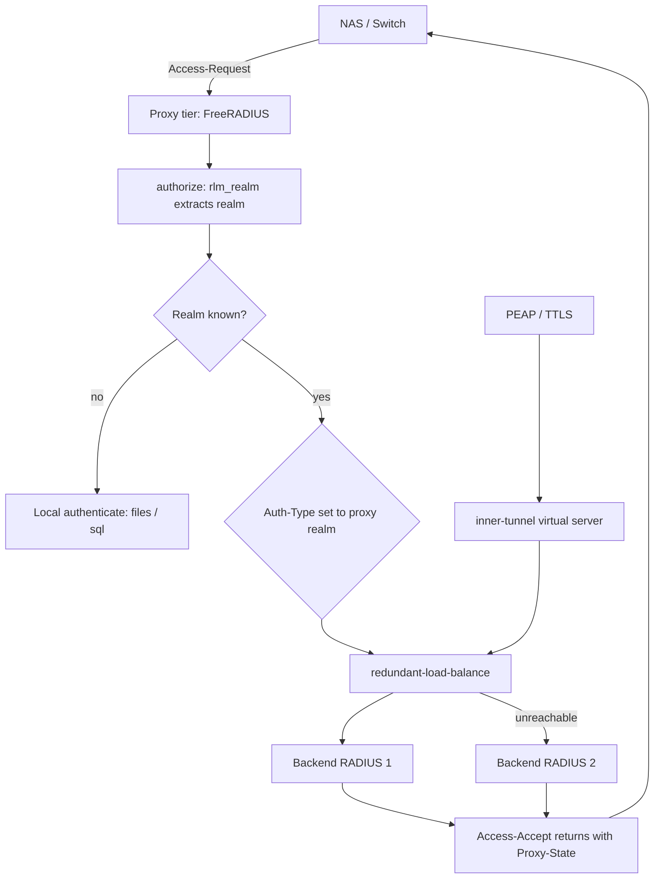

# Forwarding, Realms, and Failover: Building a RADIUS Proxy Tier

### English

A single RADIUS server rarely serves an entire organisation. Campus networks, guest Wi-Fi and multi-brand enterprises typically run a **proxy tier**: an edge server that every network device points at, which then forwards each request to whichever backend owns the identity. This gives you a single point of configuration for network devices, load distribution across backends, and a place to enforce policy — but it also introduces a hard constraint: a forwarded request can only be understood by the server that ultimately answers it.

The routing key is the **realm** — conventionally the domain part after the `@` in a username, such as `student@uni.edu`. FreeRADIUS v3 extracts it with the `rlm_realm` module and stores it in the `Proxy-to-Realm` control attribute. After the `authorize` section finishes, the core looks for a matching realm and forwards the request to that realm's home server pool instead of authenticating locally. Realms are just labels: the realm name in `proxy.conf` does not have to equal the realm in the username, though keeping them identical makes debugging far easier.

```none
# proxy.conf (FreeRADIUS 3.x)
home_server remoteradius1 {
    type    = auth
    ipaddr  = radius1.network.example
    port    = 1812
    secret  = aS3cr3T
}

home_server_pool remote_radius_failover {
    type        = fail-over
    home_server = remoteradius1
    home_server = remoteradius2
}

realm network.example {
    auth_pool = remote_radius_failover
}
```

Version 4 restructures this completely. `proxy.conf` is gone; forwarding moves out of the server core into the `rlm_radius` module, and the hidden pool/load-balancing logic becomes ordinary unlang that you can read. The mapping is mechanical: a `home_server` becomes an `rlm_radius` instance, a `home_server_pool` becomes an `authenticate` section, and `Proxy-to-Realm` becomes `control:Auth-Type`.

```none
radius remoteradius1 {
    mode     = proxy
    transport = udp
    udp {
        ipaddr = 192.0.2.1
        port   = 1812
        secret = aS3cr3T
    }
    type = Access-Request
    type = Accounting-Request
}

authenticate proxy-network.example {
    redundant-load-balance {
        remoteradius1
        remoteradius2
    }
}

recv Access-Request {
    preprocess
    files
    update control { Auth-Type := "proxy-network.example" }
    pap
}
```

Two behaviours make proxy tiers genuinely hard, and both are worth understanding before you build one.

The first is **realm stripping**. By default, FreeRADIUS removes the realm suffix from the `User-Name` before forwarding, so the backend sees `student` rather than `student@uni.edu`. If the backend authenticates on the full string, it will reject — and the symptom looks exactly like a credential problem, which sends people hunting through password policies instead of proxy configuration. If your backend expects the full username, configure the home server to preserve it.

The second is **where each virtual server's sections live**. The proxy tier must handle the outer session, but tunneled methods such as PEAP and TTLS need the inner-tunnel server — and if you proxy the inner tunnel, the outer and inner identities can differ. That opens a billing hazard: a user can authenticate with one identity outside and a different identity inside, and if accounting is written to the wrong server, the session cannot be billed correctly. This is precisely why the stock `inner-tunnel` configuration carries a warning about it, and why accounting placement deserves explicit design rather than inheritance.

A robust failover story also needs the client side considered. `redundant` tries each server in turn; `redundant-load-balance` spreads load across healthy servers and only fails over when one stops answering. Combine that with a local fallback — authenticate against `files` when no remote server responds — and you get a tier that degrades instead of locking everyone out. The `Proxy-State` attribute is the mechanism that lets a proxy return a response to the correct original requester across the whole chain, and it must be preserved by every hop.

Finally, plan for versioning: FreeRADIUS 3.2.x is the stable branch, and version 4 remained an in-development release for a long period with the project explicitly warning that it should not be used in production. Proxy configuration differs substantially between them, so record which version a deployment runs.

### 中文

單一 RADIUS 伺服器很少服務整間機構。校園網絡、訪客 Wi-Fi、多品牌企業通常會架設**代理層（proxy tier）**：所有網絡裝置都指向一台邊緣伺服器，由它把每個請求轉發到真正擁有該身分的後端。這好處是網絡裝置只需一份設定、負載可分散到各後端、亦多了一個執行政策的位置；但同時引入了一個硬限制：被轉發的請求，只有最終作答的伺服器才理解。

路由的關鍵是 **realm** —— 慣常是使用者名稱 `@` 之後的網域部分，例如 `student@uni.edu`。FreeRADIUS v3 用 `rlm_realm` module 抽取它，存入 `Proxy-to-Realm` control 屬性。當 `authorize` section 結束後，核心會尋找相符的 realm，把請求轉發到該 realm 的 home server 池，而不是本地驗證。Realm 純粹是標籤：`proxy.conf` 的 realm 名稱不必與使用者名稱的 realm 相同，不過令兩者一致會令除錯容易得多。

```none
# proxy.conf (FreeRADIUS 3.x)
home_server remoteradius1 {
    type    = auth
    ipaddr  = radius1.network.example
    port    = 1812
    secret  = aS3cr3T
}

home_server_pool remote_radius_failover {
    type        = fail-over
    home_server = remoteradius1
    home_server = remoteradius2
}

realm network.example {
    auth_pool = remote_radius_failover
}
```

v4 把這一切重新整理。`proxy.conf` 不再存在，轉發從伺服器核心搬到 `rlm_radius` module，原本藏在池與負載平衡裡的邏輯變成普通的 unlang，你可以直接閱讀。對應關係是機械式的：`home_server` 變成一個 `rlm_radius` 實例，`home_server_pool` 變成一個 `authenticate` section，而 `Proxy-to-Realm` 變成 `control:Auth-Type`。

```none
radius remoteradius1 {
    mode     = proxy
    transport = udp
    udp {
        ipaddr = 192.0.2.1
        port   = 1812
        secret = aS3cr3T
    }
    type = Access-Request
    type = Accounting-Request
}

authenticate proxy-network.example {
    redundant-load-balance {
        remoteradius1
        remoteradius2
    }
}

recv Access-Request {
    preprocess
    files
    update control { Auth-Type := "proxy-network.example" }
    pap
}
```

有兩種行為令代理層真正困難，值得在動工前先理解。

第一是 **realm 剝除（realm stripping）**。FreeRADIUS 預設在轉發前把 realm 後綴從 `User-Name` 移除，所以後端看到的是 `student` 而不是 `student@uni.edu`。若後端以完整字串驗證，就會拒絕 —— 而症狀看起來與憑證錯誤一模一樣，令人把時間花在密碼政策上而非代理設定。若你的後端期望完整使用者名，就要把 home server 設定為保留它。

第二是**各 virtual server 的 section 放在哪裡**。代理層必須處理外層 session，但 PEAP、TTLS 等隧道方法需要 inner-tunnel 伺服器 —— 而如果你把內層隧道也代理出去，外層與內層的身分可以不一致。這帶來一個計費風險：使用者可以用一個身分完成外層認證、另一個身分完成內層，若 accounting 寫到錯誤的伺服器，該 session 就無法正確計費。正因如此，內建的 `inner-tunnel` 設定特別附有警告，accounting 的落點必須經過明確設計，而不是靠繼承。

健全的容錯設計也要考慮使用者端一側。`redundant` 依序嘗試每台伺服器；`redundant-load-balance` 把負載分散到健康的伺服器，只有當某台不再回應才容錯切換。再配合本地備援（遠端全部無回應時改用 `files` 驗證），就得到一個「降級而不是鎖死所有人」的代理層。`Proxy-State` 屬性是讓代理在整條鏈路中把回應送回正確原始請求者的機制，每一跳都必須保留它。

最後要有版本規劃：FreeRADIUS 3.2.x 是穩定分支，而 v4 在很長時間內仍是開發中版本，官方明確警告不要用於生產環境。代理設定在兩者之間差異頗大，所以務必記錄部署實際運行的是哪一版。

## Key Takeaway
RADIUS proxying routes by realm, and FreeRADIUS 4 replaces proxy.conf with rlm_radius plus Auth-Type sections — but realm stripping and inner-tunnel accounting must be handled deliberately.

## Related Concepts
- Realms and Proxy-to-Realm Routing
- rlm_radius vs proxy.conf
- Realm Stripping and Backend Identity
- Proxy-State Across Hops

## Diagram

