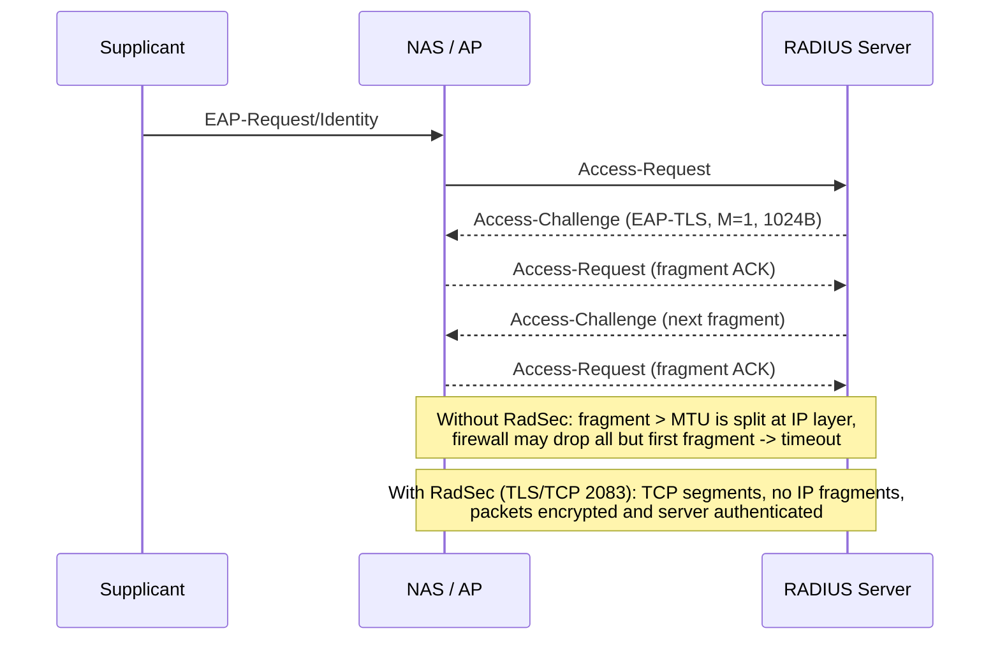

# RadSec, EAP Fragmentation, and Transport-Level Security for RADIUS

### English

Classic RADIUS runs over UDP with a shared secret that protects only the *integrity* of each packet, not its contents. Anyone who can observe the wire sees the username, the attributes, and the response — including the reply attributes that often carry the assigned IP address and session timeout. Worse, the request authenticator protects the packet only against modification, not against an attacker who knows the shared secret. Two independent mitigations exist, and serious deployments use both: **RadSec** for transport security, and careful **EAP fragmentation** tuning for reliability.

**RadSec** (RFC 5174) is RADIUS over TLS, normally on TCP port 2083. Because it rides on TCP, TLS provides confidentiality, integrity, and authentication of the server, and TCP handles segmentation — so there are no IP fragments to lose. This directly fixes the most common class of "authentication mysteriously fails" incidents. RADIUS over UDP permits packets up to 4096 bytes, far above a typical 1500-byte Ethernet MTU, so a large EAP-TLS exchange gets fragmented at the IP layer; if a firewall drops all but the first fragment, the handshake stalls and times out. RadSec removes that entire failure mode. The cost is that every device in the path must support RadSec, and TCP's head-of-line blocking means a lost segment stalls the session rather than being retransmitted transparently as with UDP. Common free implementations include FreeRADIUS, FreeSWITCH, strongSwan and RADIUS-test tools; interoperability between vendor implementations is the thing to verify in a lab before committing.

```none
# FreeRADIUS: a RadSec listener alongside the classic UDP one
server radsec {
    listen {
        type = auth
        ipaddr = 10.0.0.10
        port = 2083
        transport = tcp
        tls {
            cert_file = ${certdir}/server.pem
            key_file  = ${certdir}/server.key
            ca_file   = ${certdir}/ca.pem
            require_client_cert = yes
        }
    }
}
```

The second area is **EAP fragmentation**, which is a different mechanism entirely and often confused with IP fragmentation. EAP itself does not support fragmentation; individual EAP methods do. EAP-TLS, for example, adds a flags octet with three bits: L (Length included), M (More fragments) and S (Start), plus a four-octet TLS Message Length field. The server sends a fragment, the peer acknowledges it with an empty EAP-Response, and the server then sends the next fragment. This ACK-NAK style means the sender must wait — which is why a RADIUS server that proxies EAP and does not reassemble it simply forwards fragments as-is, leaving the real transport to IP fragmentation.

The numbers here decide whether authentication works at all. RFC 9191 notes that typical EAP fragment sizes are 1020–1500 bytes, that many access points drop an EAP session which has not completed after 40–50 round trips, and that a certificate chain larger than roughly 60 KB therefore cannot complete in most deployments. The practical tuning knob on the server side is the maximum EAP fragment size; a value around 1024 or 1300 is the common compromise, because a fragment plus its RADIUS attributes must fit within one Ethernet frame, while a fragment that is too small multiplies the round trips. FreeRADIUS exposes this as `eap { tls { max_fragment_size = 1024 } }`, and the server can additionally use the `Framed-MTU` attribute sent by the network device to limit fragment size automatically.

The failure signature is distinctive and worth recognising. If a certificate-based login works on some devices and hangs on others, look at the packet capture: if the RADIUS packets exceed the path MTU and fragments are being dropped, the handshake will loop — the access point retransmits, the server waits, and the session eventually resets. Two fixes apply together: enable RadSec end-to-end, and reduce the fragment size so each RADIUS packet fits within the MTU without IP fragmentation. Do both, and a large-certificate EAP-TLS deployment becomes routine.

### 中文

傳統 RADIUS 跑在 UDP 上，shared secret 只保護封包的**完整性**，並不保護封包**內容**。任何能在網絡上觀察封包的人，都看得到使用者名稱、各項屬性，以及回應 —— 包括經常帶著獲配 IP 位址與 session timeout 的 reply 屬性。更差的是，request authenticator 只防止封包被竄改，對知道 shared secret 的攻擊者並無防備。針對這兩點有兩套獨立的緩解方案，成熟部署會同時採用：**RadSec** 提供傳輸層安全，而**EAP 分段（fragmentation）**的細緻調校確保可靠度。

**RadSec**（RFC 5174）是把 RADIUS 放進 TLS，通常使用 TCP 2083 埠。因為建基於 TCP，TLS 提供保密性、完整性與伺服器身分驗證，而 TCP 自行處理分段 —— 因此根本沒有 IP 分段可以遺失。這直接治好了最常見那一類「認證莫名失敗」的事故。RADIUS over UDP 容許最多 4096 位元組的封包，遠超一般 1500 位元組的乙太網 MTU，所以大型 EAP-TLS 交換會在 IP 層被分段；若防火牆只放行第一個分段，其餘丟棄，握手就會停滯並逾時。RadSec 徹底消除這個失效模式。代價是路徑上每台裝置都要支援 RadSec，而 TCP 的隊頭阻塞意味著遺失一個 segment 會停住整個 session，而不是像 UDP 那樣被透明地重傳。常見的免費實作包括 FreeRADIUS、FreeSWITCH、strongSwan 與 RADIUS 測試工具；真正要驗證的，是各廠商實作之間的互通性 —— 落實前先在實驗室測清楚。

```none
# FreeRADIUS：RadSec listener 與傳統 UDP 並存
server radsec {
    listen {
        type = auth
        ipaddr = 10.0.0.10
        port = 2083
        transport = tcp
        tls {
            cert_file = ${certdir}/server.pem
            key_file  = ${certdir}/server.key
            ca_file   = ${certdir}/ca.pem
            require_client_cert = yes
        }
    }
}
```

第二個範疇是 **EAP 分段**，那是完全不同的機制，經常與 IP 分段混淆。EAP 本身不支援分段，是個別 EAP 方法自行實作。以 EAP-TLS 為例，它加入了一個帶三個位元的 flags 八位元組：L（包含長度）、M（尚有後續片段）、S（Start），再加上一個四個八位組的 TLS Message Length 欄位。伺服器送出一個片段，peer 以空的 EAP-Response 確認，伺服器才送出下一個片段。這種 ACK-NAK 式設計意味著送端必須等待 —— 這正是「代理 EAP 但不做重組」的 RADIUS 伺服器只會照原樣轉發片段、把真正的傳輸交給 IP 分段處理的原因。

這裡的數字決定認證究竟能不能成事。RFC 9191 指出：典型的 EAP 片段大小為 1020–1500 位元組；許多存取點會在 EAP session 超過 40–50 個來回仍未完成時將它丟棄；因此大於約 60 KB 的憑證鏈在多數部署中根本無法完成。伺服器端主要的調校旋鈕是最大 EAP 片段大小；1024 或 1300 是常見的折衷值，因為一個片段連同其 RADIUS 屬性必須放得下於一個乙太網 frame，而片段太細碎則會倍增來回次數。FreeRADIUS 以 `eap { tls { max_fragment_size = 1024 } }` 暴露這個設定，伺服器亦可利用網絡裝置送來的 `Framed-MTU` 屬性自動限制片段大小。

失敗特徵相當獨特，值得牢記。如果憑證式登入在某些裝置成功、另一些裝置就停住不出錯，那就去看封包擷取：若 RADIUS 封包超出路徑 MTU 而分段被丟棄，握手會陷入迴圈 —— 存取點重送、伺服器等待、session 最終被重置。兩個修法要一起用：全線段啟用 RadSec，並縮小片段長度，令每個 RADIUS 封包都放得下於 MTU 而無需 IP 分段。兩者併用，大憑證鏈的 EAP-TLS 部署就會變成例行操作。

## Key Takeaway
RadSec (RADIUS over TLS on TCP 2083) removes IP-fragmentation failures and protects packet contents, while a tuned EAP fragment size keeps certificate exchanges inside the path MTU and under the ~50-round-trip limit of real access points.

## Related Concepts
- RadSec / RADIUS over TLS (RFC 5174)
- EAP-TLS Fragmentation (L/M/S flags)
- Framed-MTU and max_fragment_size
- RFC 9191 Large Certificate Handling

## Diagram

