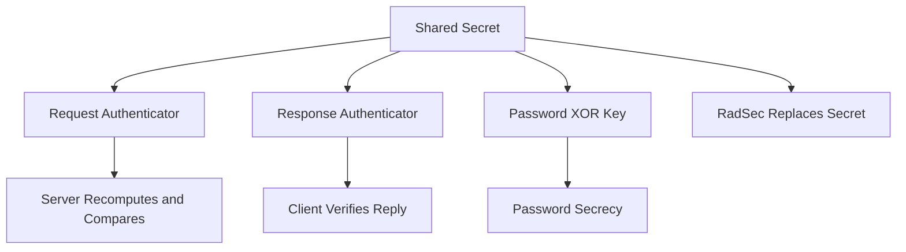

# Shared Secrets: Why One String Guards the Whole Conversation

## English

Every RADIUS packet carries a 16-byte shared secret's fingerprint in a field called the Authenticator. In an Access-Request, the client generates a random 16-byte value and puts it there; the server recomputes it from the secret plus the packet and compares. In responses (Access-Accept, Access-Reject, Access-Challenge), the server computes the Authenticator as an MD5 hash over the response code, the packet identifier, the length, the request Authenticator, and any attributes, with the shared secret appended. The client can therefore verify that a reply really came from someone who knows the secret, and that the reply has not been altered in flight.

The secret is not just an integrity check, though. User-Password is hidden by XOR-ing the password with an MD5 hash of the secret plus the request Authenticator. That means the secrecy of every password on the wire rests entirely on the shared secret. If someone captures the traffic and learns the secret, they can decrypt the password field offline. This is why the secret must be long and random, not a word like 'testing123' that appears in every tutorial.

A subtle consequence: the same secret is used in both directions and never travels on the wire. It is a pre-shared key, so provisioning it is an operational problem. In a large network you have hundreds of switches and access points, each with a configured secret. Rotating them means touching every device. That is one of the reasons people move to RadSec (RADIUS over TLS), where certificates replace shared secrets.

There is also a replay concern. Because the request Authenticator is random, an attacker cannot simply replay an old Access-Request and have the server accept it as fresh — the server sees a different Authenticator than the one it computed. But the server must still track recent identifiers to reject duplicates. In practice, RADIUS relies on the randomness of the 16-byte field plus the shared secret to prevent forgery.

Finally, the secret is per-client, not per-user. Each NAS (network access server, e.g. a switch or wireless controller) is configured with a secret in the server's clients.conf. If one device is compromised and its secret leaks, only that device's traffic is exposed — but an attacker who knows a secret can also forge Access-Requests and responses for that client. Treat the secret like a root password: unique per device, rotated, and never reused across vendors.

## 中文

每一個 RADIUS 封包都會在一個叫 Authenticator 的欄位裡，帶著 16 bytes 共享金鑰的「指紋」。在 Access-Request 中，客戶端會產生一個隨機的 16 bytes 值放進去；伺服器則用金鑰加上封包內容重新計算一次再比對。至於回應（Access-Accept、Access-Reject、Access-Challenge），伺服器會把回應碼、封包識別碼、長度、請求的 Authenticator，以及所有屬性連同共享金鑰一起做 MD5 雜湊，算出 Authenticator。客戶端因此可以驗證回應真的來自知道金鑰的一方，而且內容在傳輸途中沒有被改動。

不過，共享金鑰不只是完整性檢查。User-Password 是把密碼與「金鑰加請求 Authenticator 的 MD5 雜湊」做 XOR 來隱藏的。換句話說，線上每一個密碼的保密性，完全取決於共享金鑰。如果有人擷取了流量並得知金鑰，就可以離線解密密碼欄位。所以金鑰必須又長又隨機，不可以是每個教學都出現的「testing123」這類字眼。

一個微妙的後果是：同一條金鑰兩個方向都用，而且永遠不會線上上傳輸。它是預共享金鑰（pre-shared key），所以如何派發就是營運上的難題。在大型網路中，你有幾百臺交換機和無線接入點，每一臺都設定了金鑰。要輪換金鑰，就等於要逐臺裝置去改。這正是人們轉向 RadSec（RADIUS over TLS）的原因之一——用憑證取代共享金鑰。

還有一個重播（replay）的顧慮。由於請求的 Authenticator 是隨機的，攻擊者不能簡單地把舊的 Access-Request 重播一次就當成新的——伺服器看到的 Authenticator 與它自己算出來的不同。但伺服器仍然要追蹤最近的識別碼，以拒絕重複封包。實務上，RADIUS 就是靠這 16 bytes 的隨機性加上共享金鑰來防止偽造。

最後，金鑰是「按客戶端」而非「按使用者」的。每個 NAS（network access server，網路接入伺服器，例如交換機或無線控制器）都會在伺服器的 clients.conf 裡設定一條金鑰。如果某一臺裝置被入侵、金鑰外洩，就只有那臺裝置的流量會暴露——但知道金鑰的攻擊者也可以為該客戶端偽造 Access-Request 和回應。請把金鑰當成 root 密碼來看待：每臺裝置獨立一條、定期輪換、絕不跨廠商重用。

## Key Takeaway

The RADIUS shared secret is a per-device pre-shared key that both authenticates packets via the Authenticator and protects User-Password, so it must be long, random, unique per NAS, and rotated like a root password.

## Related Concepts
- Authenticator field and MD5 integrity
- RadSec certificate-based trust

## Diagram

