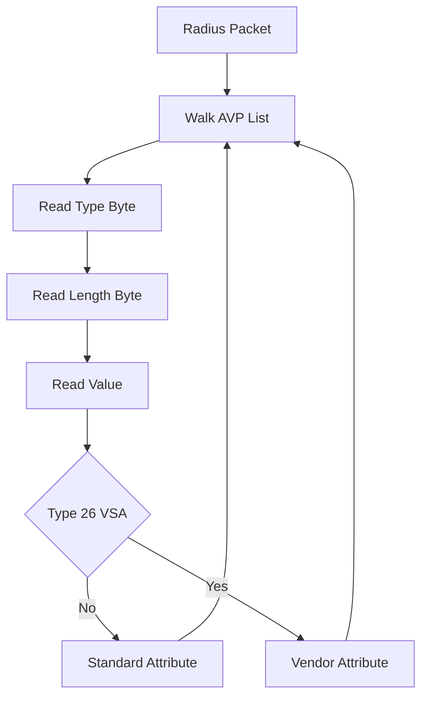

# Attribute-Value Pairs: The Extensible Dictionary That Made RADIUS Last

## English

A RADIUS packet is mostly a list of Attribute-Value Pairs (AVPs). Each AVP has a one-byte Type, a one-byte Length, and a Value whose format depends on the Type. Type 1 is User-Name, Type 2 is User-Password, Type 4 is NAS-IP-Address, Type 26 is Vendor-Specific. Because the format is TLV (type-length-value), a server can parse a packet without knowing every attribute in advance — it just walks the list. This is why RADIUS could grow from a simple dial-up authenticator in the 1990s into the backbone of Wi-Fi, VPN, and 802.1X access control without changing the wire format.

Attributes come in two families. Standard attributes are defined in RFCs (2865 and successors) and share a global namespace. Vendor-Specific Attributes (VSAs) use Type 26, which wraps a 4-byte vendor ID (assigned by IANA) plus a vendor-defined sub-attribute. That lets a switch vendor carry proprietary information — VLAN assignment, QoS policy, session timeout — without breaking other vendors' servers. A FreeRADIUS dictionary file maps names like 'Tunnel-Type' to numbers so policies can be written readably.

Some attributes are request-side (what the NAS sends: User-Name, Calling-Station-Id, NAS-Port-Type) and some are reply-side (what the server sends back: Tunnel-Type, Tunnel-Medium-Type, Tunnel-Private-Group-Id for VLAN assignment, Filter-Id for ACLs, Session-Timeout). The server's job is essentially: look at the request AVPs, decide, and emit reply AVPs. A policy engine like unlang in FreeRADIUS is just a language for inspecting and setting these pairs.

Order matters in a subtle way. If an attribute appears more than once, the meaning depends on the attribute — some are multi-valued (like Filter-Id, where multiple ACLs may apply), others are single-valued and the first or last occurrence wins. Also, the total packet size is limited to 4096 bytes (the Length field is 16 bits, but the RFC caps it at 4096), so a server cannot stuff unlimited AVPs into one reply. When a reply exceeds the limit, the server may need to fragment or drop optional attributes.

A practical lesson: when debugging, always look at the raw AVPs, not just the accept/reject verdict. A user rejected for the wrong reason often has a perfectly valid password but a NAS sending a Calling-Station-Id the policy doesn't recognise, or a reply whose VLAN attribute the switch silently ignores. Tools like radclient and the -X debug mode of FreeRADIUS print the AVPs in decoded form, which is where the real story lives.

## 中文

一個 RADIUS 封包基本上就是一串「屬性-值對」（Attribute-Value Pair，簡稱 AVP）。每個 AVP 有一個 1 byte 的 Type、一個 1 byte 的 Length，以及一個格式取決於 Type 的 Value。Type 1 是 User-Name，Type 2 是 User-Password，Type 4 是 NAS-IP-Address，Type 26 是 Vendor-Specific。因為格式是 TLV（type-length-value），伺服器不必事先知道所有屬性也能解析封包——它只要順着清單走過去。這就是為何 RADIUS 可以由 1990 年代一個簡單的撥號認證器，長成今日 Wi-Fi、VPN 與 802.1X 存取控制的骨幹，而線路格式完全不用改。

屬性分兩大家族。標準屬性由 RFC（2865 及其後繼文件）定義，共用一個全球命名空間。廠商特定屬性（Vendor-Specific Attribute，VSA）用 Type 26，裡面再包一個 4 bytes 的廠商 ID（由 IANA 分配）加上廠商自訂的子屬性。這樣交換機廠商就可以攜帶專有資訊——VLAN 指派、QoS 政策、工作階段逾時——而不會弄壞其他廠商的伺服器。FreeRADIUS 的 dictionary 檔就是把「Tunnel-Type」這類名字對應到數字，讓政策寫起來可讀。

有些屬性是請求端的（NAS 送出的：User-Name、Calling-Station-Id、NAS-Port-Type），有些是回應端的（伺服器送回的：VLAN 指派用的 Tunnel-Type、Tunnel-Medium-Type、Tunnel-Private-Group-Id，ACL 用的 Filter-Id，以及 Session-Timeout）。伺服器的工作本質上就是：看請求的 AVP、做決定、送出回應的 AVP。FreeRADIUS 的 unlang 這類政策引擎，說穿了就是一種用來檢視和設定這些配對的語言。

順序有個微妙之處。如果同一個屬性出現多次，意義取決於該屬性——有些是多值的（例如 Filter-Id，可以同時套用多條 ACL），有些是單值的，以第一次或最後一次出現為準。另外，封包總大小上限是 4096 bytes（Length 欄位是 16 bits，但 RFC 把它封頂在 4096），所以伺服器不能把無限多個 AVP 塞進一個回應。當回應超過上限，伺服器可能要分片，或者捨棄一些可選屬性。

一個實用的教訓：除錯時一定要看原始的 AVP，不要只看 accept/reject 的結論。一個被錯誤理由拒絕的用戶，往往密碼完全正確，只是 NAS 送來的 Calling-Station-Id 政策不認得，或者回應裡的 VLAN 屬性被交換機默默忽略。radclient 這類工具，以及 FreeRADIUS 的 -X 除錯模式，會把 AVP 解碼印出來，真正的原因就在那裡。

## Key Takeaway

RADIUS survives because its type-length-value AVP format is extensible: standard attributes cover common needs, vendor-specific attributes carry proprietary policy, and debugging means reading the decoded AVPs rather than the verdict.

## Related Concepts
- Vendor-Specific Attributes and IANA enterprise numbers
- FreeRADIUS dictionary files

## Diagram

