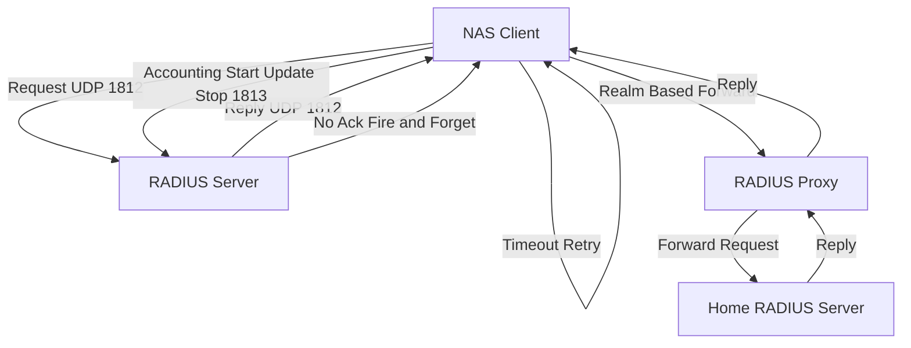

# Ports, Proxies, and Firewalls: The Operational Shape of a RADIUS Deployment

## English

RADIUS uses UDP, not TCP, and the well-known ports are 1812 for authentication/authorization and 1813 for accounting (the older, pre-IANA-assigned ports were 1645 and 1646, and some equipment still uses them). Because it is UDP, there is no connection to establish and no built-in retransmission at the transport layer. The client is responsible for retransmission: it sends a request, waits a timeout (often 5 seconds), and retries a few times before declaring the server dead. This design makes RADIUS cheap and stateless-ish, but it also means packet loss shows up as slow logins rather than connection errors.

The statelessness has a firewall consequence. A stateful firewall that tracks UDP 'sessions' can drop replies if it has not seen the matching request, or if the reply arrives after its idle timeout. Many networks therefore allow UDP 1812/1813 in both directions between the NAS and the RADIUS server, or they pin the server's source port so that replies are predictable. Some deployments use a fixed source port on the server to make firewall rules simpler, even though the RFC does not require it.

The accounting side (port 1813) is a stream of Start, Interim-Update, and Stop records. These are fire-and-forget: the server may not acknowledge them, and the client does not normally retransmit accounting in the same way as authentication. That means accounting data can be lost under load. If billing or audit depends on accounting, you need to handle gaps — for example by correlating with session state or by using a more reliable transport such as RadSec, where TCP and TLS provide ordering and retransmission.

Proxies complicate the picture. A RADIUS proxy receives a request, looks at the realm (the part after '@' in the User-Name, or a prefix before '\'), and forwards to an upstream server. The proxy must rewrite the request Authenticator and keep state so it can match the response back to the original client. This is how eduroam and large federations work: your home institution's server is reached through a chain of proxies, each of which must be trusted with the shared secret. A broken link in that chain means authentication fails even though every individual server is healthy.

Operationally, the safest shape is: RADIUS servers in a redundant pair, NAS devices configured with both, short timeouts so failover is quick, and monitoring that watches for authentication latency and reject-rate spikes rather than just process uptime. Log the NAS-IP-Address and Calling-Station-Id on every reject; those two attributes answer most 'why can't this device connect' tickets. And treat the shared secret as a secret in your configuration management, not a string in a wiki page.

## 中文

RADIUS 用的是 UDP 而非 TCP，標準埠是 1812（認證／授權）和 1813（計費）；更早期、未經 IANA 正式分配的埠是 1645 和 1646，有些裝置至今仍在用。因為是 UDP，所以沒有連線要建立，傳輸層也沒有內建重傳。重傳是客戶端的責任：送出請求、等一個逾時（通常是 5 秒）、重試幾次，然後才宣告伺服器死亡。這個設計讓 RADIUS 便宜、接近無狀態，但也意味著封包遺失會以「登入很慢」的形式出現，而不是連線錯誤。

無狀態對防火牆有後果。一個會追蹤 UDP「連線」的狀態型防火牆，如果沒看到對應的請求，或者回應在閒置逾時之後才到，就可能把回應丟掉。所以很多網路會在 NAS 與 RADIUS 伺服器之間雙向開放 UDP 1812/1813，或者把伺服器的來源埠固定下來，讓回應可預測。有些部署會在伺服器端用固定來源埠，令防火牆規則簡單些，雖然 RFC 並沒有這樣要求。

計費那一邊（埠 1813）是一連串 Start、Interim-Update、Stop 記錄。它們是「射後不理」的：伺服器未必會確認，客戶端一般也不會像認證那樣重傳計費封包。這意味著高負載下計費資料可能會遺失。如果帳單或稽核依賴計費資料，你就要處理缺口——例如與工作階段狀態互相對照，或者改用 RadSec 這類更可靠的傳輸，由 TCP 和 TLS 提供順序與重傳。

代理會令情況更複雜。RADIUS 代理收到請求後，會看 realm（User-Name 中 '@' 之後的部分，或 '\' 之前的字首），再轉發給上游伺服器。代理必須改寫請求的 Authenticator，並保留狀態，才能把回應配對回原本的客戶端。eduroam 和大型聯盟就是這樣運作的：你原屬機構的伺服器，是經由一連串代理才到達，每一環都必須被信任、持有共享金鑰。鏈中任何一環壞掉，認證就會失敗，即使每個個別伺服器本身都健康。

營運上最安全的形態是：RADIUS 伺服器成對做冗餘、NAS 同時設定兩臺、逾時設短一點讓切換快、監控要看認證延遲和拒絕率飆升，而不只是看程序有沒有活著。每次拒絕都記錄 NAS-IP-Address 和 Calling-Station-Id；這兩個屬性就能回答大部分「為何這臺裝置連不上」的工單。還有，把共享金鑰當成設定管理裡的機密，而不是維基頁面上的一串字。

## Key Takeaway

RADIUS runs on UDP 1812/1813 with client-side retransmission, which shapes firewall rules, failover design, accounting reliability, and proxy chains — so operational health means watching latency and reject rates, not just process uptime.

## Related Concepts
- UDP retransmission and failover timers
- RADIUS proxy realms and federation

## Diagram

